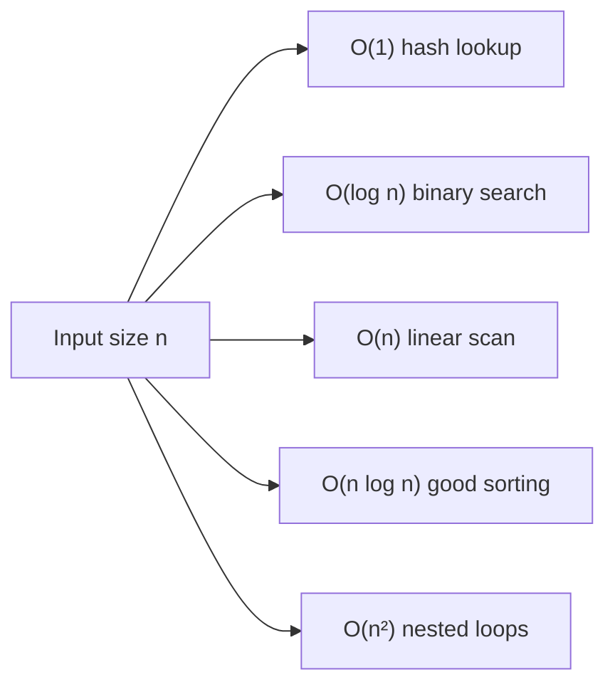

[Algorithms](algorithms.md) | [Apple](apple.md) | [AssemblyLanguage](assemblylanguage.md) |
[BASH](bash.md)  |   [Bash Cookbook](vikidsbashcookbook.md)  |
[C-Programmming](cprogramming.md) | [CommonLisp](commonlisp.md) | [Computer Security](computersecurity.md) | [CuisSmalltalk](cuissmalltalk.md) |
[Databases](databases.md) | [Emacs](emacs.md) |  [Exploitation](exploitation.md) | [Firewalls](firewalls.md) |
[Fortran](fortran.md) | [Functional Programming](functional.md) |
[Git](git.md) | [GNUSmalltalk](gnusmalltalk.md) | [Haskell](haskell.md) | [Social Engineering](internetexploitation.md)  | [Javascript](javascript.md) |  [Julia](julia.md) |
[Linux](linux.md) | [Machine Learning](machinelearning.md) | [Metasploit](metasploit.md) |[Machine Learning](machinelearning.md) |
[Networking](networking.md) | [Operating Systems](os.md) | [Open Data Science](opendatascience.md) | [Odin](odin.md) |
[Picolisp](picolisp.md) | [Pharo Smalltalk](pharo.md) | [Purescript](purescript.md) | [Python](python.md) |
[Racket](racket.md) | [Scheme](scheme.md)  |
[Unity](unity.md) | [vim](vim.md) | [V](vlang.md) |
[Web Development](webdevelopment.md) | [Windows WSL](windowswsl.md) | [Zig](ziglang.md)

# Algorithms

## Algorithms

Here is the truth about algorithms: **they are recipes, and the interesting question is not "does it work?" but "how does the cost grow when the input gets bigger?"** Once you start seeing growth rates, a lot of software design stops being guesswork.

### What it is, in plain words

An **algorithm** is a precise, finite procedure for turning inputs into outputs. A **data structure** is a way of organising data so that certain algorithms become cheap. The two are inseparable: the right structure turns an impossible algorithm into a trivial one.

Computer science classifies algorithms by the kind of job they do:

- **Searching** – find a thing (linear scan, binary search, hash lookup).
- **Sorting** – put things in order (quicksort, mergesort, heapsort, counting sort).
- **Graphs** – walk networks (BFS, DFS, Dijkstra, A*).
- **Strings** – match, parse, compress.
- **Numerics** – linear algebra, random numbers, optimisation.
- **Distributed** – consensus, replication, MapReduce-style fan-out.

And it classifies their cost with **big-O notation**: \( O(1) \) constant, \( O(\log n) \) logarithmic, \( O(n) \) linear, \( O(n \log n) \) "linearithmic", \( O(n^{2}) \) quadratic, and so on. The notation describes how the running time (or memory) grows as the input size \( n \) grows – ignoring constant factors and focusing on the shape.

### Why it matters

Choosing `list` versus `hash table` versus `B-tree` is an algorithm decision, whether you write the code yourself or pick a library. Databases, games, compilers, network routers and machine learning frameworks are all piles of algorithms. Knowing the basic ones means you recognise when a program is doing something \( O(n^{2}) \) that could be \( O(n) \), and you stop being intimidated by the word "algorithm" itself.

### An everyday analogy: finding a word in a dictionary

Looking through every page from the start is a **linear search** – \( O(n) \). Opening to the middle, deciding "before or after?", and repeating is **binary search** – \( O(\log n) \). For a thousand-page dictionary that's about ten steps instead of hundreds. Same data, different algorithm, wildly different effort. A hash table is like a librarian who has already put every word on a numbered shelf by a formula – \( O(1) \) if you know the formula.



### A hands-on example

**Binary search** in Python (on a sorted list):

```python
def binary_search(a, target):
    lo, hi = 0, len(a) - 1
    while lo <= hi:
        mid = (lo + hi) // 2
        if a[mid] == target: return mid
        if a[mid] < target:  lo = mid + 1
        else:                hi = mid - 1
    return -1

print(binary_search([1, 3, 4, 7, 9, 11], 7))   # 3
```

**A linear congruential generator** – the classic cheap pseudo-random number algorithm (good for demos, *not* for cryptography):

```python
def lcg(seed, a=1664525, c=1013904223, m=2**32):
    """X_{n+1} = (a·X_n + c) mod m"""
    x = seed
    while True:
        x = (a * x + c) % m
        yield x

from itertools import islice
print(list(islice(lcg(42), 5)))
```

$$ X_{n+1} = (a X_{n} + c) \bmod m $$

**Big-O in the wild** – these Python costs are worth memorising:

| Operation | Cost |
|-----------|------|
| `dict` / `set` lookup, insert | average \( O(1) \) |
| `list` index | \( O(1) \) |
| `list` append | amortised \( O(1) \) |
| `list` insert at front | \( O(n) \) |
| sorting (`list.sort`) | \( O(n \log n) \) |
| checking `x in list` | \( O(n) \) |

### A map of the territory

When people say "learn algorithms" they usually mean this core:

1. Arrays, linked lists, stacks, queues
2. Hash tables
3. Trees (BSTs, heaps) and graphs
4. Sorting and searching
5. Recursion and dynamic programming
6. Bit tricks and string algorithms
7. A taste of NP-completeness – why some problems have no known fast algorithm

You don't need to invent quicksort. You need to know it exists, what it costs, and when your code has accidentally reinvented bubble sort on a million rows.

### Common misconceptions

- **"The fastest algorithm is the best."** Fastest on what size? What hardware? Prefer simple \( O(n \log n) \) over clever \( O(n) \) with a huge constant until profiling says otherwise.
- **"Big-O is the running time."** It's a *growth class*. \( O(n) \) can beat \( O(\log n) \) for small \( n \).
- **"Hash tables are always O(1)."** Average case, with a good hash and load factor. Worst case is \( O(n) \); adversarial inputs are a real security issue.
- **"Algorithms = competitive programming."** That's one gym. Production algorithms also include caches, Bloom filters, LSM trees and consensus protocols.
- **"Random number generators produce true randomness."** LCGs and most PRNGs are deterministic and predictable. Use `secrets` / `/dev/urandom` for security.

### Connections

- [Data Structures and Algorithms](datastructuresandalgorithms.md) – deeper notes.
- [Computer Science](computerscience.md) – the wider field.
- [NumPy](numpy.md) and [Fortran](fortran.md) – numerical algorithms in practice.
- [PicoLisp](picolisp.md) – where lists and recursion feel natural.
- [Lambda Calculus](lambdacalculus.md) – algorithms as pure functions.

## Numerical

**Randomizing Data**

**The Linear Congruential Generator**

`  Xn+1 = (A.Xn+1 + B).Mod(M)  `

Where **A, B and M** are constants.
This will generate a sequence of numbers that appear to be random.

Linked Lists
Arrays
Stacks and Queues
Sorting
Searching
Hash Tables
Recursion
Trees
Network Based
String
Distributed

#### Links

- [Youtube:Optimal Stopping Problem](https://www.youtube.com/watch?v=fv_CB6jydE4)
- [Algorithm Visualizer](https://algorithm-visualizer.org)
