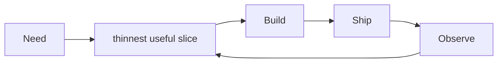

# Application Development

Here is the truth about application development: **shipping software is less about frameworks and more about feedback loops – build something small, put it in front of reality, learn, repeat.** Tools change; that loop does not.

### What it is, in plain words

**Application development** is the craft of turning a need into a running program people can use: clarifying the problem, designing a thin slice, implementing, testing, deploying, observing, iterating. It spans CLI tools, desktop apps, mobile, embedded and the web – different skins, same skeleton.

### Why it matters

Ideas don't help people until they run. Appdev is the bridge from "wouldn't it be nice" to "here, click this". Whether you write PicoLisp forms on Vikix or a React SPA, the discipline of shipping is what turns programming skill into leverage.

### An everyday analogy: cooking for guests

Reading recipes is study. Cooking for friends who will arrive at eight is appdev: constraints, taste, timing, recovery when the sauce splits. You learn faster with guests than with cookbooks alone.



### A hands-on example: a one-evening app

Goal: a page that records a daily mood score to a SQLite file.

```bash
mkdir mood && cd mood
python -m venv .venv && . .venv/bin/activate
pip install flask
```

```python
# app.py
from flask import Flask, request, redirect, render_template_string
import sqlite3, datetime

app = Flask(__name__)
DB = "mood.db"

def db():
    c = sqlite3.connect(DB)
    c.execute("CREATE TABLE IF NOT EXISTS mood (day TEXT PRIMARY KEY, score INT)")
    return c

PAGE = """
<!doctype html><title>Mood</title>
<h1>How is today?</h1>
<form method="post">
  <input type="number" name="score" min="1" max="5" required>
  <button>Save</button>
</form>
<ul><li>{{ day }}: {{ score }}</li></ul>
"""

@app.get("/")
def index():
    with db() as c:
        rows = c.execute("SELECT day, score FROM mood ORDER BY day DESC").fetchall()
    return render_template_string(PAGE, rows=rows)

@app.post("/")
def save():
    score = int(request.form["score"])
    day = datetime.date.today().isoformat()
    with db() as c:
        c.execute("INSERT OR REPLACE INTO mood VALUES (?, ?)", (day, score))
    return redirect("/")

if __name__ == "__main__":
    app.run(port=5000)
```

```bash
python app.py
```

Ship it on a [VPS](onlinevps.md) behind Caddy with [TLS](tls.md) when you're ready. Replace Flask with PicoLisp forms if that's your stack – the loop is what matters.

### Practices that survive fashion

- Version control ([Git](git.md)) from commit one.
- Automate tests for the logic you fear.
- Keep secrets out of the repo.
- Log what you'll need at 2 a.m.
- Prefer boring technology for the load-bearing parts.

### Common misconceptions

- **"I need microservices to start."** You need a working monolith you understand.
- **"Real apps use the cloud."** Real apps solve problems. A Pi on a shelf counts.
- **"UI first / DB first is the rule."** Vertical slices beat layers that don't meet.
- **"10× engineers ship alone."** Most good software is communication with a compiler and other people.

### Connections

- [Web Development](webdevelopment.md), [Databases](databases.md), [Git](git.md).
- [PicoLisp](picolisp.md) / [Health Application](pilhealth.md) – a different stack, same craft.
- [Computer Study Plan](computerstudyplan.md), [Learning Online](learningonline.md).

The main tutorial can be found [here](http://software-lab.de/doc/app.html).
Please
read through this document before proceeding with the underlying material.

Applications in Picolisp are essentially Web Apps. The main interface is through
browser and each instance of the running app is stored as a session in the browser.

Within the underlying picolisp process, each instance is actually a forked process
which is linked with the browser session.

- [picolisp-explored: web-app](https://picolisp-explored.com/series/web-app)
