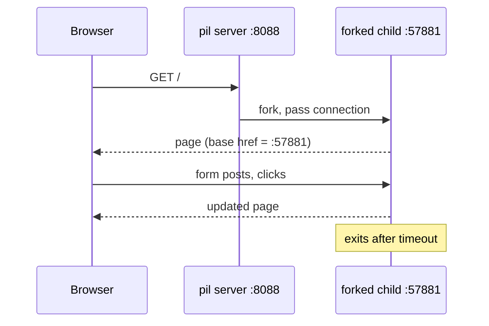

# Application Development

Here is the truth about building applications in PicoLisp: **there is no framework to learn on top of the language. The web server, the HTML generator, the form library and the database are all part of the same small system, written in the same Lisp you are writing.** An application is a few functions that print a page, plus a database model. That is it.

### What it is, in plain words

PicoLisp applications are **web applications**. You open them in a browser, but the logic lives on the server, in Lisp:

- `@lib/http.l` – an HTTP server. `(server 8080 "!work")` listens and calls your function `work` for each new visitor.
- `@lib/xhtml.l` – functions that print HTML: `html`, `<h2>`, `<table>`, `<ul>` and so on.
- `@lib/form.l` – a GUI component library: `+TextField`, `+NumField`, `+Button`, `+Chart` (a table), with JavaScript progressively enhancing the page.
- `@lib/db.l` and friends – the built-in database: entity classes, relations, indexes and transactions (see [PicoLisp DB](pildb.md)).

The unusual and clever part is **sessions**. When a browser connects, the server **forks** a child process for that user, and the child gets its own port. Everything the user does from then on is handled by "their" process, which keeps all the state in ordinary Lisp variables. No session tables, no serialising state into cookies. When the user goes idle, the process times out and exits.



### Why it matters

- **Tiny, understandable stack.** You can read the whole HTTP and form library source in an afternoon. When something breaks, the answer is in a file you can open.
- **State is easy.** Because each user has a process, "remember what they selected" is just a variable. Much of the complexity of mainstream web frameworks simply is not there.
- **Database-first.** Entities and relations are declared in Lisp and are immediately queryable, editable through forms, and transactional. Business applications are where PicoLisp has earned its living for decades.

### An everyday analogy: a personal waiter for every guest

A typical web framework is a canteen: one counter, a numbered ticket for every customer, and the staff look up your ticket each time you come back. PicoLisp gives every guest a personal waiter at their own table. The waiter remembers your order without a ticket. When you leave, the waiter goes home.

### A hands-on example: a working form in 20 lines

```picolisp
# hello.l
(allowed ()
   "!work" "@lib.css" )

(load "@lib/http.l" "@lib/xhtml.l" "@lib/form.l")

(de work ()
   (app)                                  # start a session (fork)
   (action
      (html 0 "Hello" "@lib.css" NIL
         (<h2> NIL "Who are you?")
         (form NIL
            (gui 'nm '(+TextField) 20 "Name")
            (gui '(+Button) "Greet"
               '(alert NIL "Hello, " (val> (: home nm)) "!") ) ) ) ) )

(de go ()
   (server 8088 "!work") )
```

```bash
pil hello.l -go -wait        # then open http://localhost:8088
```

Look at the page source in your browser and you will see the `<base href>` pointing to a new port. That is your forked session process. `allowed` is a whitelist of URLs the server may serve, a simple security default. Add `+` (`pil hello.l + -go -wait`) to get debug mode and a REPL in the terminal while the app runs.

From here the official tutorial (linked below) adds a database model with `class`, `rel` and `+Ref` indexes, search dialogs and charts. The Health Application tutorial on the PicoLisp site shows a complete app.

### Common misconceptions

- **"Forking per session cannot scale."** Forks on Linux are cheap (copy-on-write), and each session costs a few hundred kilobytes. It handles the user counts of real business apps comfortably; for millions of anonymous visitors you would serve static pages anyway, as this site does.
- **"There is no JavaScript, so it is not a modern web app."** The form library uses JavaScript for live updates when available, and still works without it.
- **"You must use the built-in GUI."** You can print any HTML you like with `xhtml.l`, or serve JSON (`@lib/json.l`) to a JavaScript front end.
- **"Deploying means containers and orchestration."** It means copying files to a [VPS](onlinevps.md), running `pil` under a supervisor (runit on Void, [systemd](systemd.md) elsewhere), and putting a reverse proxy with [TLS](tls.md) in front.

### Practices that survive fashion

- Version control with [Git](git.md) from the first commit.
- Keep the database model in one file and change it through migrations you can replay.
- Test the logic at the REPL first, then wire it into forms.
- Log to stderr with `(out 2 ...)` so you can follow problems on the server.

### Connections

- [PicoLisp](picolisp.md), [PicoLisp DB](pildb.md), [Input/Output](plio.md), [new](plnew.md), [PicoLisp Tutorials](piltutorials.md), [The Vikid PicoLisp Tutorial](pltutorial.md).
- [Web Development](webdevelopment.md), [Databases](databases.md), [Node Js](nodejs.md) – the one-thread, event-loop opposite of forked sessions.
- [Online VPS](onlinevps.md), [Using Linode](linode.md), [TLS](tls.md).

### The official tutorial

The main tutorial can be found [here](http://software-lab.de/doc/app.html).
Please
read through this document before proceeding with the underlying material.

Applications in Picolisp are essentially Web Apps. The main interface is through
browser and each instance of the running app is stored as a session in the browser.

Within the underlying picolisp process, each instance is actually a forked process
which is linked with the browser session.

- [picolisp-explored: web-app](https://picolisp-explored.com/series/web-app)

*All examples on this page tested on PicoLisp 26.9, October 2026.*
