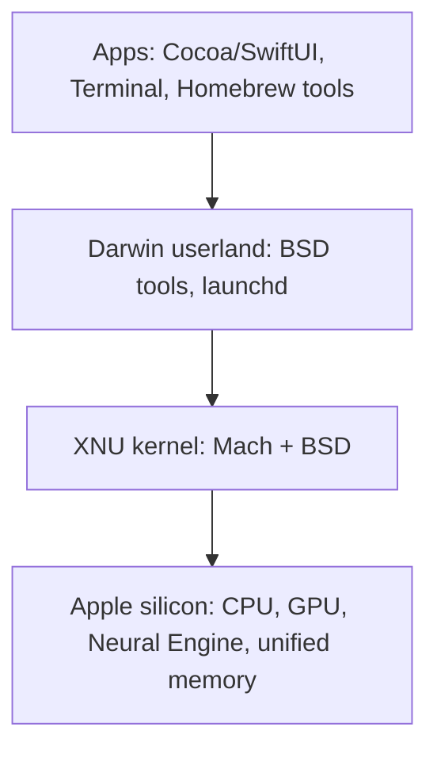

[Algorithms](algorithms.md) | [Apple](apple.md) | [AssemblyLanguage](assemblylanguage.md) |
[BASH](bash.md)  |   [Bash Cookbook](vikidsbashcookbook.md)  |
[C-Programmming](cprogramming.md) | [CommonLisp](commonlisp.md) | [Computer Security](computersecurity.md) | [CuisSmalltalk](cuissmalltalk.md) |
[Databases](databases.md) | [Emacs](emacs.md) |  [Exploitation](exploitation.md) | [Firewalls](firewalls.md) |
[Fortran](fortran.md) | [Functional Programming](functional.md) |
[Git](git.md) | [GNUSmalltalk](gnusmalltalk.md) | [Haskell](haskell.md) | [Social Engineering](internetexploitation.md)  | [Javascript](javascript.md) |  [Julia](julia.md) |
[Linux](linux.md) | [Machine Learning](machinelearning.md) | [Metasploit](metasploit.md) |[Machine Learning](machinelearning.md) |
[Networking](networking.md) | [Operating Systems](os.md) | [Open Data Science](opendatascience.md) | [Odin](odin.md) |
[Picolisp](picolisp.md) | [Pharo Smalltalk](pharo.md) | [Purescript](purescript.md) | [Python](python.md) |
[Racket](racket.md) | [Scheme](scheme.md)  |
[Unity](unity.md) | [vim](vim.md) | [V](vlang.md) |
[Web Development](webdevelopment.md) | [Windows WSL](windowswsl.md) | [Zig](ziglang.md)

# Apple Related Stuff

Here is the truth about Apple computers for a Linux person: **under the polished glass, a Mac is a Unix machine** – a certified one, in fact. With a package manager, a tiling window manager and a few keyboard tweaks, it can feel surprisingly close to home.

### What it is, in plain words

Apple makes Macs (laptops and desktops), iPhones, iPads and more, and since 2020 designs its own chips. The pieces that matter to someone who likes to understand their machine:

- **Apple silicon** – the M-series chips (starting with the M1 in 2020, with a new generation roughly every year since) are ARM64 systems-on-a-chip: CPU, GPU, neural engine and **unified memory** all in one package. They run cool, fast and long on battery. **Rosetta 2** translates older Intel (x86-64) apps on the fly.
- **macOS** – Apple's desktop OS (since 2025 versions are numbered by year, starting with macOS 26 "Tahoe"). Its core, **Darwin**, is open source and descends from NeXTSTEP, the Mach kernel and BSD. macOS is certified UNIX 03, so the shell, file layout and system calls feel familiar – with BSD flavours rather than GNU ones.
- **Security model** – System Integrity Protection, Gatekeeper, app notarisation and sandboxing. Good for most users, occasionally in the way for tinkerers.

### Why it matters

Macs are everywhere in software development, design and universities. You'll be handed one at a job, or asked to help someone with theirs. Knowing what's Unix underneath, and how to bend it, turns a locked-down-feeling appliance into a capable workstation. And Apple silicon is a good look at where hardware is going: wide ARM cores, shared memory between CPU and GPU, aggressive power management.

### An everyday analogy: a luxury hotel versus your own flat

Your Linux box is your own flat: you chose every piece of furniture and know where every wire goes. A Mac is a luxury hotel suite: beautifully done, everything works, but you can't knock down a wall, and some cupboards are locked. You can still rearrange the furniture, bring your own tools and make it comfortable for a long stay.



### A hands-on example: making a Mac feel like Vikix

**1. Command line tools and a package manager.**

```bash
xcode-select --install          # compilers, git, make
/bin/bash -c "$(curl -fsSL https://raw.githubusercontent.com/Homebrew/install/HEAD/install.sh)"
brew install coreutils gnu-sed gawk ripgrep fd git emacs sbcl
brew install --cask kitty
```

The default shell is **zsh**; macOS's own `/bin/bash` is stuck at version 3.2 for licensing reasons, so `brew install bash` if you want modern Bash. `coreutils` gives GNU versions prefixed with `g` (`gls`, `gdate`), because the built-in ones are BSD versions with different flags.

**2. A tiling window manager.** macOS doesn't let you replace its compositor, but these get close:

- **Amethyst** – automatic tiling, xmonad-style layouts, easy to start with.
- **AeroSpace** – i3-like, workspace-based, configured with a text file; popular with Linux refugees.
- **yabai** – the most powerful, scriptable; some features need SIP partly disabled.

Apple itself added basic window tiling (drag to edges, Fn+Ctrl+arrows) in macOS 15.

**3. Keyboard.** Remap Caps Lock to Control in *System Settings → Keyboard → Modifier Keys*, or use **Karabiner-Elements** (or [KMonad](kmonad.md)/kanata) for tap-hold and layers.

**4. Know the system.**

```bash
sw_vers                          # macOS version
uname -m                         # arm64 on Apple silicon
sysctl -n machdep.cpu.brand_string
system_profiler SPHardwareDataType
launchctl list | head            # launchd: macOS's init and service manager
diskutil list
```

**5. Running Linux.** Use a VM (UTM, Parallels, VMware Fusion or VirtualBox 7.1+ on ARM) with an ARM64 Linux image, or Apple's own `container` tool (2025) for lightweight Linux containers. Want Linux on the metal? **Asahi Linux** (Fedora Asahi Remix) runs natively on M1 and M2 Macs; support for newer chips is still in progress.

### Common misconceptions

- **"macOS is Linux."** It's Unix, not Linux. Different kernel (XNU), BSD userland, launchd instead of systemd/runit.
- **"Macs can't run x86 software."** Rosetta 2 handles most of it, though Apple has said Rosetta will be scaled back in future macOS releases.
- **"8 GB on Apple silicon is like 16 GB elsewhere."** Unified memory is efficient, but it's shared with the GPU; heavy dev work wants more. Apple's base models now start at 16 GB.
- **"You can't customise a Mac."** You can't change the compositor, but shell, keybindings, window management and tooling are all yours.
- **"Homebrew needs sudo."** It installs into `/opt/homebrew`, owned by you.

### Connections

- [Operating Systems](os.md) – Mach, BSD and how XNU combines them.
- [Linux](linux.md) – the comparison point.
- [Virtualization](virtualization.md) and [VirtualBox](virtualbox.md) – running Linux on a Mac.
- [KMonad](kmonad.md) – carry your keyboard layout everywhere.
- [Emacs](emacs.md) – works beautifully on macOS.

[Amethyst, an Apple Mac OS Tiling Window Manager](https://ianyh.com/amethyst/)
