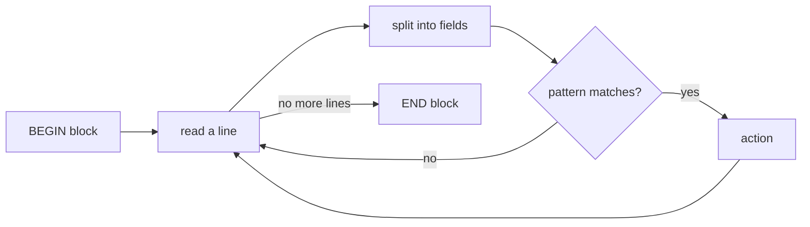

### awk

Here is the truth about awk: **it is a whole programming language disguised as a command, built for one job – reading text line by line and pulling out the columns you care about.** Nearly fifty years on, it still beats writing a script for that job.

### What it is, in plain words

**awk** (named after its authors Aho, Weinberger and Kernighan, Bell Labs, 1977) reads input one **record** (usually a line) at a time, splits each record into **fields** (usually on whitespace), and runs your *pattern → action* rules against it:

```
pattern { action }
```

If the pattern matches the line, the action runs. Leave out the pattern and the action runs for every line; leave out the action and the matching line is printed.

Fields are `$1`, `$2`, … and `$0` is the whole line. `NF` is the number of fields, `NR` the record number.

Three implementations you'll meet:

- **gawk** – GNU awk, feature-rich (Arch/Manjaro default).
- **mawk** – fast and small (Debian/Ubuntu default).
- **one-true-awk / nawk** – the original lineage, kept alive by Kernighan himself, default on BSDs and macOS. Void Linux packages all three (`gawk`, `mawk`, `nawk`).

Stick to POSIX features and your scripts run on all three.

### Why it matters

Unix tools speak text: `ps`, `df`, `ls -l`, logs, CSV exports, `/proc` files. Very often you need "column 3 where column 5 is bigger than 100, summed". `grep` can't sum, `cut` can't compare, and Python is overkill for a one-liner. awk sits exactly in that gap, and it's on every Unix-like system, including the tiniest container.

### An everyday analogy: a clerk with a stack of forms

Hand a clerk a stack of forms and an instruction sheet: "For each form, if box 5 says 'overdue', write down the name in box 1 and add box 3 to the running total. At the end, tell me the total." The clerk never sees the whole pile at once – one form, check, act, next. That's awk exactly, including the "at the end" part (`END { }`).



### A hands-on example

Print the 1st and 3rd column of a file:

```bash
awk '{ print $1, $3 }' data.txt
```

Show users with a real login shell from `/etc/passwd` (fields split by `:`):

```bash
awk -F: '$7 !~ /nologin|false/ { print $1, $7 }' /etc/passwd
```

Total memory used by all processes named `firefox` (RSS in KiB is column 6 of `ps aux`):

```bash
ps aux | awk '/firefox/ && !/awk/ { sum += $6 } END { printf "%.1f MiB\n", sum/1024 }'
```

Count requests per IP in a web log and show the top five:

```bash
awk '{ hits[$1]++ } END { for (ip in hits) print hits[ip], ip }' access.log \
  | sort -rn | head -5
```

`hits` is an **associative array** – a hash table keyed by string – and it springs into existence the first time you use it. That's awk's secret weapon.

Disks more than 80% full:

```bash
df -h | awk 'NR > 1 && $5+0 > 80 { print $6, $5 }'
```

`$5+0` turns `"83%"` into the number 83; awk converts strings to numbers by reading the leading digits.

### A small script file

For anything longer, put it in a file:

```awk
#!/usr/bin/awk -f
# csvsum.awk – sum column 2 of a CSV, grouped by column 1
BEGIN { FS = "," }
NR > 1 { total[$1] += $2 }
END   { for (k in total) printf "%-12s %10.2f\n", k, total[k] }
```

```bash
chmod +x csvsum.awk && ./csvsum.awk sales.csv
```

### Common misconceptions

- **"awk is just for printing columns."** It has variables, arrays, functions, loops, `printf`, `getline`, and arithmetic. People have written assemblers and games in it.
- **"awk handles CSV properly."** Plain `FS=","` breaks on quoted fields with commas inside. gawk has `--csv` (since 5.3) and the one-true-awk gained `--csv` too; otherwise use a real CSV tool.
- **"`for (k in arr)` is ordered."** Order is unspecified. Pipe to `sort`, or use gawk's `PROCINFO["sorted_in"]`.
- **"Fields start at 0."** `$0` is the whole line; fields start at `$1`.
- **"Single quotes are optional."** Without them the shell expands `$1` before awk sees it. Always single-quote awk programs.

### Connections

- [BASH](bash.md) and [Bash Cookbook](vikidsbashcookbook.md) – awk lives in shell pipelines.
- [Regular Expressions](regularexpressions.md) – the language of awk's patterns.
- [Linux Tools](linuxtools.md) – sed, grep, cut and friends.
- [C Programming](cprogramming.md) – awk's syntax and `printf` come straight from C (Kernighan co-wrote both books).

- [awk tutorial](https://www.thegeekstuff.com/2010/01/awk-introduction-tutorial-7-awk-print-examples/)
