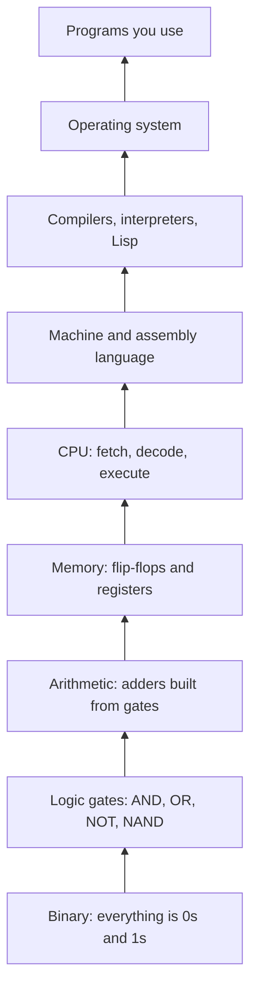

### Previews of Build a Computer in Your Head

 [Quicklinks](quicklinks.md) | [Readinglist](readinglist.md) | [computingFreedom](computingfreedom.md) |
  [BCIYH](bciyh.md) |
  [Picolisp](picolisp.md) | [Picolisp Machine](pilmachine.md) | [pil sources](pilsource.md) |
  [Linux](linux.md) | [BASH](bash.md) |
  [C Programmming](cprogramming.md) |
  [Operating Systems](os.md) |
  [Javascipt](javascript.md) |
  [Emacs](emacs.md)  | [vim](vim.md) |
  [Pharo Smalltalk](pharo.md) |
  [Computer Security](computersecurity.md) |
  [Python](python.md)

I am writing a new 'book' called **Build a Computer In Your Head (BCIYH)**,
pronouced as "Bikih", and I will be
posting excerpts/notes regarding the subject here for you to preview and
comment upon.

I have been inspired to do this by a few books and projects which you can find at
the bottom of this page.

Turing taught us that computers are essentially finite state machines.
On the other Alonzo Church taught us that computation is form of algebraic
reduction. A defined method of condensation, or restatement of given facts into
simpler facts.

Turing's picture is based on what a computer **'is'**
Church's picture is based on what a computer **'does'**

This two view points have been at odds and slowly converging ever since they were
first introduced. Building computers based on 'what they are' has always been easier
 (or at least more efficient) than building them by 'what they do'. So most
modern systems lie closer to turnings picture than Church's.

In Bikih I plan to explore these concepts deeply.


### What it is, in plain words

Here is the truth that started this project: **a computer is simple enough to hold in your head. It only feels complicated because it is usually explained from the top down, starting with apps and windows.** Explained from the bottom up, each layer is small and obvious once you have the one beneath it.

Build a Computer in Your Head is that bottom-up path. Each chapter adds one layer:



Turing's picture explains the bottom half: a machine with states and a tape, stepping one instruction at a time. Church's picture explains the top half: computation as rewriting expressions until they cannot be simplified further, which is exactly what a Lisp interpreter does. Somewhere around the assembly layer, the two pictures meet.

### Why it matters

- **Confidence.** When nothing is magic, nothing is scary. Debugging, security and performance all get easier when you can picture what the machine is really doing.
- **Durability.** Frameworks change every few years. NAND gates, binary arithmetic, stacks and the fetch-decode-execute cycle have not changed in seventy years.
- **Freedom.** You cannot own what you do not understand. This is the deepest form of [computing freedom](computingfreedom.md): knowing your machine well enough that nobody can sell you a mystery.

### An everyday analogy: learning a city on foot

You can know a city only by its underground map: stations, colour-coded lines, no idea how they connect above ground. Or you can walk it, street by street, until you can find your way anywhere. Most people know computers by their underground map (apps and icons). BCIYH is the walk.

### A hands-on example: one bit of arithmetic, three ways

Adding two one-bit numbers needs only two gates: XOR gives the sum, AND gives the carry. That is a **half adder**, the seed of every CPU's arithmetic unit.

| a | b | sum (a XOR b) | carry (a AND b) |
|---|---|---|---|
| 0 | 0 | 0 | 0 |
| 0 | 1 | 1 | 0 |
| 1 | 0 | 1 | 0 |
| 1 | 1 | 0 | 1 |

In C, using the CPU's own bitwise operators:

```c
#include <stdio.h>
int main(void) {
    for (int a = 0; a <= 1; a++)
        for (int b = 0; b <= 1; b++)
            printf("%d + %d = carry %d, sum %d\n", a, b, a & b, a ^ b);
}
```

In PicoLisp, building XOR from nothing but NAND, the universal gate:

```picolisp
(de g-nand (A B) (if (and (= A 1) (= B 1)) 0 1))
(de g-xor (A B) (let N (g-nand A B) (g-nand (g-nand A N) (g-nand B N))))
(de g-and (A B) (g-nand (g-nand A B) (g-nand A B)))
(de half (A B) (list (g-and A B) (g-xor A B)))   # (carry sum)

(for A (0 1) (for B (0 1) (println A B '-> (half A B))))
# 0 0 -> (0 0)
# 0 1 -> (0 1)
# 1 0 -> (0 1)
# 1 1 -> (1 0)
```

PicoLisp already has `nand` and `xor` built in, which is why these are prefixed `g-`. Chain half adders into full adders, full adders into a 64-bit adder, add registers and a clock, and you have the heart of a CPU. That is the whole plan of this book in miniature.

### Common misconceptions

- **"You need electronics to understand computers."** Gates are logic. You can build them in a spreadsheet, in PicoLisp, or with pen and paper. Electronics is one way to make them physical.
- **"Modern CPUs are too complex to understand."** Their *performance tricks* (pipelines, caches, branch prediction) are complex. The model they implement is the simple one above.
- **"Turing machines and lambda calculus are rivals."** They are equivalent: anything one can compute, so can the other. That result is the Church-Turing thesis, and it is why both pictures belong in this book.

### Connections

- [Assembly Language](assemblylanguage.md), [Operating Systems](os.md), [The Compiler](thecompiler.md), [C Programming](cprogramming.md).
- [Lambda Calculus](lambdacalculus.md), [Logic](logic.md), [Set Theory](settheory.md), [Computer Science](computerscience.md).
- [PicoLisp](picolisp.md), [The PicoLisp Machine](pilmachine.md), [Forth](forth.md), [Cool Hardware](coolhardware.md), [Raspberry Pi](rasberrypi.md).

### The chapters


- [The Binary Abstraction](binary.md)
- [The Turing Machine Abstraction](turing.md "MISSING PAGE")
- [The Lambda Abstraction](lambda.md "MISSING PAGE")
- [Logic and Booleans](boologic.md "MISSING PAGE")
- [Building Memory (Sequential Logic)](memory.md "MISSING PAGE")
- [Knowledge Representation](krep.md)
- [Gate in all their Dimensions](gates.md "MISSING PAGE")
- [Machine Language](machinelanguage.md "MISSING PAGE")
- [Assembly Language](assemblylanguage.md)
- [Using Stacks](stacks.md)
- [Program Control](programcontrol.md "MISSING PAGE")
- [Lexing and Parsing](lexparse.md "MISSING PAGE")
- [Systems](operating.md "MISSING PAGE")
- [Graphics](graphics.md "MISSING PAGE")
- [I/O](i-o.md "MISSING PAGE")

A very highly recommend these books and projects to anyone really interested in learning
the fundamentals of how computers and the languages written to control them
work.

- [Code](https://www.amazon.co.uk/Code-Language-Computer-Hardware/dp/0735611319/ref=sr_1_1?s=books&ie=UTF8&qid=1463032417&sr=1-1&keywords=code)
- [Nand2Tetris](http://www.nand2tetris.org)
- [SICP](https://mitpress.mit.edu/sicp/)

## Other Links

- [http://www.electronics-tutorials.ws](http://www.electronics-tutorials.ws)
- [http://www.dcs.gla.ac.uk/~simon/teaching/CS1Q-students/systems/online/](http://www.dcs.gla.ac.uk/~simon/teaching/CS1Q-students/systems/online/)
