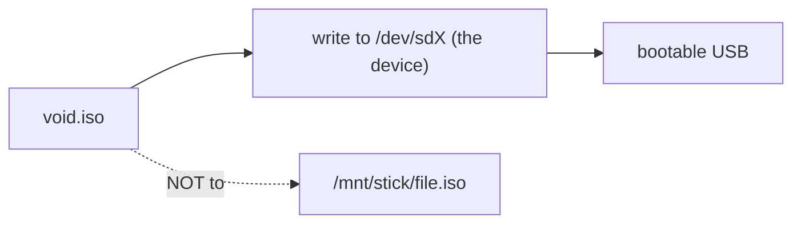

[Read This!](caveatemptor.md) | | [Quick Links](quicklinks.md) | [Algorithms](algorithms.md) | [AssemblyLanguage](assemblylanguage.md) | [BASH](bash.md) |   [C-Programmming](cprogramming.md) |
[CommonLisp](commonlisp.md) |
[Computer Security](computersecurity.md) |  [Databases](databases.md) | [Emacs](emacs.md) |  [Exploitation](exploitation.md) |
[Functional Programming](functional.md) |
[Firewalls](firewalls.md) |   [Git](git.md) | [Haskell](haskell.md) | [Javascript](javascript.md) |  [Julia](julia.md) |
[Linux](linux.md) | [Machine Learning](machinelearning.md) | [Metasploit](metasploit.md) |[Machine Learning](machinelearning.md) |
[Networking](networking.md) | [Operating Systems](os.md) |[Open Data Science](opendatascience.md) | [Odin](odin.md) |
[Picolisp](picolisp.md) | [Pharo Smalltalk](pharo.md) | [Purescript](purescript.md) |
[Python](python.md) |
[Racket](racket.md) | [Scheme](scheme.md) | [Social Engineering](internetexploitation.md) |
[Unity](unity.md) | [vim](vim.md) | [V](vlang.md) |
[Web Development](webdevelopment.md) | [Windows WSL](windowswsl.md) | [Zig](ziglang.md)

# Burn an ISO to USB Disk

Here is the truth about writing an ISO to a USB stick: **the stick becomes the image, byte for byte – it is not a folder you copy files into.** Treat it like imaging a disk and you won't end up with a stick that won't boot.

### What it is, in plain words

An **ISO image** is a single file that holds a whole filesystem – usually an optical-disc image, now used for OS installers. **Burning** (writing) it to a USB drive means copying those bytes directly onto the device (`/dev/sdX` or `/dev/mmcblk0`), not onto a partition or a mounted folder. Afterwards the stick *is* the installer: bootable, with the partition layout the image defines.

On Linux the reliable tools are `dd`, `cp` (to the device), **`ddrescue`**, or friendlier wrappers like **`usbimager`**, **Ventoy** (keeps many ISOs on one stick), and distro tools (`rpi-imager`, `fedora-media-writer`).

### Why it matters

Every Linux install, live system and recovery environment starts this way. Do it wrong – write to the wrong device, copy the ISO as a *file* onto a FAT partition, eject before sync finishes – and you get a stick that BIOS/UEFI ignores. Do it right and you always have a rescue key in your pocket.

### An everyday analogy: pressing a vinyl record

Copying songs as files onto a USB stick is like putting MP3s on a flash drive. Burning an ISO is like *pressing a record*: the shape of the medium itself becomes the music. You can't then treat that record as a folder of songs without melting it down and pressing again.



### A hands-on example

**1. Identify the stick carefully.**

```bash
lsblk -o NAME,SIZE,MODEL,TRAN,MOUNTPOINT
# unplug/replug and watch which device appears – say /dev/sdb
```

Triple-check. `dd` to the wrong disk will destroy it without asking.

**2. Unmount any partitions.**

```bash
sudo umount /dev/sdb*
```

**3. Write the image.**

```bash
sudo dd if=~/Downloads/void-live-x86_64-YYYYMMDD.iso \
        of=/dev/sdb bs=4M status=progress oflag=sync
# or, equivalently on modern coreutils:
sudo cp ~/Downloads/void-live-x86_64-YYYYMMDD.iso /dev/sdb
sudo sync
```

`oflag=sync` (and the final `sync`) make sure buffers hit the metal before you pull the stick out.

**4. Hybrid images.** Most modern Linux ISOs are *isohybrid* – they work on DVD and USB alike. Windows ISOs often need `woeusb` or Ventoy instead of raw `dd`.

**Ventoy** alternative – keep many ISOs:

```bash
# install Ventoy onto the stick once, then just copy .iso files onto it
ventoy -i /dev/sdb
cp *.iso /mnt/ventoy/
```

Boot, pick the ISO from a menu.

### Checking the download before you write

```bash
sha256sum -c sha256sum.txt
# or compare to the hash published on the distro's site
gpg --verify void-live-….iso.sig void-live-….iso
```

A corrupted ISO written perfectly still won't boot – or worse, will fail halfway through install. Verify once; it's cheaper than a mystery.

### Persistent live systems

Some live ISOs (Ubuntu, Fedora, some Void builds) support a *persistent* overlay so changes survive reboot. That usually means a second partition or a file created by their tool – raw `dd` alone doesn't create persistence. Read the distro's live-USB docs if you want a travelling desktop, not just an installer.

### Common misconceptions

- **"Drag the ISO onto the stick in a file manager."** That copies the file *onto* a filesystem. It will not boot.
- **"`of=/dev/sdb1` is safer."** It's wrong. Write to the device (`sdb`), not a partition (`sdb1`).
- **"I can pull it out when the progress bar finishes."** Wait for `sync` / `dd` to return.
- **"`bs=4M` is magic."** Bigger blocks are faster; they don't change correctness.
- **"All sticks boot in all machines."** UEFI vs legacy BIOS, Secure Boot, 32-bit UEFI on some Atom tablets – have a second stick and a machine you know works.

### Connections

- [Linux](linux.md), [Arch Linux](archlinux.md), [Ubuntu Common Tasks](ubuntucommontask.md).
- [Raspberry Pi](rasberrypi.md) – same idea with `rpi-imager` and SD cards.
- [Data Recovery](datarecovery.md) – if you `dd`'d the wrong disk.
- [Build](bciyh.md) – installing Void for Vikix.

```
using cat(1):
# cat path/to/archlinux-version-x86_64.iso > /dev/sdx
using cp(1):
# cp path/to/archlinux-version-x86_64.iso /dev/sdx
using dd:
# dd bs=4M if=path/to/archlinux-version-x86_64.iso of=/dev/sdx conv=fsync oflag=direct status=progress
using tee:
# tee < path/to/archlinux-version-x86_64.iso > /dev/sdx
using pv:
# pv path/to/archlinux-version-x86_64.iso > /dev/sdx
```
