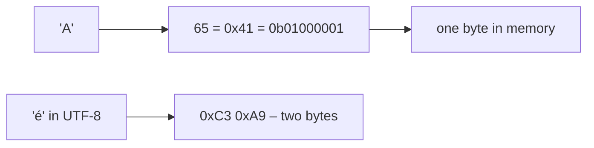

# Characters in C Programming

Here is the truth about characters in C: **there are no characters – only small integers that we agree to *draw* as letters.** `'A'` is just the number 65 wearing a costume. Everything about text in C, from strings to Unicode, follows from that.

### What it is, in plain words

The `char` type is C's smallest addressable unit: exactly one **byte** (`sizeof(char)` is always 1, and on every mainstream system a byte is 8 bits). A **character constant** in single quotes, like `'A'`, is a number – the character's code in the execution character set, which today is essentially always **ASCII** for the first 128 values.

```c
char c = 'A';        /* c holds 65 */
printf("%c %d\n", c, c);   /* A 65 */
```

Three distinct types share the name:

- `char` – for text; whether it's signed or unsigned depends on the platform (signed on x86, unsigned on ARM Linux).
- `signed char` – a byte from −128 to 127.
- `unsigned char` – a byte from 0 to 255; the right type for raw binary data.

**Escape sequences** write characters you can't type directly: `'\n'` newline, `'\t'` tab, `'\0'` the null character (value 0, which ends every C string), `'\\'` backslash, `'\''` quote, `'\x41'` hex, `'\101'` octal.

Beyond one byte, C has wide and Unicode types: `wchar_t` (`L'x'`), and since C11/C23 `char16_t` (`u'x'`), `char32_t` (`U'x'`) and **`char8_t`** (`u8'x'`, new in C23) for UTF-8 code units.

### Why it matters

Every string in C is an array of `char` ending in `'\0'`. Parsing input, reading files, network protocols and terminal I/O all come down to inspecting and changing bytes one at a time. Mistakes here – a missing terminator, a signed byte used as an array index, assuming one byte equals one letter – cause crashes, security holes and mangled non-English text.

### An everyday analogy: a numbered pigeonhole chart

Imagine a wall of 256 pigeonholes, numbered 0 to 255, with a letter painted on the front of each. When you "store an A", you're really writing down "pigeonhole 65". The painting on the front (the font, the encoding table) is what makes it look like an A. Change the chart and the same number shows a different symbol – which is exactly what happened with all the old code pages before Unicode.



### A hands-on example

```c
/* chars.c */
#include <stdio.h>
#include <ctype.h>
#include <string.h>

int main(void) {
    /* Characters are numbers */
    printf("'A'=%d  'a'=%d  '0'=%d  ' '=%d\n", 'A', 'a', '0', ' ');
    printf("'a' - 'A' = %d\n", 'a' - 'A');           /* 32 */
    printf("digit value of '7' = %d\n", '7' - '0');  /* 7 */

    /* Classify and convert with <ctype.h> – cast to unsigned char first! */
    const char *s = "Void Linux 2026!";
    int letters = 0, digits = 0;
    for (const char *p = s; *p; p++) {
        unsigned char ch = (unsigned char)*p;
        if (isalpha(ch)) letters++;
        if (isdigit(ch)) digits++;
        putchar(toupper(ch));
    }
    printf("\nletters=%d digits=%d\n", letters, digits);

    /* Strings are char arrays ending in '\0' */
    char word[] = "lisp";               /* 5 bytes: l i s p \0 */
    printf("sizeof=%zu strlen=%zu\n", sizeof word, strlen(word));

    /* UTF-8: one visible letter, several bytes */
    const char *e = "é";                /* source file saved as UTF-8 */
    printf("bytes in \"é\": %zu ->", strlen(e));
    for (const unsigned char *p = (const unsigned char *)e; *p; p++)
        printf(" %02X", *p);
    putchar('\n');
    return 0;
}
```

```bash
gcc -std=c23 -Wall chars.c -o chars && ./chars
```

Notice `strlen("é")` is 2: `strlen` counts **bytes**, not letters. To count or manipulate Unicode text properly use a library such as ICU or utf8proc, or the `mbrtoc32`/`c32rtomb` conversion functions with a UTF-8 locale.

### Why the `unsigned char` cast?

Functions in `<ctype.h>` take an `int` that must be either `EOF` or a value representable as `unsigned char`. On platforms where `char` is signed, a byte like `0xE9` becomes −23, and passing that to `isalpha` is undefined behaviour. Always cast. Likewise, `getchar()` returns an `int`, not a `char`, so that `EOF` (−1) can be told apart from byte 255 – store its result in an `int`.

### Common misconceptions

- **"A `char` is a letter."** It's a byte. A letter may take one to four bytes in UTF-8.
- **"`char` is signed."** Implementation-defined. Write `signed char` or `unsigned char` when it matters.
- **"`'a'` and `"a"` are the same."** The first is an `int` constant 97; the second is a two-byte array `{'a', '\0'}`.
- **"`toupper` handles any language."** Only single-byte characters in the current locale. Full Unicode case mapping needs a library.
- **"Strings know their length."** C strings only know where they end – the `'\0'`. Forget it and functions read past your buffer.

### Connections

- [Integers in C](cints.md) and [Floating-point numbers in C](cfloats.md) – the other basic types.
- [Literals](literals.md) – character and string literals.
- [Strings in C](cstrings.md) – arrays of these characters.
- [Unicode in C](unicodeinc.md), [Trigraphs](trigraphs.md) and [Digraphs](digraphs.md) – more on the character set.
- [C Programming](cprogramming.md).

[Back to Literals](literals.md) | [Back to C Programming](cprogramming.md)
