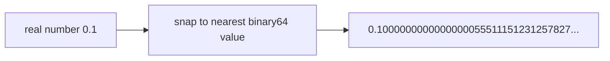

# Floating-point numbers in C Programming

Here is the truth that trips up every programmer once: **`0.1 + 0.2` is not `0.3` on your computer** – not in C, not in Python, not in JavaScript. Floating-point numbers are not real numbers; they are a clever, finite approximation of them, and knowing where the approximation leaks is the whole skill.

### What it is, in plain words

C has three floating-point types:

| Type | Usual format | Significant decimal digits | Range (approx.) |
|------|---|---|---|
| `float` | IEEE 754 binary32 | ~7 | \( 10^{\pm 38} \) |
| `double` | IEEE 754 binary64 | ~15–16 | \( 10^{\pm 308} \) |
| `long double` | 80-bit x87 on x86 Linux, 128-bit on some ARM, same as `double` on Windows/MSVC | 18–33 | varies |

A floating-point number is stored like scientific notation in base 2: a **sign**, an **exponent**, and a **significand** (mantissa).

$$ x = (-1)^{s} \times 1.f \times 2^{\,e - \text{bias}} $$

For a `double` that's 1 sign bit, 11 exponent bits and 52 fraction bits. Because the significand has a fixed number of bits, only some numbers are exact. \( 0.5 \), \( 0.25 \) and \( 3.0 \) are exact; \( 0.1 \) is not – in binary it's a repeating fraction, like \( 1/3 \) in decimal.

IEEE 754 also defines special values: **±0**, **±infinity**, **NaN** ("not a number", e.g. `0.0/0.0`), and **subnormals** – tiny numbers near zero with reduced precision.

### Why it matters

Physics simulations, graphics, audio, machine learning, statistics – all of it runs on floating point. Mistakes show up as accounts that don't balance, loops that never end because a value never exactly equals the target, or simulations that slowly drift. Understanding the format lets you choose the right type, compare values sensibly and know when to reach for integers or decimal arithmetic instead.

### An everyday analogy: a ruler with markings

A ruler marked in millimetres can't show 0.3 mm exactly – you pick the nearest mark. Floating point is a ruler whose marks get *further apart* as numbers get bigger: around 1 the marks are incredibly close; around a billion they're further apart; around \( 10^{300} \) they're astronomically far apart. Every number you store is snapped to its nearest mark.



### A hands-on example

```c
/* floats.c */
#include <stdio.h>
#include <math.h>
#include <float.h>

int main(void) {
    double a = 0.1 + 0.2;
    printf("0.1 + 0.2 = %.17g\n", a);              /* 0.30000000000000004 */
    printf("equal to 0.3? %s\n", a == 0.3 ? "yes" : "no");

    /* Compare with a tolerance instead */
    double eps = 1e-9;
    printf("close to 0.3? %s\n", fabs(a - 0.3) < eps ? "yes" : "no");

    /* Precision limits */
    printf("float  digits: %d, epsilon: %g\n", FLT_DIG, FLT_EPSILON);
    printf("double digits: %d, epsilon: %g\n", DBL_DIG, DBL_EPSILON);

    float f = 16777216.0f;          /* 2^24 */
    printf("2^24 + 1 as float = %.1f\n", f + 1.0f);   /* 16777216.0 – the +1 is lost */

    /* Literals */
    float  pi_f = 3.14159f;         /* f suffix = float */
    double big  = 6.022e23;         /* exponent notation */
    double hexf = 0x1.8p1;          /* hex float: 1.5 * 2^1 = 3.0 */
    printf("%f %e %a\n", pi_f, big, hexf);

    /* Special values */
    double inf = 1.0 / 0.0, nan = 0.0 / 0.0;
    printf("inf=%f nan=%f nan==nan? %d isnan? %d\n", inf, nan, nan == nan, isnan(nan));

    /* Summing many small numbers: order matters */
    float s1 = 0.0f;
    for (int i = 0; i < 10000000; i++) s1 += 0.1f;
    printf("float sum of 0.1 x 10M = %f (should be 1000000)\n", s1);
    return 0;
}
```

```bash
gcc -std=c23 -Wall floats.c -o floats -lm && ./floats
```

The last line is a shock the first time: the `float` sum lands far from a million, because once the total is large, adding 0.1 rounds badly. Use `double`, or a compensated (Kahan) summation, or integers counted in tenths.

### Practical rules

- Default to `double`. Use `float` only when memory or SIMD/GPU throughput demands it.
- Never test floats with `==` unless you know the values are exact. Use a tolerance appropriate to the magnitude.
- Never use floating point for money. Count cents in a 64-bit integer.
- `-ffast-math` lets the compiler reorder operations and ignore NaN/infinity rules. Fast, but it can change results – avoid it unless you understand the trade.
- C23 adds optional decimal types (`_Decimal64`) on some platforms, for exact decimal fractions.

### Common misconceptions

- **"Floats are random or inaccurate."** They're precisely specified and deterministic; they just can't represent every decimal.
- **"`double` fixes everything."** It pushes the error further out; `0.1 + 0.2` is still not `0.3`.
- **"NaN equals NaN."** NaN is unequal to everything, itself included. Use `isnan()`.
- **"Division by zero crashes."** For floats it yields infinity or NaN (integers are another story).
- **"`%f` prints floats, `%lf` prints doubles."** In `printf`, `float` is promoted to `double`, so `%f` handles both. `%lf` matters in `scanf`.

### Connections

- [Integers in C](cints.md) and [Characters in C](cchars.md) – the other basic types.
- [Literals](literals.md) – writing numbers in source code.
- [Binary](binary.md) – the bit patterns underneath.
- [NumPy](numpy.md) and [Fortran](fortran.md) – floating point at scale.
- [C Programming](cprogramming.md).

[Back to Literals](literals.md) | [Back to C Programming](cprogramming.md)
