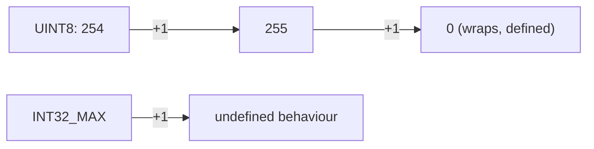

# Integers in C Programming

Here is the truth about integers in C: **an `int` is not a number in the mathematical sense – it's a fixed number of bits, and the bits run out.** Almost every integer bug in C comes from forgetting that.

### What it is, in plain words

C has a family of integer types that differ in **size** (how many bits) and **signedness** (whether they can be negative):

| Type | Typical size on 64-bit Linux | Guaranteed at least |
|------|---|---|
| `char` | 8 bits | 8 bits |
| `short` | 16 | 16 |
| `int` | 32 | 16 |
| `long` | 64 (Linux/macOS), 32 (Windows) | 32 |
| `long long` | 64 | 64 |
| `_Bool` / `bool` | 8 (holds 0 or 1) | – |

Each comes as `signed` (the default, except for `char`, which is implementation-defined) or `unsigned`. Since C99 the header `<stdint.h>` gives you exact sizes – `int8_t`, `uint16_t`, `int32_t`, `uint64_t` – plus `size_t` for sizes and indexes and `intptr_t` for integers that can hold a pointer.

**C23**, the newest standard (supported by GCC 14+ and Clang 18+ with `-std=c23`), tidied things up: signed integers are now *required* to be two's complement, `bool`/`true`/`false` are keywords, binary literals like `0b1010` and digit separators like `1'000'000` are standard, and `_BitInt(N)` gives you integers of any width you like.

### Why it matters

Integers count loop iterations, index arrays, size buffers and hold file offsets. When one silently overflows or a signed value is compared to an unsigned one, you get wrong answers, infinite loops, or buffer overflows – a whole category of security holes. Knowing the rules is the cheapest security tool you'll ever have.

### An everyday analogy: a car's odometer

An old car's odometer has six digits. Drive past 999,999 miles and it rolls over to 000,000. That's exactly what an `unsigned` integer does – well-defined wrap-around, modulo \( 2^{n} \). A **signed** integer is like a fragile odometer that, when it overflows, may do *anything*: the C standard calls this **undefined behaviour**, and optimising compilers are allowed to assume it never happens.



### A hands-on example

```c
/* ints.c */
#include <stdio.h>
#include <stdint.h>
#include <limits.h>
#include <inttypes.h>

int main(void) {
    printf("int:       %zu bytes, %d .. %d\n", sizeof(int), INT_MIN, INT_MAX);
    printf("long:      %zu bytes\n", sizeof(long));
    printf("uint64_t:  max %" PRIu64 "\n", UINT64_MAX);

    /* Literals: decimal, hex, octal, binary (C23), suffixes */
    int dec = 255, hex = 0xFF, oct = 0377, bin = 0b11111111;
    unsigned long big = 4000000000UL;
    printf("%d %d %d %d %lu\n", dec, hex, oct, bin, big);

    /* Unsigned wrap-around is defined */
    uint8_t u = 255;
    u = u + 1;
    printf("uint8 255+1 = %u\n", u);              /* 0 */

    /* Integer division truncates toward zero */
    printf("7/2=%d  -7/2=%d  -7%%2=%d\n", 7/2, -7/2, -7%2);   /* 3 -3 -1 */

    /* The signed/unsigned comparison trap */
    int neg = -1;
    unsigned int one = 1;
    if (neg < one) puts("-1 < 1");
    else           puts("surprise: -1 >= 1u");   /* this one prints! */

    /* Checked arithmetic (C23 <stdckdint.h>, or GCC/Clang builtins) */
    int result;
    if (__builtin_add_overflow(INT_MAX, 1, &result))
        puts("overflow caught");
    return 0;
}
```

```bash
gcc -std=c23 -Wall -Wextra -fsanitize=undefined ints.c -o ints && ./ints
```

The "surprise" line happens because `-1` is converted to `unsigned int` before the comparison, becoming 4,294,967,295. `-Wextra` warns about exactly this. With C23 you can write `ckd_add(&result, a, b)` from `<stdckdint.h>` instead of the builtin.

### Printing integers correctly

Mismatched `printf` formats are undefined behaviour too. `%d` int, `%u` unsigned, `%ld`/`%lu` long, `%lld` long long, `%zu` size_t, `%x` hex – and for fixed-width types use the `PRId32`/`PRIu64` macros from `<inttypes.h>`, as above.

### Common misconceptions

- **"`int` is 32 bits."** On today's mainstream platforms, yes; the standard only promises 16. Use `int32_t` when size matters.
- **"`long` is 64 bits."** Not on Windows. Use `int64_t`.
- **"Signed overflow wraps around."** It's undefined. The compiler may delete your overflow check entirely. Use unsigned types, wider types, or checked arithmetic.
- **"`char` is signed."** It's signed on x86, unsigned on ARM Linux. Use `signed char`/`unsigned char`/`uint8_t` for byte maths.
- **"Use `int` for array indexes."** `size_t` is the correct, unsigned type for sizes and indexes.

### Connections

- [Literals](literals.md) – how numbers are written in source.
- [Floating-point numbers in C](cfloats.md) and [Characters in C](cchars.md) – the other basic types.
- [C Programming](cprogramming.md) and [The C Standard Library](cstandardlibrary.md).
- [Binary](binary.md) – how the bits are laid out.
- [Exploitation](exploitation.md) – integer overflows as security bugs.

[Back to Literals](literals.md) | [Back to C Programming](cprogramming.md)
