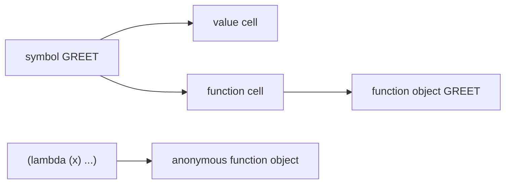

[Functions](clfunctions.md) | [with-output-to-string](withoutputtostring.md)

# Common Lisp Functions

The truth about functions in Common Lisp: **a function is an object, and a name is just one of many ways to reach it.** Once you separate "the function" from "the symbol that names it", the strange-looking `#'` and `funcall` suddenly make perfect sense.

### What it is, in plain words

A Common Lisp function is a first-class object that takes arguments and returns zero or more values. You create named ones with `defun` and anonymous ones with `lambda`:

```lisp
(defun greet (name) (format nil "Hello, ~a!" name))
(lambda (x) (* x 2))
```

Because CL is a **Lisp-2**, every symbol has a separate *function cell* and *value cell*. `(greet "Vikid")` looks in the function cell. To get the function as a value – to pass it somewhere – you ask for it explicitly with `(function greet)`, written `#'greet` for short. To call a function held in a variable, use `funcall` (fixed number of arguments) or `apply` (arguments in a list).

### Why it matters

Almost all real Lisp code is functions passed to other functions: `mapcar`, `reduce`, `sort`, `remove-if`. Knowing how Common Lisp's rich **lambda lists** work – optional, keyword and rest arguments – lets you write APIs that are both flexible and self-documenting. And because functions can return multiple values and close over variables, you can say a lot with very little code.

### An everyday analogy: a person and their job title

"The plumber" is a role, a name. The person who does the job is the actual thing. You can call the plumber by title (`(plumber pipe)`), or you can hand someone the plumber's phone number (`#'plumber`) so *they* can call later (`(funcall number pipe)`). In Lisp-2, a symbol can be both a title and an ordinary variable at once – `list` can name the function and also hold a list – without clashing.



### A hands-on example: lambda lists

The parameter kinds always appear in this order:

```lisp
(defun f (required &optional opt &rest rest &key key &aux tmp) ...)
```

For example, a helper that builds an ssh command line:

```lisp
(defun ssh-command (host &optional (port 22) &key (user "root") verbose)
  (format nil "ssh ~:[~;-v ~]-p ~a ~a@~a" verbose port user host))

(ssh-command "vikix.local")                          ; "ssh -p 22 root@vikix.local"
(ssh-command "vikix.local" 2222 :user "vikid" :verbose t)
;; "ssh -v -p 2222 vikid@vikix.local"
```

Mixing `&optional` with `&key` is legal but confusing (SBCL warns about it); in your own code prefer one or the other.

```lisp
;; Rest arguments
(defun sum (&rest nums) (reduce #'+ nums))
(sum 1 2 3 4)                       ; 10

;; Functions as values
(mapcar #'string-upcase '("void" "stump" "lisp"))   ; ("VOID" "STUMP" "LISP")
(funcall #'+ 1 2 3)                                  ; 6
(apply #'max 3 '(9 4 7))                             ; 9
(sort (list 5 1 4) #'<)                              ; (1 4 5)

;; Closures
(defun make-adder (n) (lambda (x) (+ x n)))
(defparameter *add5* (make-adder 5))
(funcall *add5* 10)                                  ; 15

;; Multiple return values
(floor 17 5)                          ; 3, 2
(multiple-value-bind (q r) (floor 17 5)
  (format nil "~a remainder ~a" q r)) ; "3 remainder 2"

;; Local functions
(labels ((fact (n) (if (<= n 1) 1 (* n (fact (1- n))))))
  (fact 20))                          ; 2432902008176640000
```

Use `flet` for local functions that don't call themselves, `labels` when they do.

### Documentation and introspection come free

```lisp
(defun area (r)
  "Area of a circle of radius R."
  (* pi r r))
(documentation 'area 'function)   ; "Area of a circle of radius R."
(describe #'area)
```

In SLIME or Sly, `C-c C-d d` shows the docstring and `M-.` jumps to the source of *any* function, including SBCL's own.

### Common misconceptions

- **"`#'` is just noise."** It means "the function named by", and it's what lets a symbol be both a variable and a function. (Scheme, a Lisp-1, doesn't need it.)
- **"`(mapcar 'square ...)` and `(mapcar #'square ...)` are identical."** The quoted symbol is looked up at call time in the *global* function namespace, so it ignores local `flet`/`labels` definitions; `#'` captures the lexically visible function.
- **"Functions return one value."** They can return several with `values`; callers who want only the first simply ignore the rest.
- **"`apply` works with any length list."** Implementations have a `call-arguments-limit` (often large, but finite). Use `reduce` for huge lists.
- **"Recursion is always optimised."** Tail calls are optimised by SBCL at normal optimisation settings, but the standard doesn't promise it.

### Connections

- [Common Lisp](commonlisp.md) – the language overview.
- [with-output-to-string](withoutputtostring.md) – a macro that wraps a body with a string stream.
- [JavaScript Functions](jsfunctions.md) – the same ideas in a Lisp-1-ish language.
- [Lambda Calculus](lambdacalculus.md) and [Functional Programming](functional.md).
- [PicoLisp](picolisp.md) – where functions are *literally* lists you can build at run time.

[with-output-to-string](withoutputtostring.md)
