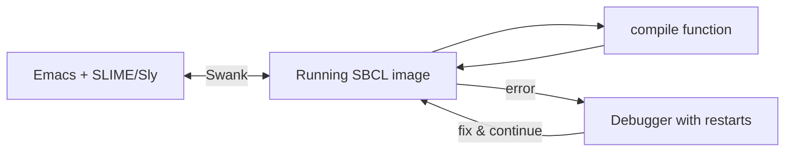

[Read This!](caveatemptor.md) | | [Quick Links](quicklinks.md) | [Algorithms](algorithms.md) | [AssemblyLanguage](assemblylanguage.md) | [BASH](bash.md) |   [C-Programmming](cprogramming.md) |
[CommonLisp](commonlisp.md) |
[Computer Security](computersecurity.md) |  [Databases](databases.md) | [Emacs](emacs.md) |  [Exploitation](exploitation.md) |
[Functional Programming](functional.md) |
[Firewalls](firewalls.md) |   [Git](git.md) | [Haskell](haskell.md) | [Javascipt](javascript.md) | [Julia](julia.md) | [Social Engineering](internetexploitation.md) |
[Picolisp](picolisp.md) | [Pharo Smalltalk](pharo.md) |
[Linux](linux.md) |
[Python](python.md) |
[Operating Systems](os.md) |
[Machine Learning](machinelearning.md) | [Metasploit](metasploit.md) |  [Open Data Science](opendatascience.md) |
[Networking](networking.md) | [Machine Learning](machinelearning.md) | [Racket](racket.md) | [Scheme](scheme.md) |
[Unity](unity.md) | [vim](vim.md) |
[Web Development](webdevelopment.md) | [Windows WSL](windowswsl.md)

# Common Lisp

Here is the truth that took me years to see: **Common Lisp is not an old language that refused to die – it's a living system that was finished early.** It was standardised in 1994, and code written then still runs unchanged today on fast, native-code compilers. Few languages can say that.

### What it is, in plain words

Common Lisp (CL) is a member of the Lisp family, defined by the ANSI X3.226 standard. Programs are written as **s-expressions** – nested lists in parentheses – and because code *is* list data, Lisp programs can write and transform Lisp programs. That's what **macros** are.

Its personality, in a few lines:

- **Interactive** – you develop inside a running image, connected to your editor through a **REPL**. You redefine a function while the program runs, and the program uses the new one immediately.
- **Multi-paradigm** – functional, imperative and object-oriented (CLOS, the Common Lisp Object System, with multiple dispatch and a meta-object protocol).
- **Compiled** – SBCL, the most popular implementation, compiles every function to native machine code.
- **A Lisp-2** – functions and variables live in separate namespaces, which is why you write `#'car` or `(function car)` to pass a function.
- **The condition system** – errors that let you *restart* computation from where it failed, instead of just unwinding the stack.

### Why it matters

Common Lisp shows what programming feels like when the language never stops you: you can grow it with macros, fix bugs in a live program, inspect any object, and get native speed. Those ideas – REPL-driven development, hot reloading, code as data, generic functions – keep being rediscovered by newer languages. Learning CL is learning where they came from. And for someone who loves [PicoLisp](picolisp.md), CL is the big, batteries-included cousin: different philosophy (PicoLisp is tiny, interpreted and dynamically bound; CL is large, compiled and lexically scoped), same joy.

### An everyday analogy: a workshop you can rebuild while working in it

Most languages are like a factory: design, build, then run, and to change anything you stop the line. Common Lisp is a workshop where you can swap the drill bit, rebuild the workbench and add a new tool *while you're still holding the piece you're working on* – and the piece doesn't fall on the floor.



### A hands-on example

Install SBCL (Void: `sudo xbps-install -S sbcl`, Arch: `sudo pacman -S sbcl`) and start it with `sbcl`.

```lisp
;; A function
(defun square (x) (* x x))
(square 12)                     ; => 144

;; Higher-order functions
(mapcar #'square '(1 2 3 4))    ; => (1 4 9 16)
(remove-if-not #'evenp '(1 2 3 4 5 6)) ; => (2 4 6)

;; The famous LOOP mini-language
(loop for i from 1 to 10
      when (oddp i) collect (* i i))   ; => (1 9 25 49 81)

;; A tiny CLOS class with a generic function
(defclass machine () ((name :initarg :name :reader name)
                      (wm   :initarg :wm   :reader wm)))
(defgeneric describe-box (m))
(defmethod describe-box ((m machine))
  (format nil "~a runs ~a" (name m) (wm m)))
(describe-box (make-instance 'machine :name "vikix" :wm "StumpWM"))
;; => "vikix runs StumpWM"

;; A macro: new syntax in five lines
(defmacro while (test &body body)
  `(loop (unless ,test (return)) ,@body))
(let ((n 3)) (while (> n 0) (print n) (decf n)))
```

That last one is the heart of Lisp: `while` isn't in the standard, so we added it, and now it's as real as anything built in.

### The modern toolchain (2026)

- **SBCL** – the default choice: fast, actively released every month or so. Others: CCL, ECL (embeddable), ABCL (on the JVM), and commercial LispWorks and Allegro.
- **Editor** – Emacs with **SLIME** or **Sly**; Vim/Neovim with Vlime or Conjure; VS Code with Alive. Lem is an editor written in CL itself.
- **Libraries** – **Quicklisp** is the long-standing library manager; **ocicl** and **Qlot** offer newer, pinned/reproducible workflows. **ASDF** (built into every implementation) defines systems.
- **StumpWM** – my window manager on [Vikix](bciyh.md) – is written in Common Lisp, so your window manager config *is* a Lisp program you can hack live from Emacs.

### Common misconceptions

- **"Lisp is interpreted and slow."** SBCL compiles to native code; with type declarations it approaches C for numeric loops.
- **"Common Lisp is dead."** The standard is frozen; the ecosystem isn't. SBCL ships regular releases, and companies still run CL in production.
- **"All those parentheses are hard to read."** After a week, with an editor that indents and balances them (paredit, smartparens, lispy), you stop seeing them.
- **"Lisp is only for AI."** It was used for 1980s AI, but also for CAD, airline scheduling (ITA Software), music composition, and window managers.
- **"Common Lisp and Scheme are the same."** Scheme is minimal and a Lisp-1; CL is large, a Lisp-2, and has a much bigger standard library.

### Connections

- [Common Lisp Functions](clfunctions.md) and [with-output-to-string](withoutputtostring.md) – going deeper.
- [PicoLisp](picolisp.md), [Scheme](scheme.md), [Racket](racket.md), [Emacs Lisp](emacslisp.md) – the rest of the family.
- [Lambda Calculus](lambdacalculus.md) – where `lambda` came from.
- [Emacs](emacs.md) – the natural home for Lisp development.
- [Functional Programming](functional.md).

[Functions of Interest](clfunctions.md) 

#### External Links

[Rip Tutorial Book](https://riptutorial.com/Download/common-lisp.pdf)
[A Road to Common Lisp](https://stevelosh.com/blog/2018/08/a-road-to-common-lisp/)
[Common Lisp: A Gentle Introduction to Symbolic Computation.](https://www.cs.cmu.edu/~dst/LispBook/book.pdf)
[Practical Common Lisp](https://gigamonkeys.com/book/)
[learn x in y minutes](https://learnxinyminutes.com/docs/common-lisp/)
[Let Over Lambda](https://letoverlambda.com/lol-orig.lisp)
[Lisp-Lang](https://lisp-lang.org)
[QuickLisp](https://www.quicklisp.org/beta/)
[Slime](https://slime.common-lisp.dev)
[LearnXinYminutes Common Lisp](https://learnxinyminutes.com/docs/common-lisp/)
[Common Lisp on Emacs](https://www.gnu.org/software/emacs/manual/html_mono/cl.html)
[Graphics Lessons in Mac](https://github.com/kaveh808/Kaveh-Common-Lisp-Lessons)
[Common Lisp Quick Reference](http://clqr.boundp.org/)
[Nyxt browser: Documentation](https://nyxt.atlas.engineer/documentation)
