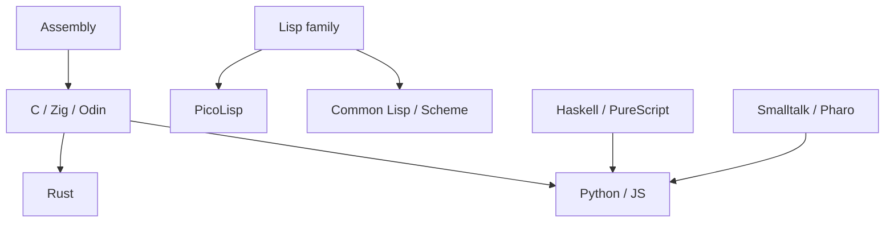

# Computer Languages Centre

Here is the truth about computer languages: **they are not competing religions – they are tools shaped by different bets about what matters.** Syntax is the paint; the bets (typing, memory, evaluation order, metaprogramming) are the structure.

### What it is, in plain words

A **programming language** is a notation for expressing computation that a machine can carry out. Languages differ along a handful of axes:

| Axis | Options | Examples |
|------|---------|----------|
| Typing | static / dynamic / gradual | Rust / Python / TypeScript |
| Evaluation | strict / lazy | C, JS / Haskell |
| Memory | manual / GC / ownership | C, Zig / Java, Go / Rust |
| Paradigm | imperative, FP, OO, logic, concatenative | C, Haskell, Smalltalk, Prolog, Forth |
| Level | close to metal ↔ close to problem | Assembly ↔ SQL, HTML |

"Level" is a spectrum, not a moral hierarchy. Assembly and PicoLisp can both be the right answer.

### Why it matters

Picking a language is picking the default costs you'll pay and the default bugs you'll avoid. C lets you touch every byte and cut yourself. Haskell makes effects visible and makes you think. Python optimises for time-to-first-result. Knowing a few languages from different corners of the map makes you better in *all* of them – patterns transfer.

### An everyday analogy: vehicles

A bicycle, a lorry and a sailboat all move things. You wouldn't haul freight on a bike or commute by freighter. Languages are vehicles. Learn to drive more than one class and the road makes sense.



### A hands-on tour of the same idea

Print the sum of squares of even numbers up to 10:

```c
/* C */
int s = 0; for (int i = 1; i <= 10; i++) if (i % 2 == 0) s += i * i;
```

```python
sum(i*i for i in range(1, 11) if i % 2 == 0)
```

```lisp
(sum '((N) (* N N)) (filter '((N) (=0 (% N 2))) (range 1 10)))
```

```haskell
sum [x*x | x <- [1..10], even x]
```

Same idea; different bets about loops, types and what "a program" looks like.

### Languages on this site

A non-exhaustive map of pages worth visiting:

- Systems: [C](cprogramming.md), [Rust](rust.md), [Zig](ziglang.md), [Odin](odin.md), [V](vlang.md), [Assembly](assemblylanguage.md)
- Lisp family: [PicoLisp](picolisp.md), [Common Lisp](commonlisp.md), [Scheme](scheme.md), [Racket](racket.md), [Emacs Lisp](emacslisp.md)
- Functional: [Haskell](haskell.md), [PureScript](purescript.md), [Functional Programming](functional.md)
- Scripting / glue: [Python](python.md), [BASH](bash.md), [Javascript](javascript.md), [awk](awk.md)
- Smalltalk: [Pharo](pharo.md), [Cuis](cuissmalltalk.md), [GNU Smalltalk](gnusmalltalk.md)
- Numerical: [Fortran](fortran.md), [Julia](julia.md)
- Other: [Forth](forth.md), [Lambda Calculus](lambdacalculus.md)

### How to choose for a new project

Ask, in order: what must I talk to (C ABI, browser, GPU)? what failure modes can I not afford (memory bugs, races)? who will maintain this in three years? how fast do I need the first prototype? The answers usually converge on two candidates; write a day of code in each and feel which one fights you less. Fashion and HN front pages are weak signals compared to that experiment.

### Common misconceptions

- **"My first language must be the perfect one."** The second language is when you actually learn programming. Start anywhere honest.
- **"Newer means better."** Fortran outlives fashion. So does C. So does Lisp.
- **"Real programmers use X."** Real programmers ship with the right tool and learn continuously.
- **"Polyglot is diluting."** Polyglot with depth beats monolingual with dogma.
- **"AI means languages don't matter."** Models are fluent in popular syntax. Architecture, types and taste still land on you.

### The landscape in 2026

A few honest observations about where languages stand right now:

- **Python** is the default for data, machine learning, scripting and teaching. Version 3.14 brought an officially supported free-threaded build, so the GIL is finally becoming optional.
- **JavaScript and TypeScript** own the browser and much of the server through Node, Deno and Bun. Node can now run TypeScript files directly by stripping types.
- **C** is still the foundation of operating systems and embedded work, with C23 the current standard. **Rust** is the main newcomer in systems code, including parts of the Linux kernel. **Zig** and **Odin** offer simpler alternatives that interoperate tightly with C.
- **Go**, **Java**, **Kotlin** and **C#** carry most business back-ends.
- **Lisps** remain the place where language ideas are born and tested: Common Lisp (SBCL), Scheme and Racket, Clojure on the JVM, and small, sharp systems like PicoLisp. Emacs Lisp runs one of the most extensible programs ever written.
- **AI coding assistants** changed how code gets written, not which languages matter. If anything, they reward languages that are easy to *read and check*, since you review more code than you type.

### A quick way to compare languages yourself

Pick a task small enough to finish in an evening and write it in three languages from different families. Word frequency in a text file works well:

```bash
# Shell (pipes)
tr -cs '[:alpha:]' '\n' < file.txt | tr A-Z a-z | sort | uniq -c | sort -rn | head
```

```python
# Python
from collections import Counter; import re
print(Counter(re.findall(r"[a-z]+", open("file.txt").read().lower())).most_common(10))
```

```picolisp
# PicoLisp
(let Idx NIL
   (in "file.txt"
      (until (eof)
         (let W (lowc (till " \t\n.,;:!?\"()" T))
            (and W (accu 'Idx W 1)) )
         (char) ) )
   (head 10 (flip (by cdr sort Idx))) )
```

A longer, commented version is the worked exercise on [PicoLisp Tutorials](piltutorials.md). Notice what each language makes easy: the shell composes existing tools, Python has a library for it, and Lisp lets you build the exact tool from lists and symbols. That difference is the whole story of language families in one exercise.

### Connections

- [Computer Science](computerscience.md), [Functional Programming](functional.md).
- [Build](bciyh.md) – Vikix's own stack: Void, StumpWM, PicoLisp, C.

[Simply Array Arithmetic](simplyarrayarithmetic.md)
[Rubinius](https://rubinius.com/)
[Julia Main Site](http://julialang.org/)
[Intro to Julia (Deep)](http://ucidatascienceinitiative.github.io/IntroToJulia/)
[Meteor](https://www.meteor.com)
[Vale Lang](https://vale.dev)

#### Error Handling

Error Handling is just code that checks certain values and conditions before proceeding down the normal path of execution.
If the code notices an 'error' then a different path of execution is followed.
