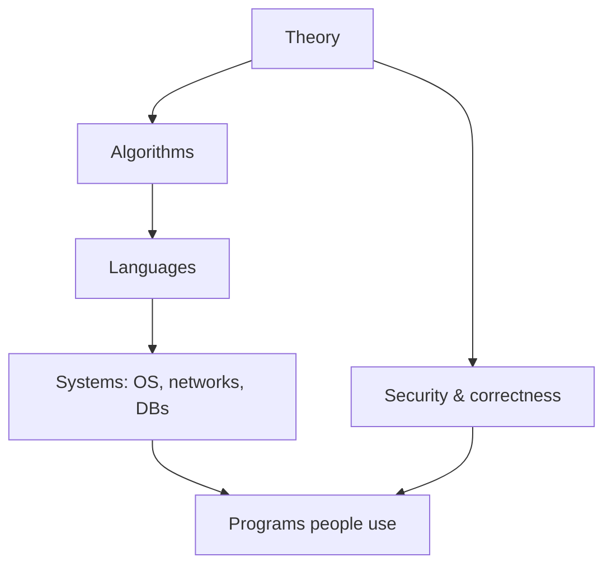

[Important Caveat Emptor!](caveatemptor.md)

# Computer Science and Theory

Here is the truth about computer science: **it is not the study of computers any more than astronomy is the study of telescopes.** It is the study of *processes* – what can be computed, how fast, how reliably, and how we express those processes so others (and machines) can carry them out.

### What it is, in plain words

**Computer science (CS)** is the body of ideas that underpins programming, systems and computation itself. A useful map of the territory:

| Area | Question it answers |
|------|---------------------|
| Theory / computability | What can be computed at all? ([Lambda calculus](lambdacalculus.md), Turing machines) |
| Algorithms & data structures | How do we compute it efficiently? ([Algorithms](algorithms.md)) |
| Programming languages | How do we express computation? |
| Computer architecture | How do machines actually run it? |
| Operating systems | How do we share a machine among many programs? ([OS](os.md)) |
| Networks | How do machines talk? ([Networking](networking.md)) |
| Databases | How do we remember reliably? ([Databases](databases.md)) |
| Security | How do we keep intent intact under attack? ([Computer Security](computersecurity.md)) |
| AI / ML | How do we make systems that improve from data? ([Machine Learning](machinelearning.md)) |
| Human–computer interaction | How do people fit into all this? |

You don't need a degree to learn it. You do need curiosity and the habit of asking "why does this work?" instead of only "how do I make it go?".

### Why it matters

Without CS ideas, programming is folklore – recipes that work until they don't. With them, you can estimate whether a design will scale, recognise a graph problem wearing a business suit, choose a language for the right reasons, and read a research paper or a kernel commit without panic. CS is the difference between using Linux and understanding it.

### An everyday analogy: cooking and food science

Anyone can follow a recipe. Food science tells you *why* salt changes protein, why bread rises, why mayonnaise emulsifies – so you can invent recipes, fix failures and adapt to a different kitchen. Computer science is food science for programs.



### A hands-on example: three CS ideas in one afternoon

**1. Computability – a program that can't exist.**

There is no general program that looks at any other program and decides whether it will halt. This is the **halting problem**, proved by Turing in 1936. Every time your editor's "analyse" spinner gives up on a tricky function, you're brushing against that limit.

**2. Complexity – the same job, different cost.**

```python
def has_pair_sum_naive(a, target):
    for i, x in enumerate(a):
        for y in a[i+1:]:
            if x + y == target: return True
    return False                                  # O(n²)

def has_pair_sum_fast(a, target):
    seen = set()
    for x in a:
        if target - x in seen: return True
        seen.add(x)
    return False                                  # O(n)
```

Same question; the data structure (a hash set) changes the algorithm class. That instinct *is* CS.

**3. Abstraction – layers that hold.**

```
your Python code
  → bytecode (CPython)
    → OS syscalls (Linux)
      → architecture (x86-64 / ARM)
        → circuits
```

Each layer promises a contract so the one above needn't care what's below. When a bug appears, you drop down one layer – not fifteen.

### How to learn it without drowning

- Pick a concrete path through [Algorithms](algorithms.md) and one language you love ([PicoLisp](picolisp.md), [Python](python.md), [Rust](rust.md)…).
- Read *Structure and Interpretation of Computer Programs* (SICP) or *The Elements of Computing Systems* (Nand to Tetris) – both reward slow reading.
- Build small systems: a toy database, a tiny interpreter, a shell. Understanding sticks to things you make.
- Use [Linux](linux.md) as your laboratory; [introspection tools](linuxinstrospection.md) make the layers visible.

### Common misconceptions

- **"CS is about coding."** Coding is to CS as writing is to literature – essential, not the whole subject.
- **"CS is maths, I can't do it."** Some branches are heavily mathematical; many of the most useful ideas (caches, processes, protocols) are logical and concrete.
- **"Degrees equal competence."** Degrees help; projects and reading help more. Plenty of great engineers are self-taught in CS fundamentals.
- **"It's all obsolete every five years."** Syntax ages. Complexity, computability, concurrency and systems principles have been stable for decades.
- **"Theory doesn't help day to day."** It helps the day you face a problem your framework hasn't named.

### Connections

- [Algorithms](algorithms.md), [Data Structures and Algorithms](datastructuresandalgorithms.md).
- [Lambda Calculus](lambdacalculus.md), [Functional Programming](functional.md).
- [Operating Systems](os.md), [Networking](networking.md), [Databases](databases.md).
- [Computer Languages](computerlanguages.md), [Computer Study Plan](computerstudyplan.md).

**The fundamental theorem of software engineering (FTSE)** is a term originated by Andrew Koenig to describe a remark by Butler Lampson[1] attributed to David J. Wheeler:[2]

**"We can solve any problem by introducing an extra level of indirection."**

- [Computer Science and Theory](computerscience.md)
- [Build a Computer in Your Head](bciyh.md)
- [Picolisp](picolisp.md), [Picolisp Machine](pilmachine.md), [pil sources](pilsource.md)
- [C Programmming](cprogramming.md)
- [Operating Systems](os.md)
- [Data Structures and Alogrithms](datastructuresandalgorithms.md)
- [Assembly Languages](assemblylanguage.md)
- [Regular Expression Trainer](http://howardabrams.com/regexp/)
- [Number System Conversion - Tutorialspoint](https://www.tutorialspoint.com/basics_of_computers/basics_of_computers_number_system_conversion.htm)
- [Floating Point Visually Explained](https://fabiensanglard.net/floating_point_visually_explained/)
