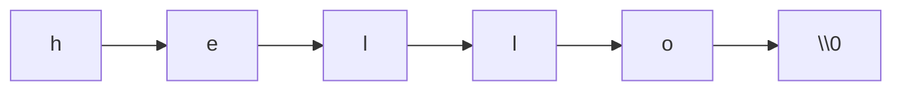

# Strings in C Programming

Here is the truth about strings in C: **there is no string type – only arrays of `char` that we agree end with a zero byte.** Every convenience and every CVE in C text handling follows from that convention.

### What it is, in plain words

A **C string** is a contiguous sequence of bytes ending in `'\0'`. The type used to point at one is `char *` (or `const char *` when you promise not to modify). The standard library in `<string.h>` and `<stdio.h>` provides the classic tools: `strlen`, `strcpy`, `strncpy`, `strcmp`, `strcat`, `strchr`, `strstr`, `sprintf`, `snprintf`.

```c
char greet[] = "hi";       /* {'h','i','\0'} – array you own */
const char *lit = "hi";    /* pointer to static literal – don't write through it */
```

### Why it matters

Buffer overflows, off-by-ones and forgotten null terminators have been the root of decades of vulnerabilities. Knowing how long a buffer is, always writing with an upper bound (`snprintf`, `memcpy` of a known size), and treating `gets` as radioactive are not style points – they are hygiene.

### An everyday analogy: a row of mailboxes with an empty one at the end

The letters of the string fill mailboxes. The empty mailbox (value 0) says "stop". There is no number on the row telling you how many boxes were allocated – only how many until the empty one. Walk past it and you're reading someone else's mail.



### A hands-on example

```c
#include <stdio.h>
#include <string.h>

int main(void) {
    char buf[16];
    const char *src = "Void Linux";

    /* Always bound your writes */
    snprintf(buf, sizeof buf, "%s", src);
    printf("len=%zu buf=%s\n", strlen(buf), buf);

    /* Concatenate safely */
    char path[64] = "/home/";
    snprintf(path + strlen(path), sizeof path - strlen(path), "%s/src", "vikid");
    puts(path);

    /* Compare */
    if (strcmp(buf, "Void Linux") == 0) puts("match");

    /* Tokenise carefully – strtok mutates and is not thread-safe */
    char csv[] = "a,b,c";
    for (char *tok = strtok(csv, ","); tok; tok = strtok(NULL, ","))
        puts(tok);

    return 0;
}
```

```bash
gcc -std=c23 -Wall -Wextra cstrings.c -o cstrings && ./cstrings
```

Prefer `snprintf` over `sprintf`, never use `gets`, and treat `strncpy`'s padding quirks as a reason to use `snprintf` or `memcpy` + explicit `'\0'`. For Unicode, remember `strlen` counts bytes, not characters – see [Unicode in C](unicodeinc.md) and [Characters](cchars.md).

### Common misconceptions

- **"`char *s` allocates a string."** It allocates a pointer. Storage lives elsewhere.
- **"`strncpy` always null-terminates."** It doesn't when the source is longer than `n`.
- **"`strlen` is free."** It walks the bytes every call – cache the length in hot loops.
- **"Literals are mutable."** Writing through them is undefined behaviour.
- **"`sizeof(str)` is the string length."** For an array it includes the terminator; for a pointer it's the pointer size.

### Safer patterns checklist

- Prefer `snprintf(dst, sizeof dst, "%s", src)` to any `strcpy` variant.
- Pass buffer sizes explicitly; never assume "big enough".
- Use `memcpy`/`memmove` when you know lengths; remember `memmove` handles overlap.
- For binary data, don't use string functions – null bytes are legal in binary and terminate C strings early.
- On POSIX, consider `strdup` / `asprintf` (GNU) and free what they allocate.
- Fuzz and test with AddressSanitizer: `gcc -fsanitize=address -g`.

If you need rich Unicode text processing, stop pretending libc strings are enough and use a dedicated library.

### Connections

- [Characters in C](cchars.md), [Literals](literals.md), [C Standard Library](cstandardlibrary.md).
- [C Programming](cprogramming.md), [Exploitation](exploitation.md).
- [Unicode in C](unicodeinc.md).

[Literals](literals.md) | [C Programming](cprogramming.md)
| [Unicode](unicodeinc.md)

The C11 standard provides a new prefix, u8, which allows you to define a UTF-8
string literal

A wide-string literal is defined using the prefix L:
L"This String is Wide."

and of the type **wchar_t**.

Although C does not strictly prohibit modifying string literals, you should not
attempt to do so.
