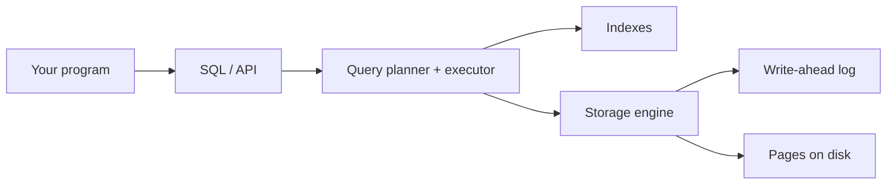

[Read This!](caveatemptor.md) |
  [Picolisp](picolisp.md) | [Picolisp Machine](pilmachine.md) | [Pil Sources](pilsource.md) |
  [Linux](linux.md) | [BASH](bash.md) |
  [C-Programmming](cprogramming.md) |   [Databases](databases.md) | [Javascipt](javascript.md) | [Python](python.md) |
  [Operating Systems](os.md) | [AssemblyLanguage](assemblylanguage.md) |
  [Computer Security](computersecurity.md) |
  [Firewalls](firewalls.md) |
  [Exploitation](exploitation.md) | [Social Engineering](internetexploitation.md) | [Metasploit](metasploit.md) |
  [Emacs](emacs.md) | [vim](vim.md) |
  [Pharo Smalltalk](pharo.md) |
 [Picolisp DB's](pildb.md)

# Databases

Here is the truth about databases: **persistence is hard, and "just write it to a file" becomes a nightmare the moment two writers, a crash or a query show up.** A database is the carefully engineered answer to those three problems.

### What it is, in plain words

A **database** is a system that stores data so that you can find it again, change it safely, and not lose it when the power goes out. A **database management system (DBMS)** is the software that provides that – PostgreSQL, SQLite, MySQL, Redis, MongoDB, PicoLisp's built-in DB.

The workhorse model is still the **relational** one: data in tables of rows and columns, queried with **SQL**, related by keys. Around it live other models that fit different shapes of data:

| Model | Good for | Examples |
|-------|----------|----------|
| Relational | structured records, joins, transactions | PostgreSQL, SQLite, MySQL |
| Key-value | caches, sessions, simple lookups | Redis, BoltDB |
| Document | JSON-shaped records | MongoDB, PostgreSQL JSONB |
| Wide-column | huge sparse tables | Cassandra, ScyllaDB |
| Graph | relationships as first-class data | Neo4j, EdgeDB |
| Embedded Lisp DB | tiny, transactional, in-process | [PicoLisp DB](pildb.md) |

### Why it matters

Almost every real program eventually needs to remember something: users, posts, configs, sensor readings. Get persistence wrong and you get corruption, lost writes, race conditions and outages. Get the *model* wrong and you spend years fighting your own schema. Understanding databases means choosing the right tool and sleeping at night.

### An everyday analogy: a library with a librarian

A pile of papers in a drawer is storage. A library is a database: a catalogue (the index) lets you find a book without scanning every shelf; the librarian (the DBMS) makes sure two people don't reshelve the same book at once; and there's a fireproof archive (write-ahead logging) so a fire in the reading room doesn't erase the collection. SQL is the polite form you fill in at the desk.



### A hands-on example: SQLite in five minutes

SQLite is a full relational database in a single file – no server. Perfect for learning, apps and even many production uses.

```bash
sudo xbps-install -S sqlite      # or: apt install sqlite3
sqlite3 blog.db
```

```sql
CREATE TABLE posts (
  id      INTEGER PRIMARY KEY,
  title   TEXT NOT NULL,
  body    TEXT NOT NULL,
  created TEXT DEFAULT (datetime('now'))
);

INSERT INTO posts (title, body) VALUES
  ('Hello', 'First post'),
  ('Lisp',  'Why PicoLisp keeps winning');

SELECT id, title, created FROM posts ORDER BY id DESC;

-- transactions: all or nothing
BEGIN;
UPDATE posts SET title = 'Hello, world' WHERE id = 1;
DELETE FROM posts WHERE id = 2;
COMMIT;          -- or ROLLBACK;
```

The same ideas in PostgreSQL (the open-source relational database I'd pick for anything networked):

```bash
sudo xbps-install -S postgresql
sudo -u postgres initdb -D /var/lib/postgres/data
# enable the service, then:
psql -U postgres -c "CREATE USER vikid WITH PASSWORD '…';"
psql -U postgres -c "CREATE DATABASE wiki OWNER vikid;"
psql -U vikid -d wiki -c 'CREATE TABLE posts (id SERIAL PRIMARY KEY, title TEXT);'
```

And in PicoLisp, persistence is a first-class language feature – entities and relations live in a transactional DB with almost no ceremony. See [PicoLisp DB](pildb.md).

### The words that actually matter

- **ACID** – Atomic, Consistent, Isolated, Durable: the contract of a serious transaction.
- **Index** – a data structure (usually a B-tree) that trades write cost and space for fast lookups. Index what you query; don't index everything.
- **Normalisation** – structuring tables so each fact lives in one place. Denormalise later, on purpose, for speed.
- **ORM** – an object-relational mapper (SQLAlchemy, ActiveRecord, Diesel). Handy; never an excuse to not know SQL.
- **CAP / distributed** – once data lives on several machines, you choose among consistency, availability and partition-tolerance. Systems like **CockroachDB** and Spanner push the "looks like one Postgres" experience across regions.

### Common misconceptions

- **"SQL databases can't scale."** PostgreSQL with decent indexes and connection pooling takes you astonishingly far. "Web scale" is rarely the real problem.
- **"NoSQL means no schema."** It means the database won't enforce one. Your application still has a schema – it's just implicit and easier to get wrong.
- **"ORMs free you from SQL."** Until you need a report, a window function or an `EXPLAIN`, and then you don't know how.
- **"A database is just files."** The files are the easy bit. Concurrency control, recovery and query planning are the hard bit.
- **"MongoDB is web scale / Postgres is old."** Both are mature, excellent tools with different sweet spots. Pick based on data shape and transactions, not fashion.

### Connections

- [PicoLisp DB](pildb.md) – a database that *is* the language.
- [PicoLisp](picolisp.md), [Python](python.md), [Databases](databases.md).
- [CockroachDB](https://www.cockroachlabs.com) – distributed SQL.
- [Computer Science](computerscience.md) – B-trees, query planners and transaction theory.

Persistance is a really headache, achieving it reliably in a distributed environment is a nightmare.

```

```

## Links, Sources and Reading List

- [CockroachDB](https://www.cockroachlabs.com)
- [Picolisp DB's](pildb.md)
- [MongoDB](mongodb.md "MISSING PAGE") --- [@ mongodb.com](https://www.mongodb.com/)
