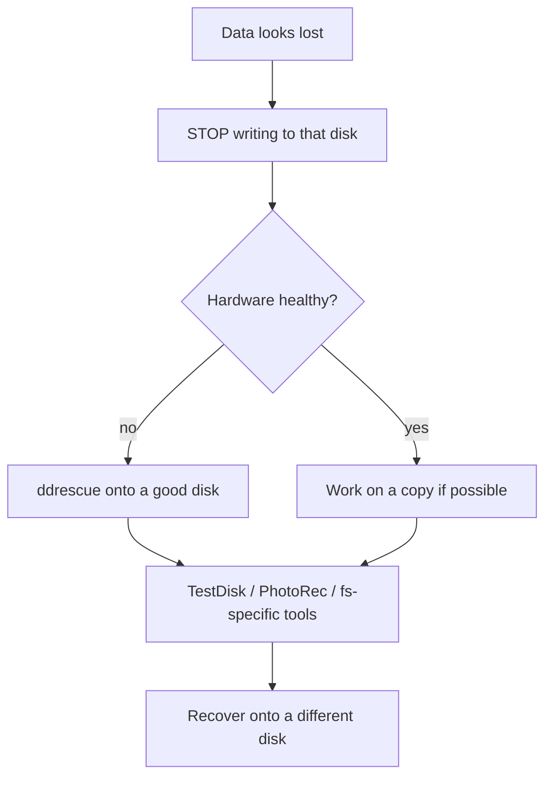

[Read This!](caveatemptor.md) |
  [Picolisp](picolisp.md) | [Picolisp Machine](pilmachine.md) | [Pil Sources](pilsource.md) |
  [Linux](linux.md) | [BASH](bash.md) |
  [C-Programmming](cprogramming.md) |
  [Operating Systems](os.md) |
  [Computer Security](computersecurity.md) | [ICSsecurity](icssecurity.md) |
  [Firewalls](firewalls.md) | [Networking](networking.md) | [Security Programs](securityprogram.md) |
 [Exploitation](exploitation.md) | [Social Engineering](internetexploitation.md) | [Metasploit](metasploit.md) | [wifi-penetration](wifipenetration.md) |
 [Forensics](forensics.md) | [Data Recovery](datarecovery.md)

# Data Recovery

Here is the uncomfortable truth about data recovery: **the moment you notice you've lost something, every further write to that disk may be destroying it.** Stop. Think. Then recover. Most "I undeleted my files" success stories start with that pause.

### What it is, in plain words

**Data recovery** is retrieving information that seems gone – deleted files, a formatted partition, a filesystem the OS won't mount, a drive that clicks. It works because "delete" usually means "forget the pointer", not "erase the bytes". Until those bytes are overwritten, a tool that understands the filesystem (or ignores it and carves raw content) can find them again.

Layers you might be dealing with:

1. **Trash / Recycle Bin** – not really lost. Just restore.
2. **Deleted files, filesystem intact** – `extundelete`, `ext4magic`, `testdisk`'s undelete, PhotoRec.
3. **Damaged partition table / filesystem** – TestDisk, `fsck` (carefully), backup superblocks.
4. **Failing hardware** – clone first with `ddrescue`, *then* recover from the clone.
5. **Truly overwritten or encrypted-without-key** – you're done. Physics and maths win.

### Why it matters

Everyone deletes the wrong directory once. Backups (and remembering to test them) are the real answer; recovery tools are the ambulance. Knowing the ambulance exists – and how not to run over the patient on the way – turns a panic into a procedure.

### An everyday analogy: a library card catalogue

Throwing away the catalogue card for a book doesn't burn the book. It just makes it hard to find. Recovery tools walk the shelves looking for books that no longer have cards. But if you keep shelving *new* books on top of the old ones, the lost book gets buried for good. That's why you stop writing to the disk.



### A hands-on example: the safe procedure

**1. Stop using the affected disk.** If it's the system disk, shut down and boot from a live USB (Void live, SystemRescue, Ubuntu live).

**2. If the drive makes noises or is dying, clone it first:**

```bash
sudo xbps-install -S ddrescue
sudo ddrescue -f -n /dev/sdX /path/to/bigdisk/image.img /path/to/bigdisk/image.map
sudo ddrescue -d -r3 /dev/sdX /path/to/bigdisk/image.img /path/to/bigdisk/image.map
# work only on image.img from here on
```

**3. Try TestDisk** for lost partitions and some undeletes:

```bash
sudo testdisk /path/to/image.img
# or: sudo testdisk /dev/sdXn
```

Walk through: select the disk → partition table type (usually Intel) → Analyse → Quick Search → deeper search if needed → write a recovered table only when you're sure.

**4. PhotoRec** (same authors) ignores the filesystem and carves files by signature – great for photos, documents, archives when the directory is toast. Recover *onto a different disk*.

**5. For an ext4 file deleted recently**, with the filesystem unmounted:

```bash
sudo extundelete /dev/sdXn --restore-file home/vikid/thesis.tex
# or --restore-directory home/vikid/Projects
# or --restore-all
```

Output lands in `./RECOVERED_FILES/`. Success rates drop fast on busy root filesystems; they stay high on large, quiet data disks.

**6. Backups going forward** – the real fix:

```bash
# example: restic to an external drive or S3-compatible store
restic -r /mnt/backup backup ~/Documents ~/Projects
restic -r /mnt/backup check
```

Or Syncthing, Borg, `rsync` to another machine. A backup you've never restored from is a hope, not a backup – test once a year.

### Common misconceptions

- **"`rm -rf` securely erases."** No, it unlinks. Use `shred` or `srm` if you need overwriting (and know that SSDs with wear-levelling may not cooperate).
- **"`fsck` recovers files."** `fsck` repairs *structure*. It can also delete orphaned data into `lost+found`. Don't run it hoping for undelete.
- **"Recovery software is magic."** It can't resurrect overwritten sectors. SSDs especially get trimmed.
- **"Professional recovery is a scam."** For mechanical failure (clicking drives, head crashes), a clean-room service genuinely can do things software can't. Prices are high because the work is.
- **"Cloud sync is a backup."** Ransomware and accidental deletes sync too. Keep a versioned, offline or append-only copy.

### When to call a professional

If the drive clicks, smells of burnt electronics, or has suffered physical trauma, stop and get a quote from a clean-room recovery service before running more software. Further power cycles can finish what the failure started. For logical damage (deleted files, bad partitions) on healthy hardware, the tools above are what the professionals start with too.

### Connections

- [ncdu](ncdu.md) – find what's eating disk *before* you delete the wrong thing.
- [Files and Directories](filesanddirectories.md) – what "unlink" actually means.
- [Linux Tools](linuxtools.md) – `dd`, `lsblk` and friends.
- [Encryption](encryption.md) – encrypted disks can't be carved without the key.
