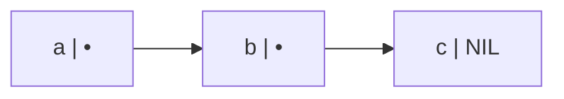

# Find Boxes in Lists

Here is the truth about lists in PicoLisp: **there are no lists. There are only boxes with two slots, pointing at other boxes.** A "list" is just the name we give to a chain of them. Once you can see the boxes, every list function stops being a thing to memorise and becomes a thing you could have written yourself.

### What it is, in plain words

PicoLisp is built from a single data structure, the **cell**. A cell is two machine words side by side. The first is the **CAR**, the second the **CDR**. Each slot holds either a number, a symbol, or a pointer to another cell.

A list is a chain of cells where each CAR holds an element and each CDR points to the next cell. The last CDR holds `NIL`, which says "the chain ends here".

```
(a b c)

 +-----+-----+     +-----+-----+     +-----+-----+
 |  a  |  ---+---->|  b  |  ---+---->|  c  | NIL |
 +-----+-----+     +-----+-----+     +-----+-----+
```

"Finding a box" means walking that chain to the cell you want, then taking its CAR (the thing in it) or keeping the cell itself (the rest of the list from there).



### Why it matters

- **Speed sense.** Getting the first element is instant. Getting the thousandth means walking a thousand boxes. Lists are not arrays, and the boxes explain why.
- **Sharing.** `(cdr L)` does not copy anything. It hands you a pointer into the same chain. Change a box destructively and every list that shares it sees the change. That is a feature when you mean it and a bug when you do not.
- **Everything is a list.** In PicoLisp code *is* data. Function definitions, database objects, property lists and the program you are typing are all made of these same cells. Learn to find boxes and you can read and rewrite programs too.

### An everyday analogy: a treasure hunt

Each box is an envelope. Inside is a prize (the CAR) and a note saying where the next envelope is hidden (the CDR). The last note says "the end" (NIL). To get the third prize you have to open the first two envelopes. You cannot jump straight to envelope three, but you can hand a friend envelope two and they have the whole rest of the hunt.

## Picking Boxes

### car, cdr & all that

`car` gives you what is in the first box. `cdr` gives you the rest of the chain. They compose: `cadr` is "the car of the cdr", the second element; `cddr` drops two boxes; PicoLisp gives you every combination up to four letters deep (`caddr`, `cdddr`, and so on).

```picolisp
: (setq L '(a b c d e))
-> (a b c d e)
: (car L)
-> a
: (cdr L)
-> (b c d e)
: (cadr L)          # second element
-> b
: (cddr L)          # drop two boxes
-> (c d e)
: (caddr L)         # third element
-> c
```

Read the middle letters right to left: `caddr` is `car` of `cdr` of `cdr`. See [car-style functions](clfunctions.md) in Common Lisp for the same family; the names go back to registers on the IBM 704 in the 1950s.

### heads & tails

When you want more than one box, use `head` and `tail`. `head` copies the first N elements into a new list. `tail` gives you the last N, and because it is a pointer into the original chain, it copies nothing.

```picolisp
: (head 2 L)
-> (a b)
: (tail 2 L)
-> (d e)
: (head -2 L)       # all but the last two
-> (a b c)
: (last L)          # last element
-> e
```

Negative counts flip the meaning: `(head -2 L)` is "everything except the last two". `(tail -1 L)` is "everything except the first".

### nth

`nth` walks to the Nth **box** and returns that cell, which means the rest of the list from there. `get` with a number walks the same way but returns the **element**.

```picolisp
: (nth L 3)
-> (c d e)
: (car (nth L 3))
-> c
: (get L 3)
-> c
```

Because `nth` returns the cell itself, you can change the list in place through it:

```picolisp
: (set (nth L 3) 'X)
-> X
: L
-> (a b X d e)
```

That is the box model paying off. You found the box, then you changed what is in it.

### Finding by content, not position

Often you do not know the position, only what you are looking for.

```picolisp
: (member 'c '(a b c d))          # returns the box holding c
-> (c d)
: (find '((N) (> N 10)) (3 7 12 40))
-> 12
: (seek '((L) (> (car L) 10)) (3 7 12 40))
-> (12 40)
: (assoc "b" '(("a" . 1) ("b" . 2)))
-> ("b" . 2)
```

`member` and `seek` return the **box** (useful for editing or continuing from there). `find` returns the **element**. `assoc` is for association lists, lists of `(key . value)` pairs.

### Common misconceptions

- **"`nth` and `get` do the same thing."** One returns the cell, the other the contents. Mixing them up is the classic beginner bug.
- **"`cdr` copies the rest of the list."** It never copies. It returns a pointer into the same chain.
- **"Lists are slow."** Walking to position N is slow. Pushing onto the front, popping, mapping and recursing down a list are all as fast as anything gets. Choose the right shape for the job, and see [Data Structures and Algorithms](datastructuresandalgorithms.md) for the trade-offs.
- **"A dotted pair is a broken list."** `(a . b)` is just a single cell whose CDR is a symbol instead of another cell. Association lists are built from them on purpose.

### Connections

- [PicoLisp](picolisp.md), [The Vikid PicoLisp Tutorial](pltutorial.md), [PicoLisp Tutorials](piltutorials.md).
- [box](plbox.md) – how to create brand-new anonymous symbols, the other kind of "box".
- [The PicoLisp Machine](pilmachine.md) – how cells sit in memory.
- [Common Lisp](commonlisp.md), [Scheme](scheme.md), [Lambda Calculus](lambdacalculus.md) – the same boxes in other Lisps.
