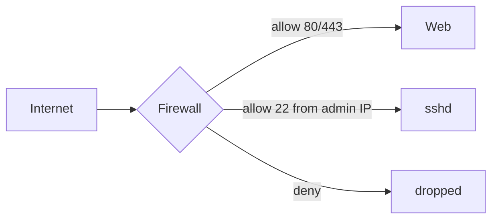

[Picolisp](picolisp.md) | [Picolisp Machine](pilmachine.md) | [Pil Sources](pilsource.md) |
  [Linux](linux.md) | [BASH](bash.md) |
  [C-Programmming](cprogramming.md) |
  [Operating Systems](os.md) |
  [Javascipt](javascript.md) |
  [Emacs](emacs.md)  | [vim](vim.md) |
  [Pharo Smalltalk](pharo.md) |
  [Computer Security](computersecurity.md) |
  [Python](python.md) |
  [The Compiler](thecompiler.md) |
  [Identifiers](identifier.md) |
  [Literals](literals.md) |
  [storage_linkage](storagelinkage.md) |
  [Firewalls](firewalls.md)

# Firewalls

Here is the truth about firewalls: **they are not a magic shield – they are deliberate rules about who may speak to whom.** A misconfigured firewall is either a locked door with the window open, or a doorstop.

### What it is, in plain words

A **firewall** filters network traffic according to rules. It can run:

- on a **host** (iptables/nftables, Windows Firewall, `pf` on BSD);
- on a **network edge** (router, cloud security group, dedicated appliance);
- or as a **service mesh / reverse proxy** layer that understands HTTP.

Rules match on addresses, ports, protocols, interfaces and sometimes application data (next-generation / layer-7 firewalls). Default posture should be **deny inbound, allow established outbound**, then open only what you need.

Related pages on this site dig into flavours: [packet filtering](packetfilteringfirewall.md), [stateful](statefullfirewall.md), [stateless](statelessfirewall.md), [circuit-level](circuitlevelfirewall.md), [application proxy](applicationproxy.md), [NG firewall](ngfirewall.md).

### Why it matters

Every open port is a promise: "I am running something here and I will keep it patched." Firewalls make those promises conscious. Combined with [SSH hardening](sshlogin.md) and minimal services, they turn a noisy internet into background radiation your box ignores.

### An everyday analogy: a nightclub door

The bouncer (firewall) checks ID and guest list (rules). Regulars already inside can go to the bar and back (established connections). Random people off the street don't get in just because they knock on every door (port scan). A VIP pass for the kitchen (port 22 for your IP only) is safer than opening the kitchen to the street.



### A hands-on example: nftables on a small server

```bash
sudo nft flush ruleset
sudo nft -f - <<'EOF'
table inet filter {
  chain input {
    type filter hook input priority 0; policy drop;
    ct state established,related accept
    iif lo accept
    ip protocol icmp accept
    ip6 nexthdr icmpv6 accept
    tcp dport { 80, 443 } accept
    tcp dport 22 ip saddr 203.0.113.10 accept
  }
  chain forward {
    type filter hook forward priority 0; policy drop;
  }
  chain output {
    type filter hook output priority 0; policy accept;
  }
}
EOF
sudo nft list ruleset
```

On Ubuntu, **UFW** is a friendlier front end:

```bash
sudo ufw default deny incoming
sudo ufw default allow outgoing
sudo ufw allow 80/tcp
sudo ufw allow 443/tcp
sudo ufw allow from 203.0.113.10 to any port 22
sudo ufw enable
```

Cloud providers add another layer (security groups / cloud firewalls). Use both: cloud rules as the outer fence, host rules as the inner.

### Logging and rate limiting

A silent firewall makes debugging hard. Log *new* drops sparingly (not every scan packet) or you'll fill the disk:

```bash
sudo nft add rule inet filter input tcp dport 22 ct state new limit rate 10/minute accept
sudo nft add rule inet filter input log prefix "drop: " flags all counter drop
```

Watch with `journalctl -k -f` or your nft/ulogd pipeline. Rate limits on SSH and connection tracking of weird traffic buy time against brute force without locking you out of your own box – keep a console or out-of-band path ready.

### Common misconceptions

- **"Firewall = antivirus."** Different jobs. One filters packets; the other hunts malware.
- **"Once it's set, forget it."** Rules rot. Review when you add services.
- **"Blocking ping increases security."** Mostly obscurity; breaks diagnostics. Rate-limit if needed.
- **"Stateful means deep packet inspection."** Stateful means tracking connections. DPI is a different (heavier) feature.
- **"I have a firewall, so I'm safe."** It won't fix weak passwords, 0-days in exposed apps, or an attacker who phished your admin.

### Connections

- [Packet filtering](packetfilteringfirewall.md), [Stateful](statefullfirewall.md), [Stateless](statelessfirewall.md).
- [Linux Security](linuxsecurity.md), [Computer Security](computersecurity.md), [Networking](networking.md).
- [Online VPS](onlinevps.md), [SSH Login](sshlogin.md).

- [ What is a firewall?](https://www.paloaltonetworks.com/documentation/glossary/what-is-a-firewall
  )
- [ Implement your own firewall in C](http://www.roman10.net/2011/07/23/a-linux-firewall-using-netfilter-part-1overview/
  )

## Types of Firewalls

- [PacketFilteringFireWall](packetfilteringfirewall.md)
- [StatelessFirewall](statelessfirewall.md)
- [StatefullFirewall](statefullfirewall.md)
- [Circuit-Level-Firewall](circuitlevelfirewall.md)
- [Application-Proxy](applicationproxy.md)

## UFW

The Uncomplicated Firewall (ufw) is a frontend for iptables and is particularly well-suited for host-based firewalls.

- [Ubuntu Article](https://wiki.ubuntu.com/UncomplicatedFirewall)
    [ Dreamhost Article on UFW Firewall](https://www.digitalocean.com/community/tutorials/how-to-set-up-a-firewall-with-ufw-on-ubuntu-14-04
  )
