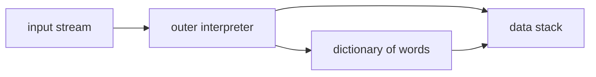

[Algorithms](algorithms.md) | [Apple](apple.md) | [AssemblyLanguage](assemblylanguage.md) |
[BASH](bash.md)  |   [Bash Cookbook](vikidsbashcookbook.md)  |
[C-Programmming](cprogramming.md) | [CommonLisp](commonlisp.md) | [Computer Security](computersecurity.md) | [CuisSmalltalk](cuissmalltalk.md) |
[Databases](databases.md) | [Emacs](emacs.md) |  [Exploitation](exploitation.md) | [Firewalls](firewalls.md) |
[Forth](forth.md) | [Fortran](fortran.md) | [Functional Programming](functional.md) |
[Git](git.md) | [GNUSmalltalk](gnusmalltalk.md) | [Haskell](haskell.md) |  [Javascript](javascript.md) |  [Julia](julia.md) |
[Linux](linux.md) | [Machine Learning](machinelearning.md) | [Metasploit](metasploit.md) |[Machine Learning](machinelearning.md) |
[Networking](networking.md) | [Operating Systems](os.md) | [Open Data Science](opendatascience.md) | [Odin](odin.md) |
[Picolisp](picolisp.md) | [Pharo Smalltalk](pharo.md) | [Purescript](purescript.md) | [Python](python.md) |
[Racket](racket.md) | [Rust](rust.md)| [Scheme](scheme.md)  | [Social Engineering](internetexploitation.md)  |
[Unity](unity.md) | [vim](vim.md) | [V](vlang.md) |
[Web Development](webdevelopment.md) | [Windows](windows.md) |[Zig](ziglang.md)

# Forth

Here is the truth about Forth: **it is a language that barely exists until you write it.** A tiny core of stack operations, and then every new word you define becomes part of the language. Few systems take "grow your own" this literally – PicoLisp is one; Forth is another.

### What it is, in plain words

**Forth** was created by Charles Moore in the early 1970s. It is a **stack-based**, concatenative language: you push numbers onto a data stack, and **words** (functions) consume and produce stack values. Source looks like this:

```forth
3 4 + .          \ prints 7
: square ( n -- n^2 )  dup * ;
5 square .       \ prints 25
```

There is almost no syntax. Words are separated by spaces. `: name … ;` defines a new word. Everything else is convention. Implementations are famously tiny – a working Forth can fit in a few kilobytes – which is why it conquered embedded systems, bootloaders (Open Firmware), NASA instruments and hobby microcontrollers.

Modern free Forths include **Gforth** (GNU), **SwapForth**, **Mecrisp** (for ARM Cortex-M), and **Factor** (a richer concatenative cousin).

### Why it matters

Forth is a masterclass in minimalism and interactivity. You build programs bottom-up, testing each word at the REPL as you go – the same joy as Lisp, with a completely different texture. If you care about small systems, language design, or how a REPL can *be* the system, Forth is worth a weekend. Moore's aesthetic – extreme simplicity, direct hardware control – rhymes with why some of us prefer Void, runit and PicoLisp.

### An everyday analogy: a RPN calculator that grows new buttons

A reverse-Polish calculator: type `3 4 +`. Now imagine you can etch a new button labelled `SQUARE` that means `dup *`. Then a button that uses `SQUARE`. Keep etching. That's Forth – a calculator whose panel you extend until the panel *is* your program.



### A hands-on example

```bash
sudo xbps-install -S gforth     # or: apt install gforth
gforth
```

```forth
\ stack effect comments: ( inputs -- outputs )
: square ( n -- n^2 )  dup * ;
: sum-of-squares ( a b -- n )  square swap square + ;

3 4 sum-of-squares . cr          \ 25

\ conditionals and loops
: fizzbuzz ( n -- )
  1+ 1 do
    i 15 mod 0= if ." FizzBuzz "
    else i 3 mod 0= if ." Fizz "
    else i 5 mod 0= if ." Buzz "
    else i . then then then
  loop cr ;
20 fizzbuzz

\ create a tiny "database" – a defining word
: cell: ( n "name" -- )  create ,  does> @ ;
100 cell: limit
limit . cr                       \ 100
```

The `does>` family – words that create other words with custom behaviour – is Forth's meta-power, analogous to Lisp macros in spirit if not in mechanism.

Talking to hardware (conceptual – Mecrisp on a microcontroller):

```forth
: led-on   ( -- )  1 25 io! ;
: led-off  ( -- )  0 25 io! ;
: blink    ( -- )  begin led-on 200 ms led-off 200 ms key? until ;
```

### Why the stack does not drive you mad

Beginners fear losing track of the stack. The discipline that prevents it:

1. Keep words tiny – three to five operations.
2. Always write the stack-effect comment `( in -- out )`.
3. Prefer named locals / `value` where your Forth supports them for longer words.
4. Test every word at the prompt before building on it.

That last point is Forth culture: the REPL is not a luxury, it is the method.

### Common misconceptions

- **"It's only historical."** Embedded Forths are still used; the concatenative ideas live on in Factor, Joy, and stack VMs.
- **"Stack languages are unreadable."** Discipline with stack-effect comments `( a b -- c )` and small words keeps them clear. Spaghetti stacks are a style problem, not a language destiny.
- **"No types means chaos."** Most Forths are untyped; some (like Typed Forth research, or Factor's methods) add structure. Correctness comes from tiny tested words.
- **"Forth lost to C."** For desktop apps, yes. For tiny machines and interactive hardware bring-up, Forth remains unmatched in density.
- **"It's like assembly."** It's higher-level than assembly, lower-level than C, and more interactive than either.

### Connections

- [PicoLisp](picolisp.md) – another tiny, growable language with a REPL at its heart.
- [Assembly Language](assemblylanguage.md) – when you drop even lower.
- [Functional Programming](functional.md) – concatenative style is composition of functions.
- [Raspberry Pi](rasberrypi.md) / [Cool Hardware](coolhardware.md) – where small languages shine.

- [Snapcraft:Install Forth](https://snapcraft.io/install/gforth/manjaro)
- [gforth.org](https://gforth.org)
- [gforth:Manual](https://gforth.org/manual/index.html#SEC_Contents)
- [forth-standard](https://forth-standard.org)
- [Complang:Tutorial](https://www.complang.tuwien.ac.at/forth/gforth/Docs-html/Tutorial.html)
- [Forth Words](https://www.complang.tuwien.ac.at/forth/gforth/Docs-html/Words.html#Words)
- <!-- 
  -{^{https://www.complang.tuwien.ac.at/forth/gforth/Docs-html/Words.html#Words Forth Words}}
  -{^{}}
  -{^{}}
  -{^{}}
   -->
