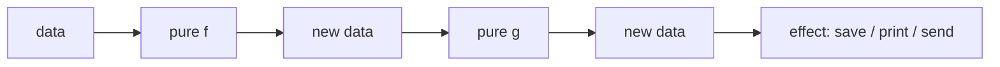

[Read This!](caveatemptor.md) | [Algorithms](algorithms.md) | [AssemblyLanguage](assemblylanguage.md) | [BASH](bash.md) |   [C-Programmming](cprogramming.md) |
[Computer Security](computersecurity.md) |  [Databases](databases.md) | [Emacs](emacs.md) |  [Exploitation](exploitation.md) | [Functional Programming](functional.md) |
[Firewalls](firewalls.md) |   [Git](git.md) | [Javascipt](javascript.md) | [Julia](julia.md) | [Social Engineering](internetexploitation.md) |
[Picolisp](picolisp.md) | [Pharo Smalltalk](pharo.md) | [Linux](linux.md) | [Python](python.md) | [Operating Systems](os.md) |
[Machine Learning](machinelearning.md) | [Metasploit](metasploit.md) |  [Open Data Science](opendatascience.md) |
[Networking](networking.md) | [Machine Learning](machinelearning.md) |[Scheme](scheme.md) | [Unity](unity.md) | [vim](vim.md) | [Web Development](webdevelopment.md)

# Functional Programming

## Functional Programming

Here is the truth functional programming keeps repeating until it sinks in: **if you stop changing things, most of your bugs disappear.** You write functions that take values and return new values, and you build programs by composing them.

### What it is, in plain words

**Functional programming (FP)** is a style – and in its pure form, a paradigm – that treats computation as the evaluation of mathematical functions. Its habits:

- **Pure functions** – same inputs always give the same outputs; no hidden side effects.
- **Immutability** – don't change data; produce new data.
- **First-class functions** – pass them, return them, store them. (See [lambda calculus](lambdacalculus.md).)
- **Composition** – build small functions, combine them into larger ones.
- **Expressions over statements** – everything returns a value; prefer `let result = if …` to chains of assignments.

Languages that push you hard in this direction: [Haskell](haskell.md), [PureScript](purescript.md), Elm, OCaml, F#. Languages that make FP pleasant and practical: [Scheme](scheme.md), [Racket](racket.md), [Common Lisp](commonlisp.md), [PicoLisp](picolisp.md), Clojure, Erlang/Elixir, [Rust](rust.md), Kotlin, and modern [JavaScript](javascript.md) / [Python](python.md).

### Why it matters

Mutable state + concurrency = pain. Mutable state + large teams = pain. FP doesn't eliminate state – a useful program must interact with the world – but it *pushes state to the edges* and keeps the core of the program predictable and testable. Even if you never write Haskell, the habit of asking "can this be a pure function?" improves every language you touch.

### An everyday analogy: recipes versus a shared whiteboard

An imperative program is a crew sharing one whiteboard: anyone can erase and rewrite a number, and you spend meetings asking who changed it. A functional program is a kitchen of recipes: each recipe takes ingredients and produces a dish; recipes don't overwrite each other. If the cake is wrong, you look at one recipe, not at every hand that held the chalk.



### A hands-on example

The same idea in three languages. Sum of squares of the even numbers up to `n`:

**Haskell (pure, lazy):**

```haskell
sumOfEvenSquares :: Int -> Int
sumOfEvenSquares n =
  sum [x * x | x <- [1..n], even x]
```

**PicoLisp (the joy of small Lisp):**

```lisp
(de sum-of-even-squares (N)
   (sum '((X) (* X X))
      (filter '((X) (=0 (% X 2))) (range 1 N)) ) )

(sum-of-even-squares 10)   # -> 220
```

**JavaScript:**

```js
const sumOfEvenSquares = n =>
  Array.from({ length: n }, (_, i) => i + 1)
    .filter(x => x % 2 === 0)
    .map(x => x * x)
    .reduce((a, b) => a + b, 0);
```

**Python:**

```python
def sum_of_even_squares(n: int) -> int:
    return sum(x * x for x in range(1, n + 1) if x % 2 == 0)
```

Notice what's absent: no mutable accumulator you manage yourself, no index variables, no chance of an off-by-one in a loop. (`sum`/`reduce` hides the accumulator in a well-tested place.)

### Core vocabulary

- **map** – transform each element: `map square xs`.
- **filter** – keep elements that pass a test.
- **fold / reduce** – collapse a collection to one value with a combining function.
- **closure** – a function that remembers the environment where it was born ([JS scope](jsscope.md)).
- **Higher-order function** – takes or returns functions.
- **Referential transparency** – any expression can be replaced by its value without changing meaning. Pure functions give you this.
- **Monad / effect types** – a way (in Haskell, PureScript, Rust's `Result`/`Option`) to keep effects visible in the type signature so purity stays honest.

### FP is a spectrum

You don't have to go full Haskell. Useful waypoints:

1. Write pure functions where you can; push I/O to the edges.
2. Prefer immutable data (`const`, persistent collections).
3. Reach for map/filter/reduce before `for`.
4. Model absence and failure with `Option`/`Maybe` and `Result`/`Either`, not nulls and thrown exceptions.
5. Learn a real FP language for a month – it permanently changes how you write the others.

### Common misconceptions

- **"FP means no side effects at all."** It means *controlling* them. Haskell programs print and talk to networks all day; the types say where.
- **"FP is slow."** Modern compilers inline and optimise aggressively; immutability enables safe parallelism. Sometimes mutable arrays win – use them at the edges.
- **"You must use recursion instead of loops."** Iteration with `map`/`fold` is recursion in a nicer suit. Tail-call optimisation matters in some languages and not others.
- **"FP is academic."** React, Redux, Spark, Erlang phone switches and most of Elm's production users disagree.
- **"Lisp is functional."** Lisp is multi-paradigm. It *invented* first-class functions; it doesn't force purity. That's a feature.

### Connections

- [Lambda Calculus](lambdacalculus.md) – the mathematics underneath.
- [Haskell](haskell.md), [PureScript](purescript.md), [Scheme](scheme.md), [PicoLisp](picolisp.md), [Common Lisp](commonlisp.md).
- [JavaScript Functions](jsfunctions.md) and [Scope](jsscope.md) – FP idioms in the browser.
- [Rust](rust.md) – iterators, `Result`, immutability by default.

- Function Calls are the primary construct.
- A name is associated with one value only. It is not a 'variable'.
- New values are associated with new names through recursive function calling
- Functions are values
- It is execution order agnostic
- [Lambda Calculus](lambdacalculus.md)
