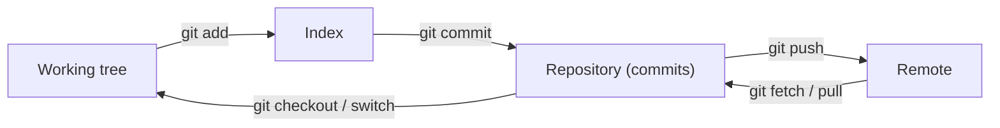

[Read This!](caveatemptor.md) |
  [Picolisp](picolisp.md) | [Picolisp Machine](pilmachine.md) | [Pil Sources](pilsource.md) |
  [Linux](linux.md) | [BASH](bash.md) |
  [C-Programmming](cprogramming.md) | [Javascipt](javascript.md) | [Python](python.md) | [Scheme](scheme.md) |
  [Operating Systems](os.md) | [AssemblyLanguage](assemblylanguage.md) |
  [Computer Security](computersecurity.md) |
  [Firewalls](firewalls.md) |
  [Exploitation](exploitation.md) | [Social Engineering](internetexploitation.md) | [Metasploit](metasploit.md) |
  [Emacs](emacs.md) | [vim](vim.md) |
  [Pharo Smalltalk](pharo.md) |
  [Databases](databases.md) | [Networking](networking.md) | [Machine Learning](machinelearning.md) |
  [Git](git.md)

# Git

Here is the truth about Git that finally made it click for me: **it is not a backup tool and not a file-sync tool – it is a content-addressed database of snapshots, with pointers.** Once you see the graph of commits, every confusing command becomes a way of moving those pointers around.

### What it is, in plain words

**Git** is a distributed version-control system created by Linus Torvalds in 2005 to manage the Linux kernel. "Distributed" means every clone has the full history; there is no required central server. GitHub, Codeberg, GitLab and the like are just convenient places to put a clone and talk about it.

The three places your work lives:

1. **Working tree** – the files you edit.
2. **Index (staging area)** – the next snapshot you're building, file by file.
3. **Repository (`.git/`)** – the database of commits, tags and branches.

A **commit** is a snapshot of the index, with a pointer to its parent commit(s), an author, a message, and a hash. A **branch** is a movable pointer to a commit. `HEAD` is a pointer to the branch (or commit) you're on.



### Why it matters

Almost every piece of software you'll touch is in Git. Knowing it means you can explore history, undo mistakes safely, collaborate without overwriting each other, and understand *how* a codebase grew. It also teaches a useful habit: make small, honest commits that each say one thing.

### An everyday analogy: a sketchbook with sticky notes

Each commit is a photograph of your sketchbook. Branches are sticky notes saying "this is where the dragon drawing is" or "this is the colour-test page". Merging is photocopying two pages onto a new one. The remote is a spare sketchbook in a friend's studio that you occasionally sync with.

### A hands-on example: the everyday loop

```bash
git clone git@github.com:vukini/thevikidtruth.com.git
cd thevikidtruth.com
git status                          # what's different?
git switch -c topic/fix-page     # new branch (modern; was git checkout -b)

# edit files…
git add content/computing/git.md
git commit -m "Computing: write Git page"
git pull --rebase origin main       # update first – important on shared main
git push -u origin HEAD
```

Useful daily commands:

```bash
git log --oneline --graph --decorate -20
git diff                            # unstaged
git diff --staged                   # staged
git show HEAD                       # last commit
git blame content/computing/git.md  # who last touched each line
git stash push -m "wip"             # set work aside
git stash pop
```

Undo, carefully:

```bash
git restore file.md                 # throw away unstaged edits
git restore --staged file.md        # unstage, keep edits
git revert HEAD                     # new commit that undoes the last one (safe for shared history)
git reset --soft HEAD~1             # undo last commit, keep changes staged
# git reset --hard and git push --force: only on branches nobody else has pulled
```

### Remotes, rebase and merge

`git pull` is `git fetch` + either merge or rebase. Rebase replays your commits on top of the updated branch – a cleaner history, which is why this site's workflow uses `git pull --rebase` before every push. Never rebase commits that other people already have; use merge (or revert) for those.

```bash
git remote -v
git fetch origin
git switch main && git pull --rebase
git switch topic/fix-page && git rebase main
```

### Submodules and subtrees, briefly

Sometimes you need one repository inside another. **Submodules** pin an external repo at a specific commit:

```bash
git submodule add https://github.com/example/lib.git vendor/lib
git submodule update --init --recursive   # after clone
```

They work, but have sharp edges (a clone doesn't fetch them unless you ask). For many cases, copying the code in with `git subtree` or just using a package manager is happier. Reach for submodules when you truly need to track an upstream at a pinned revision.

### Common misconceptions

- **"`git pull` is the opposite of `git push`."** Pull is fetch + integrate. Push sends your commits. They're not symmetric.
- **"Branches are copies of files."** They're 41-byte pointers. Creating a branch is instant.
- **"Merge commits are bad."** They're honest. Rebase is for keeping *your local* history tidy before sharing.
- **"`git clone` downloads the latest files."** It downloads the *entire history*.
- **"Force-push is always wrong."** It's wrong on shared branches. On your own feature branch, `git push --force-with-lease` (safer than `--force`) is normal after a rebase.

### Connections

- [Linux Tools](linuxtools.md) – Git sits in the everyday toolbox.
- [BASH](bash.md) – scripting around Git.
- [Source control and this site](bciyh.md) – how Vikix and this site are built.
- [Git](https://git-scm.com/book/en/v2) – the free Pro Git book, still the best deep reference.

To update your local repository with remote repository you can use:

```
git pull

git pull origin <branch_name>
```

## Sources, Links & Reading Lists

- Pro Git Reedited Jon Forrest
- [Git Submodules](https://www.w3docs.com/snippets/git/how-to-pull-the-latest-git-submodule.html)
- [Do you really know Git?](https://www.youtube.com/watch?v=gFb9BaBZ8ko)
- [Git Branching and Merging](https://www.youtube.com/watch?v=to6tIdy5rNc)
