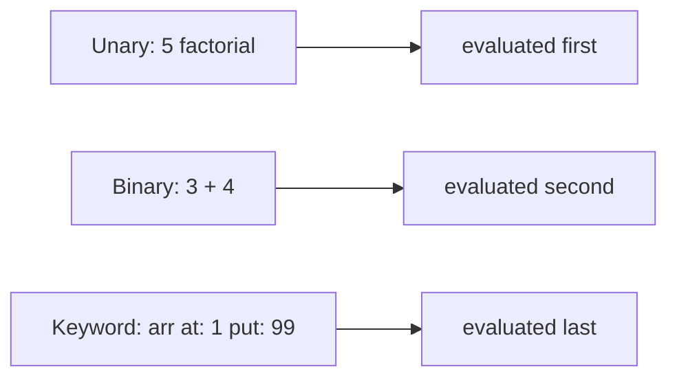

[Read This!](caveatemptor.md) | | [Quick Links](quicklinks.md) | [Algorithms](algorithms.md) | [AssemblyLanguage](assemblylanguage.md) | [BASH](bash.md) |   [C-Programmming](cprogramming.md) |
[CommonLisp](commonlisp.md) |
[Computer Security](computersecurity.md) |  [Databases](databases.md) | [Emacs](emacs.md) |  [Exploitation](exploitation.md) |
[Functional Programming](functional.md) |
[Firewalls](firewalls.md) |   [Git](git.md) | [Smalltalk](gnu.md "MISSING PAGE") | [Haskell](haskell.md) | [Javascript](javascript.md) |  [Julia](julia.md) |
[Linux](linux.md) | [Machine Learning](machinelearning.md) | [Metasploit](metasploit.md) |[Machine Learning](machinelearning.md) |
[Networking](networking.md) | [Operating Systems](os.md) |[Open Data Science](opendatascience.md) | [Odin](odin.md) |
[Picolisp](picolisp.md) | [Pharo Smalltalk](pharo.md) | [Purescript](purescript.md) |
[Python](python.md) |
[Racket](racket.md) | [Scheme](scheme.md) | [Social Engineering](internetexploitation.md) |
[Unity](unity.md) | [vim](vim.md) | [V](vlang.md) |
[Web Development](webdevelopment.md) | [Windows WSL](windowswsl.md) | [Zig](ziglang.md)

# GNU Smalltalk

Here's the truth about GNU Smalltalk: **it's Smalltalk without the world around it** – no windows, no image browser, just the language in a terminal, run like a script. That makes it the quickest way to taste Smalltalk's ideas, and also explains why most people eventually move on to [Pharo](pharo.md) or [Cuis](cuissmalltalk.md).

### What it is, in plain words

**GNU Smalltalk** (`gst`) is the GNU Project's free implementation of Smalltalk-80. Where classic Smalltalks are visual environments you live inside, gst is **file- and command-line oriented**: you write `.st` files in a text editor and run them, like Python or Perl. It still has an image (a saved snapshot of all objects) underneath, a JIT-capable virtual machine, and a decent class library, including streams, collections, sockets and a C interface.

An honest 2026 status note: the last stable release is **3.2.5 (2013)**. Development since then has been sporadic, mostly on the Git master branch. Many distributions still package it (Debian and Ubuntu as `gnu-smalltalk`; elsewhere it builds from source with the usual `./configure && make`), and it still works well for learning and scripting, but for active projects the living Smalltalks are Pharo, Cuis and Squeak.

### Why it matters

Smalltalk is where many things we now take for granted were born or refined: everything-is-an-object, message passing, the class browser, unit testing (SUnit, ancestor of JUnit), refactoring tools, and the Model-View-Controller pattern. GNU Smalltalk lets you learn the **language** without first having to learn an unusual **environment**. If a GUI-first image feels strange, start here, then graduate.

### An everyday analogy: learning a language by reading letters

Pharo is like moving to the country and living with a family: total immersion, a bit overwhelming at first. GNU Smalltalk is like learning the same language through letters and a dictionary at your own desk. Slower to fluency, but nothing about the setting gets in your way.

### The core idea: everything is a message

In Smalltalk you never "call a function". You **send a message** to an object, and the object decides what to do. There are three kinds:



Precedence is unary, then binary, then keyword – always left to right within each kind. That means `2 + 3 * 4` is **20**, not 14. There is no special maths precedence; `*` is just another message.

### A hands-on example

Install and start the REPL:

```bash
sudo apt install gnu-smalltalk   # Debian/Ubuntu; or build from source
gst
```

Try some expressions (in the REPL each line is evaluated as you press Enter):

```smalltalk
3 + 4 * 2.                       "14 – left to right: (3+4)*2"
100 factorial printString size.  "158 digits – big integers are automatic"
#(3 1 4 1 5) asSortedCollection asArray.   "(1 1 3 4 5 )"
'Void Linux' reversed.           "'xuniL dioV'"
(1 to: 10) inject: 0 into: [:sum :each | sum + each].   "55"
```

Now a small class in a file, `counter.st`:

```smalltalk
Object subclass: Counter [
    | count |

    init [ count := 0 ]

    increment [ count := count + 1. ^self ]

    count [ ^count ]
]

Counter class extend [
    new [ ^super new init ]
]

| c |
c := Counter new.
c increment; increment; increment.     "cascade: three messages to the same object"
Transcript showCr: 'Count is ', c count printString.
```

Run it:

```bash
gst counter.st
# Count is 3
```

The square-bracket class syntax is GNU Smalltalk's own "bang-less" file format; Pharo uses a different format (Tonel) for files, but the code inside methods is the same Smalltalk.

Blocks – `[:x | x * 2]` – are closures, and control flow is just messages sent to them and to booleans:

```smalltalk
(3 > 2) ifTrue: [ 'yes' displayNl ] ifFalse: [ 'no' displayNl ].
1 to: 3 do: [:i | i printNl ].
[:x | x * x] value: 9.   "81"
```

There is no `if` statement in the language. `ifTrue:` is a method on the classes `True` and `False`.

### Common misconceptions

- **"Smalltalk needs a GUI."** GNU Smalltalk proves it doesn't.
- **"`2 + 3 * 4` is 14."** It's 20. Use parentheses when you mean maths precedence.
- **"GNU Smalltalk is the reference Smalltalk."** There isn't one; Pharo, Squeak, Cuis, VisualWorks and GemStone all differ in libraries and tooling.
- **"Smalltalk is dead."** Pharo releases continue, and its ideas live on in Ruby, Objective‑C, Swift and every IDE with a live object inspector.
- **"Message sending is slow."** Modern VMs (Cog/Spur in Pharo) use inline caches and JIT compilation; it's fast enough for real systems.

### Connections

- [Pharo Smalltalk](pharo.md), [Learn Pharo](learnpharo.md) and [Objects and Messages in Pharo](objectsandmessagespharo.md) – the live environment.
- [Cuis Smalltalk](cuissmalltalk.md) – small, clean and understandable.
- [JavaScript Objects](jsobjects.md) – a very different take on objects.
- [Common Lisp](commonlisp.md) – the other great "live image" tradition.

[https://www.gnu.org/software/smalltalk/manual/gst.html](https://www.gnu.org/software/smalltalk/manual/gst.html)
