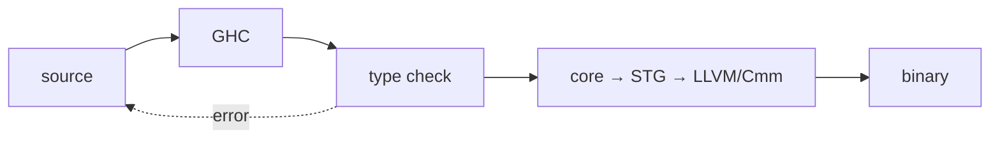

[Read This!](caveatemptor.md) | [Algorithms](algorithms.md) | [AssemblyLanguage](assemblylanguage.md) | [BASH](bash.md) |   [C-Programmming](cprogramming.md) |
[Computer Security](computersecurity.md) |  [Databases](databases.md) | [Emacs](emacs.md) |  [Exploitation](exploitation.md) | [Functional Programming](functional.md) |
[Firewalls](firewalls.md) |   [Git](git.md) | [Haskell](haskell.md) | [Javascipt](javascript.md) | [Julia](julia.md) | [Social Engineering](internetexploitation.md) |
[Picolisp](picolisp.md) | [Pharo Smalltalk](pharo.md) |
[Linux](linux.md) |
[Python](python.md) |
[Operating Systems](os.md) |
[Machine Learning](machinelearning.md) | [Metasploit](metasploit.md) |  [Open Data Science](opendatascience.md) |
[Networking](networking.md) | [Machine Learning](machinelearning.md) |[Scheme](scheme.md) |
[Unity](unity.md) | [vim](vim.md) |
[Web Development](webdevelopment.md)

# Haskell

Here is the truth about Haskell: **it is the language where the type checker is not a nag – it is a collaborator that writes half the program with you.** Once you accept that purity and laziness are features, a lot of software architecture lessons fall out for free.

### What it is, in plain words

**Haskell** is a purely functional, statically typed, lazily evaluated language, born from academic language research in the late 1980s and still evolving (GHC is the main compiler; Haskell 2010 is the standard most people mean, with GHC extensions widely used). Its pillars:

- **Purity** – a function of type `Int -> Int` cannot launch missiles. Effects are tracked in types (`IO`, `STM`, …).
- **Laziness** – values are computed when needed, which makes infinite structures and cheap pipelines natural.
- **Type inference** – you can omit most type signatures; the compiler still knows.
- **Type classes** – ad-hoc polymorphism (`Eq`, `Functor`, `Monad`) without inheritance.
- **Algebraic data types** and pattern matching – the backbone of readable logic.

### Why it matters

Even if you never ship Haskell, a month with it permanently changes how you write Python, Rust, JavaScript and Lisp. Ideas that felt academic – pure functions, `Maybe`/`Optional`, parser combinators, software transactional memory – showed up in industry through Haskell's influence. [PureScript](purescript.md) is its cousin on JavaScript; [Rust](rust.md)'s traits owe a debt; Elm took a simpler slice to the browser.

### An everyday analogy: a proof assistant for everyday code

Writing Haskell feels less like giving orders and more like constructing a proof that your program makes sense. The compiler is the examiner. Failures are usually type errors that point at the real mistake – not a crash at 3 a.m. in production.



### A hands-on example

```bash
sudo xbps-install -S ghc cabal-install   # or use ghcup
ghci                                     # the REPL
```

```haskell
-- sum of squares of evens, the Haskell way
sumOfEvenSquares :: Int -> Int
sumOfEvenSquares n =
  sum [x * x | x <- [1..n], even x]

-- Algebraic data type + pattern match
data Shape = Circle Double | Rect Double Double
  deriving (Show, Eq)

area :: Shape -> Double
area (Circle r) = pi * r * r
area (Rect w h) = w * h

-- Maybe instead of null
safeDiv :: Double -> Double -> Maybe Double
safeDiv _ 0 = Nothing
safeDiv x y = Just (x / y)

-- fmap / Functor – apply a function under the Maybe
result :: Maybe Double
result = (*2) <$> safeDiv 10 4          -- Just 5.0

-- Do-notation for IO (effects are explicit)
main :: IO ()
main = do
  putStrLn $ show $ sumOfEvenSquares 10
  print $ area (Rect 3 4)
  print result
```

```bash
cabal init -n && cabal run
```

A taste of the ecosystem: **Cabal** / **Stack** for projects, **Hackage** for packages, **hls** (Haskell Language Server) for editor support. Popular libraries: `aeson` (JSON), `servant` or `yesod` (web), `containers` and `unordered-containers`, `lens` (optional, powerful).

### A tiny project shape

```bash
mkdir hello-hs && cd hello-hs
cabal init -n --is-executable
# edit app/Main.hs, then:
cabal build
cabal run
cabal test
```

GHC2021 (a bundle of widely used extensions) is a sensible default for new code. Add dependencies in the `.cabal` file and let Cabal fetch them. For reproducible builds across machines, commit `cabal.project.freeze` or use Stack's resolver pins.

### Common misconceptions

- **"You must understand monads before writing anything."** You can write useful programs with `IO` and `Maybe` long before the abstraction clicks. Use `do` notation; learn the theory when you're curious.
- **"Lazy means slow."** Lazy means *when needed*. Space leaks are the real footgun; bang patterns and strict data types fix them when profiling says so.
- **"Haskell is only academic."** It runs trading systems, card compilers, `pandoc`, PostgREST and plenty of production backends.
- **"No loops means no iteration."** Recursion, `map`, `fold`, `scan`, and `forM_` cover the ground.
- **"Dynamic languages are freer."** Freedom to crash is not freedom. Haskell's freedom is refactoring with a compiler as safety net.

### Connections

- [Functional Programming](functional.md), [Lambda Calculus](lambdacalculus.md).
- [PureScript](purescript.md) – Haskell-like on JS.
- [Haskell Kata](haskellkata.md) – practice.
- [Rust](rust.md), [Common Lisp](commonlisp.md), [PicoLisp](picolisp.md) – other points on the FP spectrum.

## Getting Started

1. [Haskell Kata](haskellkata.md)
1. [Fpcomplete Get Started](https://www.fpcomplete.com/haskell/get-started/windows/)
1. [Fpcomplete How to Play](https://www.fpcomplete.com/haskell/tutorial/stack-play/)
1. [Fpcomplete Stack Building](https://www.fpcomplete.com/haskell/tutorial/stack-build/)
1. [Fpcomplete - Learn](https://www.fpcomplete.com/haskell/learn/)
1. [Haskell Stack Docs](https://docs.haskellstack.org/en/stable/README/)
1. [GHCUp](https://www.haskell.org/ghcup/)
1. [Learn You a Haskell](http://learnyouahaskell.com/chapters)
1. [Cabal Docs](https://www.haskell.org/cabal/)
1. [Archlinux Haskell Wiki](https://wiki.archlinux.org/title/Haskell)
