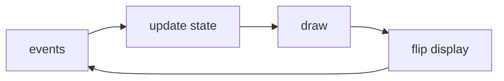

[Python Libraries, tools and Links](pythonlibrariestoolsandlinks.md) | [Official Python Docs](https://docs.python.org/3/)
| [Intro to Pygame](intropygame.md)

# Intro to Pygame Notes

Here is the truth about Pygame: **it is a friendly box of SDL bindings that lets Python draw pixels, play sounds and read joysticks – enough to make real games without a 3D engine.** If you can write a loop and blit a surface, you can ship a game.

### What it is, in plain words

**Pygame** is a community library wrapping **SDL2** for Python. It gives you:

- a window and a pixel **Surface**;
- event input (keys, mouse, gamepads);
- image and font loading;
- sound and music;
- clocks for frame timing.

It will not give you a full editor like Unity. It will give you a 200-line breakout clone you understand completely – which is the point.

### Why it matters

Games are the most motivating way to learn event loops, state machines, vectors and asset pipelines. Pygame keeps the feedback immediate: change a number, see a sprite move. For teaching and prototypes it still earns its place in 2026, alongside newer options like Arcade, pyglet and Raylib bindings.

### An everyday analogy: a puppet theatre

Unity is a film studio. Pygame is a puppet theatre: you hold the puppets (sprites), move them each frame, and change the backdrop when the scene changes. Small, visible, yours.



### A hands-on example

```bash
pip install pygame
```

```python
import pygame

pygame.init()
screen = pygame.display.set_mode((640, 480))
clock = pygame.time.Clock()
x, y = 320, 240
speed = 200  # pixels per second
running = True

while running:
    dt = clock.tick(60) / 1000  # seconds since last frame
    for e in pygame.event.get():
        if e.type == pygame.QUIT:
            running = False

    keys = pygame.key.get_pressed()
    x += (keys[pygame.K_RIGHT] - keys[pygame.K_LEFT]) * speed * dt
    y += (keys[pygame.K_DOWN]  - keys[pygame.K_UP])   * speed * dt

    screen.fill((20, 20, 30))
    pygame.draw.circle(screen, (80, 200, 120), (int(x), int(y)), 20)
    pygame.display.flip()

pygame.quit()
```

Move with arrow keys. From here: load a `Surface` with `pygame.image.load`, use `pygame.sprite.Sprite` groups for collisions, add `pygame.mixer` for blips. Keep logic in updates and drawing in draws – mixing them is how games become spaghetti.

### A tiny architecture that scales past demos

```
assets/          images, sounds
game/
  __init__.py
  state.py       title / playing / paused
  player.py
  enemies.py
main.py          loop only
```

Each entity gets `handle_event`, `update(dt)`, `draw(screen)`. The main loop calls them in order. When you want scenes, swap the active state object. This boring structure is what keeps a jam game editable on day three.

Delta time (`dt`) matters: multiply motion by `dt` so the game runs the same at 30 or 144 fps. Hard-coded "move 5 pixels per frame" is how games break on different machines.

### Common misconceptions

- **"Pygame is dead."** The pygame-ce (community edition) fork is actively maintained and recommended.
- **"It's too slow."** Pure Python logic can be; blit and SDL are fine for 2D. Profile before rewriting.
- **"You need an OOP framework."** Sprites help; they're optional. A clear loop matters more.
- **"Games require a degree in maths."** Vectors help; start with rectangles and circles.
- **"Web is the only place to ship."** pygame games package with PyInstaller or briefcases; or rewrite hot parts later.

### Resources that stay useful

- pygame-ce documentation and examples
- *Making Games with Python & Pygame* (Al Sweigart) – free, dated but clear
- The [Python](python.md) pages on this site for language basics
- For the next step up: Godot (not Python) or Unity – when you need editors and scenes more than understanding

Ship one tiny game to completion – polish, start screen, game over – before starting a second. Finished beats ambitious.

### Installing pygame-ce on Vikix

The community edition installs under the same import name, so tutorials still work:

```bash
python3 -m venv ~/.venvs/games && . ~/.venvs/games/bin/activate
pip uninstall -y pygame 2>/dev/null; pip install pygame-ce
python -m pygame.examples.aliens        # a bundled demo game
```

Install either `pygame` or `pygame-ce` in an environment, never both, because they share the `pygame` package name. Under StumpWM, a game window behaves like any other X window; if it opens at an odd size, start it with `SDL_VIDEO_WINDOW_POS=center` or make the frame float.

### Sprites and collisions, the next step

```python
import pygame, random

class Coin(pygame.sprite.Sprite):
    def __init__(self, pos):
        super().__init__()
        self.image = pygame.Surface((16, 16), pygame.SRCALPHA)
        pygame.draw.circle(self.image, (242, 181, 68), (8, 8), 8)
        self.rect = self.image.get_rect(center=pos)

coins = pygame.sprite.Group(
    Coin((random.randint(20, 620), random.randint(20, 460))) for _ in range(10)
)

# inside the loop, after moving the player rect:
#   got = pygame.sprite.spritecollide(player, coins, dokill=True)
#   score += len(got)
#   coins.draw(screen)
```

A `Group` draws all its sprites in one call and `spritecollide` tests the player against all of them, removing the ones you hit. Those two functions take you from "a square that moves" to "a game with a goal".

### From frames to vectors

`pygame.math.Vector2` makes movement code read like the maths. Velocity is a vector, position changes by velocity times `dt`, and normalising stops diagonal movement being faster:

```python
direction = pygame.math.Vector2(keys[pygame.K_RIGHT] - keys[pygame.K_LEFT],
                                keys[pygame.K_DOWN] - keys[pygame.K_UP])
if direction.length_squared() > 0:
    direction = direction.normalize()
pos += direction * speed * dt
```

That is the same [vector space](vectorspaces.md) idea used by Three.js and every game engine.

### Connections

- [Python](python.md), [NumPy](numpy.md) (for heavier maths).
- [Javascript](javascript.md) / [Three.js](jsthree.md) – other playful paths.
- [Unity](unity.md) – when you outgrow 2D SDL.

This page is based on the video tutorial called
[The ultimate introduction to Pygame](https://www.youtube.com/watch?v=AY9MnQ4x3zk&t=72s).

```
import pygame
from sys import exit
from random import randint, choice
```
