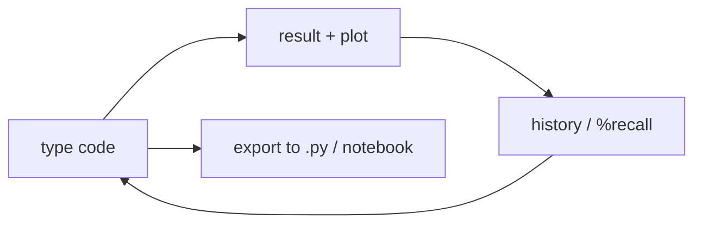

[computingFreedom](computingfreedom.md) |
  [Build](bciyh.md) |
  [Picolisp](picolisp.md) | [Picolisp Machine](pilmachine.md) | [pil sources](pilsource.md) |
  [Linux](linux.md) | [BASH](bash.md) |
  [C Programmming](cprogramming.md) |
  [Operating Systems](os.md) |
  [Javascipt](javascript.md) |
  [Emacs](emacs.md)  | [vim](vim.md) |
  [Pharo Smalltalk](pharo.md) |
  [Computer Security](computersecurity.md) |
  [Python](python.md) |

# iPython

Here is the truth about IPython: **the best place to learn Python is not a file – it's a prompt that remembers what you just did, shows you plots, and lets you edit the last thought.** IPython is that prompt, and Jupyter is the notebook built around it.

### What it is, in plain words

**IPython** (Interactive Python) is an enhanced shell for Python, started by Fernando Pérez in 2001. Type code, see results immediately, use tab-completion, inspect objects with `?`, run shell commands with `!`, and keep a searchable history. **Jupyter Notebook** and **JupyterLab** grew out of IPython's notebook interface and now support many languages; the Python kernel is still IPython.

In 2026 you mostly meet IPython in three forms:

- the terminal app, `ipython`;
- the kernel inside JupyterLab / Notebook / VS Code / Emacs;
- embedded in tools like Spyder and some scientific IDEs.

### Why it matters

Scientific Python – NumPy, SciPy, pandas, Matplotlib – was shaped around IPython's workflow: try an idea, plot it, refine. Even if you write production code in modules, exploration happens here. Learning IPython's tricks cuts the friction between "I wonder" and "I see".

### An everyday analogy: a lab bench with a whiteboard

A `.py` file is a finished lab report. IPython is the bench: reagents out, whiteboard beside you, every measurement scribbled down and revisable. When the experiment works, you copy the clean parts into the report.



### A hands-on example

```bash
pip install ipython matplotlib numpy
ipython
```

```python
In [1]: import numpy as np
In [2]: x = np.linspace(0, 2*np.pi, 100)
In [3]: x[:5]                          # quick peek
In [4]: def f(t):
   ...:     return np.sin(t) * np.exp(-t/5)
In [5]: f(x)[:5]
In [6]: f?                             # docstring / source
In [7]: %timeit f(x)                   # micro-benchmark
In [8]: !head -3 /etc/os-release       # shell escape
In [9]: %history -n 1-5                # what did I just do?
In [10]: %save experiment.py 1-5       # write it out
```

Useful magics (the `%` commands):

| Magic | Purpose |
|-------|---------|
| `%time` / `%timeit` | measure speed |
| `%run script.py` | run a file in this session |
| `%debug` | drop into debugger after an exception |
| `%matplotlib inline` | (notebook) show plots in place |
| `%autoreload 2` | reload imported modules as they change |
| `%pwd`, `%cd`, `%ls` | navigate without leaving |

In a notebook, start with:

```python
%load_ext autoreload
%autoreload 2
import matplotlib.pyplot as plt
```

Then edit your module in an editor, re-run one cell, and the imports refresh – REPL-driven development, Python-style.

### Magics versus Python

Anything starting with `%` is an IPython *magic*, not Python syntax. Line magics (`%timeit expr`) take the rest of the line; cell magics (`%%timeit`) take the rest of the cell in a notebook. When you paste code into a `.py` file, strip the magics or keep them only in notebooks.

The configuration lives in `~/.ipython/profile_default/ipython_config.py`. A few favourite tweaks:

```python
c = get_config()
c.InteractiveShell.confirm_exit = False
c.TerminalInteractiveShell.editing_mode = "vi"   # or emacs
c.InteractiveShellApp.exec_lines = ["%load_ext autoreload", "%autoreload 2"]
```

### Beyond the terminal: notebooks and editor kernels

JupyterLab gives you cells, Markdown narrative and plots in one document – ideal for notes and teaching. VS Code and Emacs can attach to the same IPython kernel, so you edit a `.py` file with proper tooling and still "Send to REPL". That hybrid – file as source of truth, IPython as playground – is the workflow I recommend once scripts grow past a few cells.

Sharing: `.ipynb` files are JSON and work with Git, but diffs are noisy. Tools like `nbdime` help; or keep the notebook for exploration and promote finished code into modules, importing them back with `%autoreload`.

### Common misconceptions

- **"IPython and Jupyter are the same."** IPython is the Python kernel and terminal shell; Jupyter is the multi-language notebook front end.
- **"Notebooks are for production."** They're for exploration and communication. Package real code into modules and test it.
- **"`?` is only for docs."** `obj??` shows source; `*pattern*?` searches names.
- **"The terminal IPython can't plot."** Use `%matplotlib` with an interactive backend, or write figures to files.
- **"It's slow."** The shell is not the bottleneck; your algorithms are. `%timeit` proves it.

### Connections

- [Python](python.md), [NumPy](numpy.md), [SciPy](scipy.md).
- [Open Data Science](opendatascience.md), [Machine Learning](machinelearning.md).
- [Emacs](emacs.md) – run IPython in `M-x run-python` or via ein/jupyter.

## Libraries, Tools

- [SciPy](scipy.md) --- [@ SciPy.org](https://www.scipy.org/)
- [Numpy](numpy.md) --- [ @ numPy.org](http://www.numpy.org/)
- [iPython](ipython.md) --- [@ ipython.org](https://ipython.org/)
