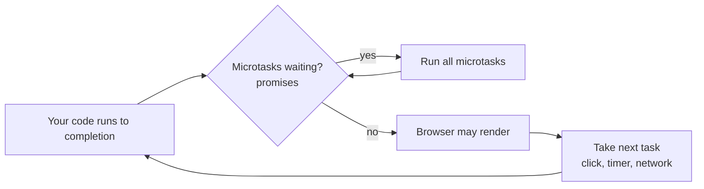

[Javascript](javascript.md) | [Javascript kata](jskata.md) |[Node JS](nodejs.md) | [Data Types](jsdatatypes.md) | [Variables](jsvariable.md) | [Control Flow](jscontrolflow.md) |
[Scope and Environment](jsscope.md) | [Objects](jsobjects.md) | [Functions](jsfunctions.md) | [Events](jsevents.md) |
[Prototypal Inheritance](jsprototypalinheritance.md) |
[Three.js](jsthree.md) | [3DE Code Editor](https://www.code3dgames.com/3de/) |

# Javascript Events

Here is the truth about events: **your JavaScript mostly doesn't run – it waits.** It registers "when this happens, do that", goes quiet, and the browser (or Node.js) wakes it up when something happens. Learning events is learning to write code that waits well.

### What it is, in plain words

An **event** is a signal that something happened: a click, a key press, a page finishing loading, a network message arriving, a file being read. An **event listener** (or handler) is a function you attach to a target that will be called when that event fires.

```js
const button = document.querySelector("#save");
button.addEventListener("click", (event) => {
  console.log("saved at", event.timeStamp);
});
```

The browser hands your function an **event object** describing what happened – which element, which key, mouse coordinates and so on.

### Why it matters

User interfaces are event-driven by nature: you never know when the user will click. Servers are too: you never know when the next request will arrive. Node.js was built around this idea, which is why one process can juggle thousands of connections. If you understand events, you understand why JavaScript is single-threaded yet responsive – and why one slow loop can freeze an entire page.

### An everyday analogy: a doorbell

You don't stand at the front door all day waiting for visitors. You install a doorbell and get on with your life. When it rings, you go and answer. `addEventListener` is installing the doorbell. Your handler is "go and answer". The **event loop** is you, finishing whatever you were doing before walking to the door – it never interrupts you mid-sentence.

### The event loop



Only one piece of your code runs at a time. Events queue up, and each handler runs to the end before the next starts. That's why this freezes the page:

```js
button.addEventListener("click", () => {
  const end = Date.now() + 5000;
  while (Date.now() < end) {} // 5 seconds of nothing else happening
});
```

Long work belongs in a Web Worker, or split into chunks.

### A hands-on example: bubbling and delegation

Save this as `events.html` and open it in a browser:

```html
<ul id="menu">
  <li data-cmd="open">Open</li>
  <li data-cmd="save">Save</li>
  <li data-cmd="quit">Quit</li>
</ul>
<script type="module">
  const menu = document.querySelector("#menu");

  // One listener on the parent handles every child – even ones added later.
  menu.addEventListener("click", (e) => {
    const item = e.target.closest("li");
    if (!item) return;
    console.log("command:", item.dataset.cmd);
  });

  // Keyboard shortcut, StumpWM-style prefix key
  let prefix = false;
  document.addEventListener("keydown", (e) => {
    if (e.ctrlKey && e.key === "t") { prefix = true; e.preventDefault(); return; }
    if (prefix) { console.log("prefix command:", e.key); prefix = false; }
  });
</script>
```

When you click an `<li>`, the event first travels *down* from the window to the element (**capture**), then *up* again from the element to the window (**bubbling**). Listeners on ancestors hear it on the way up. That's why one listener on `#menu` can serve all its items. This pattern is called **event delegation**, and it saves memory and handles dynamically added elements for free.

Useful controls on the event object:

- `e.preventDefault()` – stop the browser's default action (following a link, submitting a form).
- `e.stopPropagation()` – stop the event bubbling further. Use sparingly; it surprises other code.
- `e.target` – where the event started; `e.currentTarget` – the element whose listener is running.

### Cleaning up

Listeners keep their closures alive. In a long-lived app, remove them when done. The modern way is an `AbortController`:

```js
const ctrl = new AbortController();
window.addEventListener("resize", onResize, { signal: ctrl.signal });
// later
ctrl.abort(); // removes every listener registered with this signal
```

Other handy options: `{ once: true }` (auto-remove after first call) and `{ passive: true }` (promise not to call `preventDefault`, letting scrolling stay smooth).

### Events in Node.js

Node has its own `EventEmitter`, and modern browsers' `EventTarget` is available there too:

```js
import { EventEmitter } from "node:events";
const bus = new EventEmitter();
bus.on("deploy", (site) => console.log("deployed", site));
bus.emit("deploy", "thevikidtruth.com");
```

### Common misconceptions

- **"Event handlers run in parallel."** Never. One at a time, each to completion.
- **"`onclick = ...` and `addEventListener` are the same."** The property holds only one handler; a second assignment silently replaces the first. `addEventListener` stacks them.
- **"`setTimeout(fn, 0)` runs immediately."** It queues `fn` as a task after current code and all pending promise callbacks.
- **"Inline `onclick=\"...\"` attributes are fine."** They mix markup and code and are blocked by strict Content Security Policies. Attach listeners from scripts.
- **"Every element needs its own listener."** Delegate to a parent.

### Connections

- [Functions](jsfunctions.md) – listeners are callbacks.
- [Scope and Environment](jsscope.md) – handlers are closures over the state they need.
- [Objects](jsobjects.md) – the event object and the DOM are plain objects with prototypes.
- [Node JS](nodejs.md) – the same event-driven model on the server.
- [Three.js](jsthree.md) – animation loops driven by `requestAnimationFrame`.
