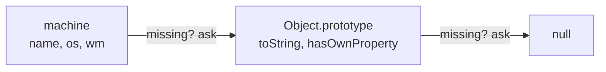

[Javascript](javascript.md) | [Javascript kata](jskata.md) |[Node JS](nodejs.md) | [Data Types](jsdatatypes.md) | [Variables](jsvariable.md) | [Control Flow](jscontrolflow.md) |
[Scope and Environment](jsscope.md) | [Objects](jsobjects.md) | [Functions](jsfunctions.md) | [Events](jsevents.md) |
[Prototypal Inheritance](jsprototypalinheritance.md) |
[Three.js](jsthree.md) | [3DE Code Editor](https://www.code3dgames.com/3de/) |

# Javascript Objects

Strip away the syntax and here is the truth: **a JavaScript object is just a bag of named slots, plus a hidden link to another bag to ask when a slot is missing.** Arrays, functions, dates, DOM nodes – all of them are that, underneath.

### What it is, in plain words

An object is a collection of **properties**. Each property has a **key** (a string or a symbol) and a **value** (anything – a number, another object, a function). When a property's value is a function, we call it a **method**.

```js
const machine = {
  name: "vikix-box",
  os: "Void Linux",
  wm: "StumpWM",
  uptimeDays: 12,
  describe() {
    return `${this.name} runs ${this.os} with ${this.wm}`;
  },
};
console.log(machine.describe());
```

You read properties with a dot (`machine.os`) or with brackets when the key is computed (`machine["os"]`, `machine[key]`).

### Why it matters

Objects are how JavaScript groups data that belongs together. JSON – the format half the internet uses to talk – is literally JavaScript object syntax. Every browser API hands you objects; every npm package exports them. Understanding how they behave – especially how they are *shared* and how lookup works – is the difference between guessing and knowing.

### An everyday analogy: a filing cabinet with a reference desk

Think of an object as a filing cabinet with labelled drawers. Open the drawer called `name`, find a card. If there is no drawer with the label you want, the clerk walks over to a *reference desk* (the prototype) and asks there. If the reference desk doesn't have it either, it asks *its* reference desk, until the chain runs out and you get `undefined`.



### A hands-on example: working with objects in 2026

```js
// Create
const user = { id: 7, name: "Vidyuth", langs: ["PicoLisp", "C"] };

// Add / change / delete
user.editor = "Emacs";
user.id = 8;
delete user.editor;

// Check
console.log("name" in user);           // true (own or inherited)
console.log(Object.hasOwn(user, "id")); // true (own only, modern replacement for hasOwnProperty)

// Walk
for (const [key, value] of Object.entries(user)) {
  console.log(key, "=>", value);
}

// Copy and merge without mutating
const updated = { ...user, name: "VikiD" };
console.log(user.name, updated.name); // Vidyuth VikiD

// But the copy is shallow!
updated.langs.push("Lisp");
console.log(user.langs); // [ 'PicoLisp', 'C', 'Lisp' ] -- shared array

// Deep copy when you need it
const safe = structuredClone(user);

// Destructuring
const { name, langs: [firstLang] } = user;
console.log(name, firstLang); // Vidyuth PicoLisp

// Optional chaining and nullish defaults
console.log(user.address?.city ?? "unknown"); // unknown
```

### Objects are references

When you write `const b = a`, you do not get a new object. You get a second name for the same one. Equality follows the same rule: `{} === {}` is `false`, because they are two different objects, even though they look alike. To compare contents you have to compare properties yourself (or serialise both with `JSON.stringify` for simple data).

### Classes are objects too

The `class` keyword (2015) is tidy syntax over the same machinery:

```js
class Box {
  #secret = "hidden";          // truly private field
  constructor(label) { this.label = label; }
  open() { return `${this.label}: ${this.#secret}`; }
}
const b = new Box("tools");
console.log(b.open());
console.log(Object.getPrototypeOf(b) === Box.prototype); // true
```

Private `#fields` are now supported everywhere, so you no longer need naming conventions like `_secret`.

### Getters, setters and computed keys

An object slot doesn't have to store a value; it can *compute* one. A getter runs code every time you read it, and keys can themselves be computed at creation time:

```js
const field = "cpu";
const stats = {
  [field + "Load"]: 0.42,       // key is "cpuLoad"
  get percent() { return Math.round(this.cpuLoad * 100) + "%"; },
};
console.log(stats.percent); // 42%
```

This is how many libraries make an object *look* like plain data while doing work behind the scenes. Handy, but remember: reading a property is not always free.

### Maps when keys are data

If your keys are arbitrary user data (or not strings), use a `Map` instead of a plain object. A `Map` keeps insertion order, accepts any key type, has a `.size`, and cannot accidentally collide with inherited names like `constructor`.

### Common misconceptions

- **"JavaScript has classes like Java."** It has prototypes. `class` is a friendlier way to set them up. See [Prototypal Inheritance](jsprototypalinheritance.md).
- **"Spread makes a copy."** A *shallow* one. Nested objects are still shared.
- **"Property order is random."** It is defined: integer-like keys ascending, then string keys in insertion order, then symbols.
- **"`const` objects are frozen."** Only the binding is constant. Use `Object.freeze` for the object, and remember even that is shallow.
- **"Everything is an object."** Primitives (numbers, strings, booleans…) aren't; JavaScript just wraps them temporarily so `"abc".length` works.

### Connections

- [Variables](jsvariable.md) – why two names can point at one object.
- [Data Types](jsdatatypes.md) – objects versus primitives.
- [Functions](jsfunctions.md) – functions are objects you can call.
- [Prototypal Inheritance](jsprototypalinheritance.md) – the chain behind every lookup.
- [Pharo Smalltalk](pharo.md) – where "everything is an object that receives messages" is taken all the way.
