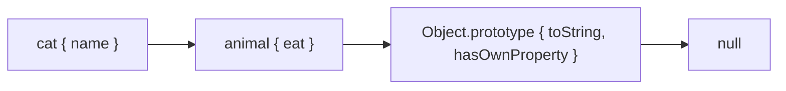

[Javascript](javascript.md) | [Javascript kata](jskata.md) |[Node JS](nodejs.md) | [Data Types](jsdatatypes.md) | [Variables](jsvariable.md) | [Control Flow](jscontrolflow.md) |
[Scope and Environment](jsscope.md) | [Objects](jsobjects.md) | [Functions](jsfunctions.md) | [Events](jsevents.md) |
[Prototypal Inheritance](jsprototypalinheritance.md) |
[Three.js](jsthree.md) | [3DE Code Editor](https://www.code3dgames.com/3de/) |

# Prototypal Inheritance

Here is the truth that makes JavaScript's object model click: **there are no classes in the engine – only objects linked to other objects.** The `class` keyword is tidy syntax over a much older idea called prototypal inheritance.

### What it is, in plain words

Every JavaScript object has an internal link to another object, its **prototype**. When you ask for a property and it isn't on the object itself, the engine looks at the prototype, then *that* object's prototype, and so on until it hits `null`. That chain is how inheritance works.

```js
const animal = {
  eat() { return `${this.name} eats`; },
};
const cat = Object.create(animal, { name: { value: "Mira", enumerable: true } });
console.log(cat.eat());                         // "Mira eats"
console.log(Object.getPrototypeOf(cat) === animal); // true
```

Functions used with `new` get a special `.prototype` property; the objects they construct are linked to it. The `class` syntax (ES2015) writes that pattern for you.

### Why it matters

Every array method (`map`, `filter`), every string method, every DOM node method lives on a prototype, not on each individual value. Understanding the chain explains:

- why changing `Array.prototype` affects every array (and why you shouldn't, usually);
- how `instanceof` works;
- what `this` is doing when a method is found up the chain;
- why mixins and `Object.create` are natural, and classical hierarchies sometimes feel forced.

### An everyday analogy: a chain of reference desks

You ask a junior clerk a question. If they don't know, they ask the senior clerk. If the senior doesn't know, they ask the librarian. If the librarian doesn't know, you get "undefined". Each clerk only stores what's unique to them; shared knowledge lives further up. That's the prototype chain.



### A hands-on example: from prototypes to classes

The old way, still worth knowing:

```js
function Machine(name, wm) {
  this.name = name;
  this.wm = wm;
}
Machine.prototype.describe = function () {
  return `${this.name} runs ${this.wm}`;
};

const box = new Machine("vikix", "StumpWM");
console.log(box.describe());
console.log(Object.getPrototypeOf(box) === Machine.prototype); // true
console.log(box instanceof Machine);                           // true
```

What `new Machine(...)` actually does:

1. Create a blank object.
2. Set its prototype to `Machine.prototype`.
3. Call `Machine` with `this` bound to that object.
4. Return the object (unless the constructor returns a different object).

The modern way – same mechanism, clearer syntax:

```js
class Machine {
  constructor(name, wm) {
    this.name = name;
    this.wm = wm;
  }
  describe() { return `${this.name} runs ${this.wm}`; }
}

class Laptop extends Machine {
  constructor(name, wm, battery) {
    super(name, wm);
    this.battery = battery;
  }
  describe() { return `${super.describe()} (${this.battery}% battery)`; }
}

const tip = new Laptop("vikix-air", "StumpWM", 87);
console.log(tip.describe());
console.log(Object.getPrototypeOf(Laptop.prototype) === Machine.prototype);
```

`extends` wires the prototype chain; `super` calls up it. Private fields (`#battery`) stay on the instance and are *not* inherited via the prototype.

### Own versus inherited

```js
const o = { x: 1 };
console.log(o.toString());                 // inherited from Object.prototype
console.log(Object.hasOwn(o, "x"));        // true
console.log(Object.hasOwn(o, "toString")); // false
console.log("toString" in o);              // true – walks the chain
```

`for...in` walks the chain (and is rarely what you want); `Object.keys` / `Object.entries` / `for...of Object.entries` stay on own enumerable properties.

### Setting and freezing the chain

```js
const proto = { kind: "box" };
const obj = Object.create(proto);
Object.setPrototypeOf(obj, null);   // make a pure dictionary – no inherited names
const dict = Object.create(null);
dict.admin = true;                  # no risk of colliding with Object.prototype
```

Changing an object's prototype after creation (`Object.setPrototypeOf` or `__proto__`) is allowed but slow – engines optimise for stable shapes. Prefer `Object.create` at birth.

### Common misconceptions

- **"JavaScript has classical inheritance like Java."** It has prototypes. `class` is sugar.
- **"Methods live on the instance."** Usually they live on the prototype, shared by all instances.
- **"`instanceof` checks the constructor."** It walks the object's prototype chain looking for `Constructor.prototype`.
- **"Assigning `obj.__proto__ = …` is fine."** Prefer `Object.create` / `Object.setPrototypeOf`, and rarely even those.
- **"Prototypes and closures are the same."** Prototypes share *properties* across objects; closures share *variables* across function calls. Both are powerful; don't mix the terms up.

### When to stay class-free

Prototypal patterns still shine for dictionaries of shared behaviour, for mixins (`Object.assign(Target.prototype, mixin)`), and for objects that don't need constructors. If a hierarchy would have only one level, `Object.create` may be clearer than a `class`. Use classes when you have identity, construction logic and a clear "is-a" relationship; use plain objects and prototypes when you're composing behaviour.

### Connections

- [Objects](jsobjects.md) – the bags of properties that prototypes link.
- [Functions](jsfunctions.md) – constructors are functions.
- [Scope and Environment](jsscope.md) – the *other* chain (lexical), for variables.
- [Pharo Smalltalk](pharo.md) and [GNU Smalltalk](gnusmalltalk.md) – languages where "everything is a message to an object" is the whole model.

hidden property [[Prototype]] - null or a reference to other object

```
prototype obj
     ^
     | [[Prototype]]
     |
    obj
```

When we read a property from object, and it’s missing, JavaScript takes it from the prototype
` obj.__proto__ ` can be used to set it

```
let earphones = { speakers: 2 };

let jbl       = { bluetooth: true };

jbl.__proto__ = earphones;  // sets jbl.[[Prototype]] to earphones
```

alternatively:

```
let jbl       = {
  bluetooth: true,
  __proto__: earphones
};
```

## Sources, External Links

[javascript.info/prototype-inheritance](https://javascript.info/prototype-inheritance)
