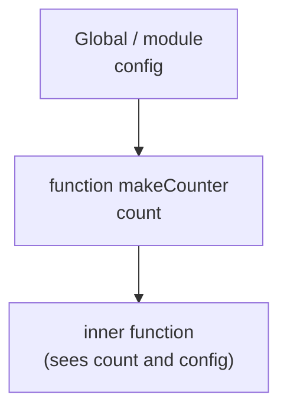

[Javascript](javascript.md) | [Javascript kata](jskata.md) |[Node JS](nodejs.md) | [Data Types](jsdatatypes.md) | [Variables](jsvariable.md) | [Control Flow](jscontrolflow.md) |
[Scope and Environment](jsscope.md) | [Objects](jsobjects.md) | [Functions](jsfunctions.md) | [Events](jsevents.md) |
[Prototypal Inheritance](jsprototypalinheritance.md) |
[Three.js](jsthree.md) | [3DE Code Editor](https://www.code3dgames.com/3de/) |

# Javascript Scope

The truth behind scope is simple: **every name lives somewhere, and code can only see the names in its own room and the rooms that contain it.** That nesting of rooms, decided by where you *write* the code, is all scope is.

### What it is, in plain words

**Scope** is the region of a program where a name is visible. An **environment** (the spec calls it an *Environment Record*) is the actual table, at run time, that maps names to values for that region. Each environment keeps a pointer to its *outer* environment, forming a chain. When you use a name, JavaScript looks in the current environment, then the outer one, then the next, until it hits the global environment. If the name isn't there, you get a `ReferenceError`.

Modern JavaScript has these kinds of scope:

- **Global / module scope** – top level of a script or module. In a module (the norm in 2026) top-level names stay private to the file.
- **Function scope** – everything declared inside a function.
- **Block scope** – anything between `{ }` for `let`, `const` and `class`.

JavaScript is **lexically** scoped: what a function can see is fixed by where it sits in the source, not by who calls it.

### Why it matters

Scope is how large programs stay sane. It lets two functions both use a variable called `i` without fighting. It lets you hide data so only the code that needs it can touch it. And it is the foundation of **closures**, which power callbacks, event handlers, React hooks, module patterns and almost every bit of idiomatic JavaScript.

### An everyday analogy: rooms in a house

You are standing in the kitchen. You can see everything in the kitchen. Through the doorway you can also see the hall, and through the front windows, the street. But nobody in the street can see into your kitchen cupboards.

Inner rooms see outward; outer rooms cannot see inward. That one-way glass is the scope chain.



### A hands-on example: closures

Run this in `node`:

```js
function makeCounter() {
  let count = 0;            // lives in makeCounter's environment
  return function () {      // this inner function keeps a reference to it
    count += 1;
    return count;
  };
}

const next = makeCounter();
console.log(next()); // 1
console.log(next()); // 2

const other = makeCounter();
console.log(other()); // 1  -- a fresh environment, a fresh count
```

`makeCounter` has finished running, yet `count` survives. Why? Because the returned function holds on to the environment it was born in. That pair – function plus captured environment – is a **closure**. Nobody outside can read or reset `count`; it is truly private.

### Block scope fixes the classic loop bug

```js
for (var i = 0; i < 3; i++) setTimeout(() => console.log("var", i));
// var 3, var 3, var 3

for (let j = 0; j < 3; j++) setTimeout(() => console.log("let", j));
// let 0, let 1, let 2
```

With `var` there is one `i` for the whole function, and by the time the timers fire it is 3. With `let`, each loop iteration gets a new block environment, so each arrow function closes over its own `j`.

### Shadowing

An inner name can hide an outer one with the same name:

```js
const colour = "blue";
function paint() {
  const colour = "red"; // shadows the outer one inside paint
  return colour;
}
console.log(paint(), colour); // red blue
```

Legal, sometimes useful, often confusing. Linters such as ESLint can warn you about it.

### `this` is not scope

A very common confusion: `this` is not looked up through the scope chain (except in arrow functions, which borrow `this` from the surrounding code). Ordinary functions get `this` from *how they are called*. Scope answers "which variables can I see?"; `this` answers "which object am I acting on right now?". Keep them in separate drawers.

### Common misconceptions

- **"Scope depends on where a function is called."** No – that would be *dynamic* scope. JavaScript uses *lexical* scope: where it's written. (Emacs Lisp was dynamically scoped by default for decades, and PicoLisp is dynamically bound by design – a good contrast to study.)
- **"Closures copy variables."** They capture a *live reference* to the environment. If the variable changes later, the closure sees the new value.
- **"Closures leak memory."** Only if you keep the closure alive forever, e.g. an event listener you never remove. The garbage collector frees environments nobody can reach.
- **"Hoisting moves code to the top."** Nothing moves. Declarations are registered when the environment is created; `let`/`const` stay locked until their line runs (the temporal dead zone – see [Variables](jsvariable.md)).
- **"Globals are just convenient."** Every global is a name every other script can trample. Modules exist to end that.

### Connections

- [Variables](jsvariable.md) – the names that scope organises.
- [Functions](jsfunctions.md) – every function call creates a new environment.
- [Events](jsevents.md) – event handlers are closures over the state they need.
- [Prototypal Inheritance](jsprototypalinheritance.md) – a *second* chain of lookups, for properties rather than variables. Don't mix them up.
- [Functional Programming](functional.md) and [Lambda Calculus](lambdacalculus.md) – closures are where these ideas came from.
