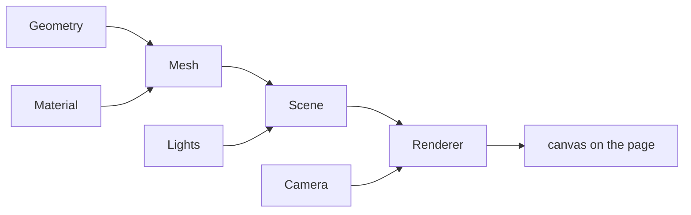

[Javascript](javascript.md) | [Javascript kata](jskata.md) |[Node JS](nodejs.md) | [Data Types](jsdatatypes.md) | [Variables](jsvariable.md) | [Control Flow](jscontrolflow.md) |
[Scope and Environment](jsscope.md) | [Objects](jsobjects.md) | [Functions](jsfunctions.md) | [Events](jsevents.md) |
[Prototypal Inheritance](jsprototypalinheritance.md) |

[Three.js](jsthree.md) | [3DE Code Editor](https://www.code3dgames.com/3de/) | [Making Shapes](js3makingshapes.md)

# Three.js

[Making Shapes](js3makingshapes.md)

Here is the truth about 3D graphics on the web: **a 3D scene is just three things, a scene, a camera and a renderer, and a loop that redraws them sixty times a second.** Three.js hides the painful parts of WebGL so that those three ideas are all you have to hold in your head.

### What it is, in plain words

[Three.js](https://threejs.org) is an open-source JavaScript library, started by Ricardo Cabello (mrdoob) in 2010, for drawing 3D graphics in the browser. Underneath it talks to the GPU through **WebGL 2**, and newer releases also ship a `WebGPURenderer` for the **WebGPU** API, which by 2026 is available in all the major browsers. You never write GPU shader code unless you want to.

The core vocabulary:

- **Scene** – the world: a tree of objects, lights and cameras.
- **Camera** – the point of view. `PerspectiveCamera` for normal 3D, `OrthographicCamera` for flat, CAD-like views.
- **Renderer** – turns the scene as seen by the camera into pixels on a `<canvas>`.
- **Mesh** = **Geometry** (the shape: box, sphere, a loaded model) + **Material** (how the surface reacts to light).
- **Lights** – ambient, directional (sun), point (bulb), spot.
- **The animation loop** – a function the browser calls before every screen refresh.



### Why it matters

- **3D anywhere.** Product viewers, data visualisation, maps, games, art and teaching tools run in a browser tab with no install.
- **It teaches real graphics ideas.** Coordinates, matrices, cameras and lighting are the same in Blender, game engines and Three.js. The maths is the [linear algebra](linearalgebra.md) of vectors and transforms.
- **Huge ecosystem.** Loaders for glTF models, orbit controls, post-processing, physics add-ons, and React Three Fiber if you work in React.

### An everyday analogy: a film set

The scene is the set with its props (meshes). The lights are the lighting rig. The camera is the camera. The renderer is the film crew that shoots a frame. The animation loop is the director shouting "action" sixty times a second, moving the props a little each time.

### A hands-on example

The files below give you the classic spinning cube. Two improvements I would make in 2026: use `renderer.setAnimationLoop` instead of calling `requestAnimationFrame` yourself (it also works for VR), and handle window resizing. Add lighting with a material that responds to it:

```js
// main.js additions
const light = new THREE.DirectionalLight(0xffffff, 3);
light.position.set(2, 3, 4);
scene.add(light, new THREE.AmbientLight(0xffffff, 0.3));

cube.material = new THREE.MeshStandardMaterial({ color: 0xf2b544 }); // reacts to light

renderer.setAnimationLoop((t) => {          // t = time in ms
  cube.rotation.x = t / 1000;
  cube.rotation.y = t / 1500;
  renderer.render(scene, camera);
});

addEventListener('resize', () => {
  camera.aspect = innerWidth / innerHeight;
  camera.updateProjectionMatrix();
  renderer.setSize(innerWidth, innerHeight);
});
```

Driving rotation from the time `t` rather than adding `0.01` each frame means the cube spins at the same speed on a 60 Hz laptop and a 144 Hz monitor.

Then add mouse control in two lines:

```js
import { OrbitControls } from 'three/addons/controls/OrbitControls.js';
new OrbitControls(camera, renderer.domElement);
```

Run it with `npx vite` as shown and open `http://localhost:5173`. On Vikix you need `nodejs` from xbps (see [Node Js](nodejs.md)).

### Common misconceptions

- **"Three.js is a game engine."** It is a rendering library. Physics, audio, input and asset pipelines are add-ons or other libraries.
- **"`MeshBasicMaterial` is broken because lights do nothing."** Basic material ignores light on purpose. Use `MeshStandardMaterial` or `MeshPhysicalMaterial`.
- **"3D in the browser is slow."** The GPU does the heavy lifting. Slowness usually comes from too many separate meshes (use instancing) or huge textures.
- **"You need to know WebGL first."** You don't. Learning Three.js first and WebGL later is the gentler order.
- **"The cube example rotates at a fixed speed."** Incrementing by `0.01` per frame ties speed to the display's refresh rate. Use the time value.

### Connections

- [JavaScript Data Types](jsdatatypes.md), [JS Objects](jsobjects.md), [JS Functions](jsfunctions.md), [JS Events](jsevents.md).
- [Node Js](nodejs.md), [Web Development](webdevelopment.md), [Intro to Pygame](intropygame.md) – the same game-loop idea in Python.
- [Linear Algebra](linearalgebra.md) and [Affine Transformations](affinetransformation.md) – the maths behind every camera.


#### Getting Started

[Three.js Official Docs](https://threejs.org/docs/index.html#manual/en/introduction/Creating-a-scene)
 [Installation](https://threejs.org/docs/#manual/en/introduction/Installation)

```
======================================================================================================
Install
======================================================================================================
npm install --save three

npm install --save-dev vite

npx vite

http://localhost:5173
```

[vitejs](https://vitejs.dev/guide/#command-line-interface), [using npm](https://docs.npmjs.com/cli/v9/using-npm/scripts),
[threejs server video](https://threejs-journey.com/lessons/local-server),
[Package management basics](https://developer.mozilla.org/en-US/docs/Learn/Tools_and_testing/Understanding_client-side_tools/Package_management)

Files, Code

```
======================================================================================================
index.html
======================================================================================================
<!DOCTYPE html>
<html>
	<head lang="en">
		<meta charset="utf-8">
		<title>My first three.js app</title>
		<style>
			body { margin: 0; }
		</style>
	</head>
	<body>
		<script type="module" src="/main.js"></script>
	</body>
</html>
```

```
======================================================================================================
main.js
======================================================================================================

import * as THREE from 'three';

const scene = new THREE.Scene();
const camera = new THREE.PerspectiveCamera( 75, window.innerWidth / window.innerHeight, 0.1, 1000 );

const renderer = new THREE.WebGLRenderer();
renderer.setSize( window.innerWidth, window.innerHeight );
document.body.appendChild( renderer.domElement );

const geometry = new THREE.BoxGeometry( 1, 1, 1 );
const material = new THREE.MeshBasicMaterial( { color: 0x00ff00 } );
const cube = new THREE.Mesh( geometry, material );
scene.add( cube );

camera.position.z = 5;
function animate() {
	requestAnimationFrame( animate );

	cube.rotation.x += 0.01;
	cube.rotation.y += 0.01;

	renderer.render( scene, camera );
}
animate();
```

to be continued...
