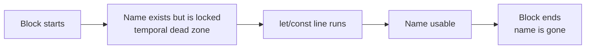

[Javascript](javascript.md) | [Javascript kata](jskata.md) |[Node JS](nodejs.md) | [Data Types](jsdatatypes.md) | [Variables](jsvariable.md) | [Control Flow](jscontrolflow.md) |
[Scope and Environment](jsscope.md) | [Objects](jsobjects.md) | [Functions](jsfunctions.md) | [Events](jsevents.md) |
[Prototypal Inheritance](jsprototypalinheritance.md) |
[Three.js](jsthree.md) | [3DE Code Editor](https://www.code3dgames.com/3de/) |

# Javascript Variables

Here is the truth nobody tells beginners: **a variable is not a box that holds a value. It is a name that points at a value.** Once that sinks in, half the "weird" behaviour of JavaScript stops being weird.

### What it is, in plain words

A variable is a label you attach to a value so you can find it again. In modern JavaScript (everything since ES2015, and everything you should be writing in 2026) you create one with one of two keywords:

- **`const`** – the name is bound once and can never be pointed somewhere else.
- **`let`** – the name can be re-pointed later.

There is a third, older keyword, **`var`**. It still works, because the web never breaks old pages, but it has strange scoping rules (it ignores blocks and is "hoisted" to the top of the function). Treat it as a museum piece. Use `const` by default, and reach for `let` only when you genuinely need to reassign.

```js
const name = "Vikix";   // never re-bound
let count = 0;          // will change
count = count + 1;      // fine
// name = "Arch";       // TypeError: Assignment to constant variable.
```

### Why it matters

Programs are mostly about *state* – what is true right now. Variables are how we name state. If you can see at a glance which names change and which don't, you can read a program like a story. `const` everywhere with the occasional `let` is a signal to the reader: "only these few things move".

It also matters because of bugs. Most JavaScript surprises come from three places: re-assigning something you didn't mean to, sharing one object between two names, and reading a name before it exists. Each one is a variable problem.

### An everyday analogy: name tags at a party

Imagine a party where every guest wears a sticky name tag. The *guest* is the value; the *tag* is the variable.

- `const` is a tag that has been glued on. It stays with that guest all night.
- `let` is a tag you can peel off and stick on a different guest.
- Two tags can be stuck on the *same* guest. If that guest spills wine on their shirt, both tags now point at a stained shirt.

That last point is the one that bites people.

### A hands-on example: binding versus mutation

Open a terminal and run `node` (or the browser console – press F12).

```js
const list = [1, 2, 3];
list.push(4);           // allowed!
console.log(list);      // [1, 2, 3, 4]

const alias = list;     // second tag on the same guest
alias.push(5);
console.log(list);      // [1, 2, 3, 4, 5]  -- surprise?
```

`const` stops you re-binding the *name*. It does not freeze the *value*. Arrays and objects are mutable, so both `list` and `alias` see the change. If you want a real copy, make one:

```js
const copy = [...list];          // shallow copy
const deep = structuredClone(list); // deep copy, built in since 2022
copy.push(6);
console.log(list.length, copy.length); // 5 6
```

If you want the value itself frozen, say so: `Object.freeze(list)`.

Primitives – numbers, strings, booleans, `null`, `undefined`, `bigint`, `symbol` – are immutable. You cannot change the number 3; you can only point a name at a different number. That is why this "just works":

```js
let a = 10;
let b = a;
b = b + 1;
console.log(a, b); // 10 11
```

### The temporal dead zone

`let` and `const` exist from the start of their block, but you may not touch them until the line that declares them runs. The gap is called the **temporal dead zone**:

```js
{
  // console.log(x); // ReferenceError: Cannot access 'x' before initialization
  let x = 42;
  console.log(x);    // 42
}
```

With `var` the same code prints `undefined` instead of failing. Failing loudly is better – it is the language telling you the truth.



### Common misconceptions

- **"`const` means constant value."** No – it means constant *binding*. The object behind it can still change.
- **"Variables have types."** In JavaScript, *values* have types; names don't. `let x = 1; x = "one";` is legal. If you want types on names, that is what TypeScript (or JSDoc checks) adds on top.
- **"`var` and `let` are the same thing with different spelling."** `var` is function-scoped and hoisted; `let` is block-scoped. A `for (var i...)` loop with callbacks inside famously gives every callback the same `i`.
- **"Global variables are fine in small scripts."** In a browser, top-level `var` attaches itself to `window`. Modules (`<script type="module">`, or any `.mjs` file) keep your top-level names private. Use modules.
- **"Copying an object with `=` duplicates it."** It only adds a second tag. Use spread, `structuredClone`, or a library.

### Connections

- How long a name lives, and who can see it, is the subject of [Scope and Environment](jsscope.md).
- What values a name can point at is covered in [Data Types](jsdatatypes.md).
- The "two tags, one guest" problem gets serious with [Objects](jsobjects.md).
- Functions are values too, so they get names exactly like this – see [Functions](jsfunctions.md).
- Lisp people will recognise the idea at once: in [PicoLisp](picolisp.md) a symbol is a name with a value cell, and binding is the whole game.
