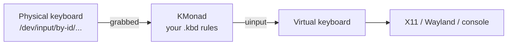

# Kmonad Keyboard

The truth about keyboards is that **the layout printed on the keys is just a suggestion.** Between the switch and your program sits software that decides what each key means – and KMonad lets you rewrite that decision completely.

### What it is, in plain words

**KMonad** is a keyboard remapper written in Haskell. It grabs your physical keyboard at a low level, runs every key event through a configuration you write, and emits new events through a virtual keyboard. Because it works below the window system, the result works everywhere: in X11, Wayland, the Linux console, even in a login prompt. It runs on Linux, macOS and Windows.

What makes it more than a simple remapper is that it brings **firmware-style features** – the kind you'd normally need a QMK keyboard for – to any keyboard, including your laptop's:

- **layers** – hold a key and the whole keyboard changes meaning;
- **tap-hold** – a key does one thing when tapped, another when held;
- **home-row mods** – `a s d f` act as Super/Alt/Ctrl/Shift when held;
- **multi-tap**, **sticky keys**, **macros**, **compose sequences**.

Configuration lives in a `.kbd` file written in a Lisp-like syntax – which is a pleasant surprise if you like parentheses.

### Why it matters

Your hands do more work at a keyboard than almost anywhere else. If you live in Emacs, StumpWM and a terminal, as I do on Vikix, nearly every action is a chord. Moving Ctrl to Caps Lock, putting arrows under your home row, or turning a useless key into a window-manager prefix reduces strain and makes everything faster. KMonad does it in one portable config file that you can carry to any machine.

### An everyday analogy: a simultaneous interpreter

At a conference, the speaker speaks one language and you hear another through your headphones, almost instantly. The speaker doesn't change; the interpreter does the translation in real time. Your keyboard is the speaker, your programs are the audience, and KMonad is the interpreter – and you write the dictionary.



### A hands-on example

Install. KMonad is in many repos (Arch AUR `kmonad`, Nix, Guix); otherwise build from source with Stack or grab a static release binary from GitHub.

Linux needs access to input devices and to `uinput`:

```bash
sudo modprobe uinput
sudo groupadd -f uinput
sudo usermod -aG input,uinput $USER
echo 'KERNEL=="uinput", MODE="0660", GROUP="uinput", OPTIONS+="static_node=uinput"' \
  | sudo tee /etc/udev/rules.d/90-uinput.rules
# log out and in again
```

Find your keyboard device:

```bash
ls /dev/input/by-id/ | grep -i kbd
```

Write `~/.config/kmonad/laptop.kbd`:

```lisp
(defcfg
  input  (device-file "/dev/input/by-id/usb-Your_Keyboard-event-kbd")
  output (uinput-sink "KMonad laptop")
  fallthrough true      ;; unmapped keys pass through unchanged
  allow-cmd false)

;; the keys we want to touch, in physical layout order
(defsrc
  caps a    s    d    f    j    k    l    ;    spc)

(defalias
  ;; Caps: tap = Escape, hold = Control
  cesc (tap-hold-next-release 200 esc lctl)
  ;; home-row mods
  ma (tap-hold-next-release 200 a lmet)
  ms (tap-hold-next-release 200 s lalt)
  md (tap-hold-next-release 200 d lctl)
  mf (tap-hold-next-release 200 f lsft)
  ;; space: tap = space, hold = navigation layer
  nav (tap-hold-next-release 200 spc (layer-toggle nav)))

(deflayer base
  @cesc @ma @ms @md @mf j    k    l    ;    @nav)

(deflayer nav
  _     _   _   _   _   left down up  rght _)
```

Run it:

```bash
kmonad ~/.config/kmonad/laptop.kbd
```

Now Caps is Escape on tap and Control on hold, and holding Space turns `j k l ;` into arrow keys. On Void, make it a runit service by creating `/etc/sv/kmonad/run` with `exec kmonad /home/you/.config/kmonad/laptop.kbd` and linking it into `/var/service/`.

### Pairing with StumpWM

StumpWM's default prefix is `C-t`. With Caps-as-Control, that becomes a comfortable left-hand roll. Or dedicate a key: map Right Alt to F20 in KMonad and set `(set-prefix-key (kbd "F20"))` in `~/.stumpwmrc` – a one-key prefix nothing else uses.

### Common misconceptions

- **"It's a Haskell library; I need to know Haskell."** You only write the `.kbd` file. Haskell matters only if you build from source.
- **"Home-row mods will ruin my typing."** They take a week to get used to, and the timeout (200 ms above) is tunable. `tap-hold-next-release` avoids most misfires.
- **"It only works under X."** It works below the display server, which is the whole point.
- **"It's the only option."** **kanata** (Rust) is a popular, actively developed successor inspired by KMonad, with very similar config syntax. **keyd** is a simpler C daemon. Pick what suits you; the ideas transfer.
- **"If KMonad crashes I lose my keyboard."** It releases the grab on exit; your keyboard returns to normal. Keep a terminal handy while experimenting anyway.

### Connections

- [Keyboard Config](keyboardconfig.md) – simpler remapping with xkb and `setxkbmap`.
- [Penti](penti.md) – a far more radical rethink of the keyboard.
- [Haskell](haskell.md) – the language KMonad is written in.
- [Emacs](emacs.md) and [vim](vim.md) – where better modifier keys pay off the most.

- [Powerful keybindings easier than ever with KMonad - Youtube](https://www.youtube.com/watch?v=Dhj1eauljwU)
- [Tutorial on Git](https://github.com/kmonad/kmonad/blob/master/keymap/tutorial.kbd)
- [Source on Git](https://github.com/kmonad/kmonad)
