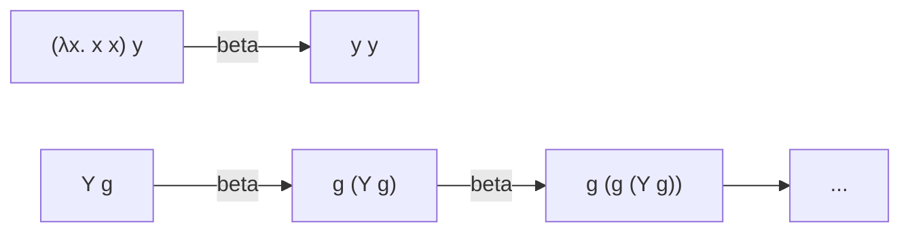

[Read This!](caveatemptor.md) | [Algorithms](algorithms.md) | [AssemblyLanguage](assemblylanguage.md) | [BASH](bash.md) |   [C-Programmming](cprogramming.md) |
[Computer Security](computersecurity.md) |  [Databases](databases.md) | [Emacs](emacs.md) |  [Exploitation](exploitation.md) | [Functional Programming](functional.md) |
[Firewalls](firewalls.md) |   [Git](git.md) | [Javascipt](javascript.md) | [Julia](julia.md) | [Social Engineering](internetexploitation.md) |
[Picolisp](picolisp.md) | [Pharo Smalltalk](pharo.md) | [Linux](linux.md) | [Python](python.md) | [Operating Systems](os.md) |
[Machine Learning](machinelearning.md) | [Metasploit](metasploit.md) |  [Open Data Science](opendatascience.md) |
[Networking](networking.md) | [Machine Learning](machinelearning.md) |[Scheme](scheme.md) | [Unity](unity.md) | [vim](vim.md) | [Web Development](webdevelopment.md)

# Lambda Calculus

Here is a truth that still amazes me: **you can build all of computation out of nothing but functions.** No numbers, no booleans, no loops, no variables that change – just making functions and applying them. That tiny system is the lambda calculus, and every Lisp, every closure, every `=>` in JavaScript descends from it.

### What it is, in plain words

The lambda calculus, invented by Alonzo Church in the 1930s, has exactly three kinds of expression:

1. **Variables** – \( x \), \( y \), \( f \).
2. **Function abstraction** – \( \lambda x.\, M \): "a function that takes \( x \) and gives back \( M \)".
3. **Function application** – \( M\, N \): "apply \( M \) to \( N \)".

And one real rule of computation, **beta reduction**: to apply a function, substitute the argument for the parameter.

$$ (\lambda x.\, M)\, N \;\to\; M[x := N] $$

For example \( (\lambda x.\, x\, x)\, y \to y\, y \).

That's the whole language. Two helper rules keep it honest: **alpha conversion** (renaming a bound variable changes nothing: \( \lambda x.\, x = \lambda y.\, y \)) and, optionally, **eta** (\( \lambda x.\, f\, x = f \) when \( x \) isn't free in \( f \)).

### Why it matters

Church and Turing proved, independently and in the same year (1936), that the lambda calculus and the Turing machine can compute exactly the same things. So this tiny function language is a complete model of computation – the "assembly language" of functional programming.

It matters practically too:

- **Lisp** (1958) took its `lambda` straight from Church. [PicoLisp](picolisp.md), [Scheme](scheme.md), [Common Lisp](commonlisp.md) and Racket all carry it.
- **Closures**, higher-order functions and anonymous functions in Python, JavaScript, Rust and C++ are lambda terms with syntax sugar.
- The **typed** lambda calculi underpin [Haskell](haskell.md), OCaml and proof assistants like Lean and Coq/Rocq, where programs and proofs turn out to be the same thing (the Curry–Howard correspondence).

### An everyday analogy: fill-in-the-blank forms

A lambda is a form with a blank: "Dear ___, thank you for coming." Abstraction is *making* the form and labelling the blank \( x \). Application is handing someone the form and a name. Beta reduction is filling in the blank wherever it appears. The surprising part is that the thing you write in the blank can be *another form* – and that's enough to compute anything.

### A hands-on example: numbers and booleans from nothing

With no built-in data, how do we get true and false? We define them by what they *do*: choose.

$$ \text{TRUE} = \lambda a.\, \lambda b.\, a \qquad \text{FALSE} = \lambda a.\, \lambda b.\, b $$

Then \( \text{IF} = \lambda c.\, \lambda t.\, \lambda e.\, c\, t\, e \) just applies the boolean to the two branches.

Numbers are "do something \( n \) times" (**Church numerals**):

$$ 0 = \lambda f.\, \lambda x.\, x \qquad 1 = \lambda f.\, \lambda x.\, f\, x \qquad 2 = \lambda f.\, \lambda x.\, f\,(f\, x) $$

$$ \text{SUCC} = \lambda n.\, \lambda f.\, \lambda x.\, f\,(n\, f\, x) \qquad \text{PLUS} = \lambda m.\, \lambda n.\, \lambda f.\, \lambda x.\, m\, f\,(n\, f\, x) $$

You can run these directly in any language with first-class functions. In JavaScript:

```js
const TRUE  = a => b => a;
const FALSE = a => b => b;
const IF    = c => t => e => c(t)(e);

const ZERO = f => x => x;
const SUCC = n => f => x => f(n(f)(x));
const PLUS = m => n => f => x => m(f)(n(f)(x));

const toInt = n => n(k => k + 1)(0);   // decode for humans
const TWO = SUCC(SUCC(ZERO));
const THREE = SUCC(TWO);

console.log(toInt(PLUS(TWO)(THREE)));      // 5
console.log(IF(TRUE)("yes")("no"));        // yes
```

And in PicoLisp, where a function is literally a list of parameters and body:

```lisp
(setq Two '((F X) (F (F X))))
(Two inc 0)                       # -> 2
(Two '((S) (pack S "!")) "hi")    # -> "hi!!"
```

### Recursion without names

There are no named definitions in the pure calculus, so how can a function call itself? With a **fixed-point combinator**:

$$ Y = \lambda f.\, (\lambda x.\, f\,(x\, x))\,(\lambda x.\, f\,(x\, x)) $$

\( Y\, g \) reduces to \( g\,(Y\, g) \) – the function receives *itself* as an argument. In strict languages like JavaScript you use the variant called **Z** to avoid looping forever.



### Common misconceptions

- **"It's just notation for functions."** It's a complete model of computation, equal in power to Turing machines.
- **"Lambda calculus needs numbers to be useful."** Numbers, pairs, lists and booleans can all be *encoded* as functions.
- **"Every expression has an answer."** \( (\lambda x.\, x\, x)(\lambda x.\, x\, x) \) reduces to itself forever. Non-termination is built in – just like real programs.
- **"Evaluation order doesn't matter."** The final answer, *if one exists*, is unique (Church–Rosser theorem), but some orders find it and others loop forever. Lazy (normal-order) evaluation always finds it when it exists – that's Haskell's strategy.
- **"Lambdas in Python are the lambda calculus."** Python's `lambda` is restricted to one expression. The idea is the same; the language around it isn't pure.

### Connections

- [Functional Programming](functional.md) – the programming style built on this.
- [Functions in JavaScript](jsfunctions.md) and [Scope](jsscope.md) – closures in practice.
- [PicoLisp](picolisp.md), [Scheme](scheme.md), [Common Lisp](commonlisp.md), [Haskell](haskell.md) – languages that wear their lambda proudly.
- [Computer Science](computerscience.md) – where computability theory lives.
- [Set Theory](../mathematics/settheory.md) – the other great foundation, built on sets instead of functions.

- function abstraction
- function application
