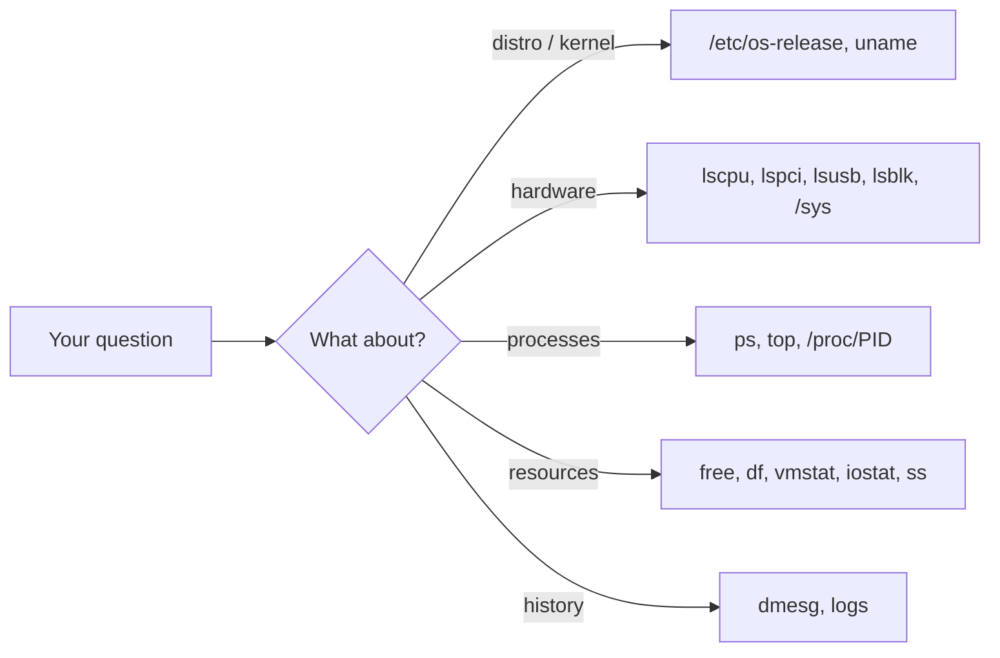

# Linux Introspection

Here's a truth that makes Linux wonderful to learn on: **the system will tell you almost everything about itself if you just ask.** No hidden registry, no magic – mostly plain text files and a handful of honest little commands.

### What it is, in plain words

**Introspection** means a system examining itself. On Linux that means finding out: what distribution and kernel am I running, what hardware is here, what's running, what's using the disk, the memory, the network – and why it booted the way it did.

Most of the answers come from two virtual filesystems the kernel provides:

- **`/proc`** – one directory per process (`/proc/1234/`), plus system-wide files like `/proc/cpuinfo`, `/proc/meminfo`, `/proc/version`.
- **`/sys`** – a structured view of devices, drivers and kernel settings.

Neither exists on disk. When you `cat` them, the kernel generates the text on the spot.

### Why it matters

You can't fix what you can't see. Before installing a driver you need the exact hardware ID; before reporting a bug you need the kernel version; before blaming a program you need to know whether the CPU, disk or memory is actually the bottleneck. Introspection turns "my computer is slow" into "process X is waiting on disk Y".

### An everyday analogy: a car's dashboard and service manual

A good car tells you its speed, fuel, temperature and warnings on the dashboard, and the service manual tells you its make, engine and part numbers. `/proc` is the live dashboard; `/etc/os-release`, `uname` and `lspci` are the service manual. You don't need to take the engine apart.



### A hands-on example: a tour of your own box

**Which Linux is this?**

```bash
cat /etc/os-release        # works on essentially every modern distro
uname -a                   # kernel version, architecture
```

`lsb_release -a` – what this page used to recommend – needs an extra package and isn't installed on Void, Arch or many minimal systems. `/etc/os-release` is the standard now.

**What hardware?**

```bash
lscpu                      # CPU model, cores, flags, caches
lsblk -f                   # disks, partitions, filesystems, mount points
lspci -k                   # PCI devices and which kernel driver owns each
lsusb                      # USB devices
cat /sys/class/power_supply/BAT0/capacity   # laptop battery %
sudo dmidecode -t system   # vendor, model, serial (from firmware)
```

**What's running and what's it costing?**

```bash
uptime                     # load averages
free -h                    # memory; read the 'available' column
ps -eo pid,user,%cpu,%mem,comm --sort=-%cpu | head
vmstat 1 5                 # CPU, memory, swap, IO every second
ss -tulpn                  # listening sockets and their programs
```

**Ask /proc about a single process** (try your shell, `$$`):

```bash
cat /proc/$$/status        # state, memory, threads, capabilities
ls -l /proc/$$/fd          # open files
cat /proc/$$/cmdline | tr '\0' ' '; echo
readlink /proc/$$/exe      # the binary it's running
```

**What happened at boot?**

```bash
sudo dmesg --human | less        # kernel messages
sudo dmesg --level=err,warn
```

On systemd distros add `journalctl -b`; on Void with socklog, look in `/var/log/socklog/`.

**Which init system?** PID 1 tells you:

```bash
ps -p 1 -o comm=           # runit on Void, systemd on most others
```

### A one-screen summary

Tools like **fastfetch** (the maintained successor to the archived neofetch) print a neat summary for screenshots. For live monitoring, **htop** or **btop** give the whole picture interactively.

### Common misconceptions

- **"Files in /proc take up disk space."** They're generated on read; `ls -l` shows size 0.
- **"Load average is CPU percentage."** It's the average number of tasks running *or waiting* (including on disk I/O, the `D` state). A load of 4 on an 8-core box is fine.
- **"`free` says I'm out of memory."** Cache counts as used but is instantly reclaimable. Trust *available*.
- **"`uname -r` tells me the distro."** It tells you the kernel. Distros share kernels; check `os-release`.
- **"I need root for everything."** Most of this works as a normal user. Root is needed for other users' process details, `dmidecode` and some `dmesg` setups.

### Connections

- [Linux Memory and Process](linuxprocessesandmemory.md) – what the numbers in `/proc` describe.
- [pmap](pmap.md) – a process's memory map.
- [ncdu](ncdu.md) – where the disk space went.
- [The Linux Process Manager](thelinuxprocessmanager.md) – how processes are scheduled.
- [Linux Tools](linuxtools.md) – the wider toolbox.

**Find out version of linux**
    lsb_release -a
