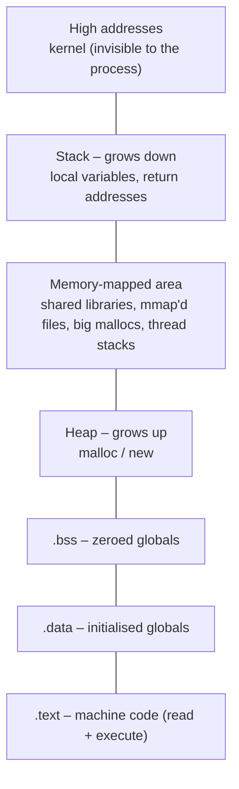

[computingFreedom](computingfreedom.md) |
  [Build](bciyh.md) |
  [Picolisp](picolisp.md) | [Picolisp Machine](pilmachine.md) | [pil sources](pilsource.md) |
  [Linux](linux.md) | [BASH](bash.md) |
  [C Programmming](cprogramming.md) |
  [Operating Systems](os.md) |
  [Javascipt](javascript.md) |
  [Emacs](emacs.md)  | [vim](vim.md) |
  [Pharo Smalltalk](pharo.md) |
  [Computer Security](computersecurity.md) |
  [Python](python.md) | [SimpleLinuxConfig](simplelinuxconfig.md)

# Linux Memory and Process

The truth behind every running program on Linux: **each process believes it has the whole machine's memory to itself.** It doesn't. The kernel and the CPU are running a very convincing illusion called *virtual memory*, and once you see how it's staged, processes stop being mysterious.

### What it is, in plain words

A **process** is a running program: some code, some memory, some open files, and a bit of kernel bookkeeping (a PID, an owner, a state, a parent). On Linux every process gets its own **virtual address space** – on x86-64 a range of 128 TiB for user space. The addresses your program uses are not physical RAM addresses; the CPU's memory management unit translates them, page by page (usually 4 KiB per page), using **page tables** the kernel keeps for each process.

Inside that space a process is laid out in regions:



Address Space Layout Randomization (**ASLR**) shuffles the start of each region every run, which is why addresses differ each time.

### Why it matters

Almost every hard bug and every interesting security issue lives here: stack overflows, use-after-free, memory leaks, segmentation faults, "the OOM killer took my database". Performance too – cache misses and page faults are where time goes. And understanding the layout tells you why one process can't scribble over another's memory: they literally can't name each other's addresses.

### An everyday analogy: hotel room numbers

Every guest in a hotel chain is told "you're in room 101". In every hotel, a different guest is in "room 101" – it's a different building. The front desk (the MMU, guided by the kernel) knows which real room each guest's "101" maps to. Guests can't wander into another building's 101. And some rooms – the shared lobby, the restaurant – appear in everyone's map: those are shared libraries.

### A hands-on example: see it for yourself

```c
/* layout.c */
#include <stdio.h>
#include <stdlib.h>
#include <unistd.h>

int initialised = 42;   /* .data */
int zeroed;             /* .bss  */

int main(void) {
    int local = 1;                       /* stack */
    int *heap = malloc(sizeof *heap);    /* heap  */
    printf("pid    %d\n", getpid());
    printf("text   %p\n", (void *)main);
    printf("data   %p\n", (void *)&initialised);
    printf("bss    %p\n", (void *)&zeroed);
    printf("heap   %p\n", (void *)heap);
    printf("stack  %p\n", (void *)&local);
    getchar();                           /* pause so we can look */
    return 0;
}
```

```bash
gcc -g layout.c -o layout && ./layout
```

In a second terminal, using the PID it printed:

```bash
cat /proc/<pid>/maps        # every region, with permissions
pmap -x <pid>               # same, with sizes and RSS
grep -E 'Vm|Rss' /proc/<pid>/status
```

You'll see the addresses printed by the program land neatly inside the regions the kernel lists. Run it twice: thanks to ASLR, the numbers change.

### How processes are born and die

Linux creates processes with **fork** (copy myself) and **exec** (replace my program with another). The copy is cheap because of **copy-on-write**: parent and child share pages until one of them writes, and only then is a page actually copied.

```bash
ps -eo pid,ppid,stat,rss,vsz,comm --forest | head -20
```

`STAT` letters tell you the state: `R` running, `S` sleeping, `D` uninterruptible (usually waiting on disk), `Z` zombie (finished, parent hasn't collected the exit status), `T` stopped. On Vikix, PID 1 is **runit**; on most other distros it's systemd.

### When memory runs out

Linux **overcommits**: `malloc` usually succeeds even if RAM is short, because many programs never touch all they ask for. Pages are only really allocated when touched (a **page fault** brings them in). If real memory then runs out and swap (or zram) can't help, the **OOM killer** picks a process to kill. Check `dmesg` or the journal for "Out of memory: Killed process". Modern desktops increasingly use userspace helpers like `earlyoom` or systemd-oomd to act before the system freezes.

### Common misconceptions

- **"VSZ is how much RAM a process uses."** It's address space reserved. RSS (resident) or PSS (proportionally shared) is the real number.
- **"Free RAM is wasted, so Linux is leaking."** The kernel uses spare RAM as page cache. `free -h` – look at the *available* column, not *free*.
- **"Threads are separate processes."** On Linux they're tasks that share one address space. Each has its own stack, mapped inside the shared space.
- **"A segfault means the program touched another program's memory."** It touched an address not mapped in *its own* space, or broke the permissions (writing to `.text`, say).
- **"Swap is obsolete."** A little swap (or zram) lets the kernel park cold pages and avoids sudden OOM kills.

### Connections

- [pmap](pmap.md) – the map of a live process.
- [The Linux Process Manager](thelinuxprocessmanager.md) – scheduling and process states.
- [Linux Introspection](linuxinstrospection.md) – asking `/proc` and friends what's happening.
- [objdump](objdump.md) – the sections on disk that become these regions.
- [Operating Systems](os.md) and [Modern Operating Systems](modernoperatingsystems.md) – the theory behind it all.
- [Exploitation](exploitation.md) – why stack and heap layout matter to attackers.

- Perhaps the best place to start is to read this page by
  [Duartes](http://duartes.org/gustavo/blog/post/anatomy-of-a-program-in-memory/).
- [linux-processes-memory-layout](https://www.thegeekstuff.com/2012/03/linux-processes-memory-layout/)
