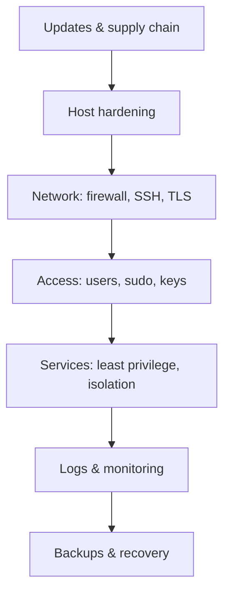

# Linux Security

Here is the truth about Linux security: **there is no antivirus product that will save a misconfigured server, and no amount of hardening will save a system you never update.** Security is a set of habits – least privilege, small attack surface, quick patches, deep defence – not a package you install.

### What it is, in plain words

**Linux security** covers everything that keeps a Linux system doing only what you intend: authentication, permissions, updates, network exposure, service hygiene, kernel hardening, logging and response. The same kernel runs phones, TVs, supercomputers and the web; the *threats* differ, but the principles don't.

A minimal mental model:



### Why it matters

A box on the internet is probed within minutes of getting an address. Default passwords, forgotten `sshd` with password auth, ancient WordPress, an exposed Redis – these are how real breaches start. If you run Vikix at home the stakes are lower, but the habits you build there are the same ones that keep a public server alive.

### An everyday analogy: locking up a workshop

You don't buy a tank to protect a workshop. You lock the door (firewall / SSH keys), don't leave the key under the mat (no password auth), keep the tools off the floor so nobody trips (least privilege), notice when a window is broken (logs), and keep a spare set of plans off-site (backups). Most break-ins walk through an unlocked door, not a hole blown in the wall.

### A hands-on hardening checklist

**1. Keep the system updated.**

```bash
# Void
sudo xbps-install -Su
# Debian/Ubuntu
sudo apt update && sudo apt full-upgrade
```

Enable unattended security updates on Ubuntu (`unattended-upgrades`); on Void, a cron/`runit` timer that runs `xbps-install -Su` and notifies you is enough.

**2. Lock SSH down** – keys only, no root login. See [SSH Login](sshlogin.md).

**3. Firewall, default deny.**

```bash
# nftables sketch (or use ufw on Ubuntu)
sudo nft add table inet filter
sudo nft 'add chain inet filter input { type filter hook input priority 0; policy drop; }'
sudo nft add rule inet filter input ct state established,related accept
sudo nft add rule inet filter input iif lo accept
sudo nft add rule inet filter input tcp dport 22 accept
```

See [Firewalls](firewalls.md).

**4. Least privilege.**

- Ordinary user for daily work; `sudo` for admin.
- `sudo` with specific commands where possible, not unbounded root shells for everyone.
- Services run as their own user (`User=` in systemd, `chpst -u` in runit), never as root unless they must.

**5. Shrink the attack surface.**

```bash
ss -tulpn        # what is listening?
systemctl list-units --type=service --state=running
# on Void: ls /var/service
```

If you don't need it, disable it. Every open port is a promise to keep something patched.

**6. File integrity and permissions.**

```bash
find / -perm -4000 -type f 2>/dev/null    # SUID binaries – know them
chmod 700 ~/.ssh && chmod 600 ~/.ssh/*
```

**7. Isolation for risky things.** Containers (Podman/Docker), VMs ([VirtualBox](virtualbox.md), KVM), or at least a separate user. Don't test malware on your host.

**8. Logs and time.**

```bash
journalctl -p err -b                 # systemd
# Void with socklog: look in /var/log/socklog/
timedatectl                          # accurate time matters for logs and TLS
```

**9. Backups you'll actually restore.** An untested backup is a story you tell yourself. See [Data Recovery](datarecovery.md).

### Common misconceptions

- **"Linux can't get viruses."** It gets trojans, cryptominers, web shells and worm-exploited services. Desktop malware is rarer; server compromise is routine.
- **"I'm behind a router, so I'm safe."** NATs are not firewalls for outbound-initiated attacks, and many routers are themselves unpatched.
- **"SELinux/AppArmor are too hard."** On Fedora/RHEL and Debian/Ubuntu they ship with workable defaults. Don't disable them to "make it work" – fix the label.
- **"A web application firewall is all I need."** WAFs help; unpatched apps and weak SSH don't care.
- **"Security tools equal security."** Tools assist habits. Habits come first.

### A note on "distro security"

People ask whether Ubuntu, Debian, Fedora, Arch or Void is "more secure". The honest answer: a maintained, minimal, updated system with locked-down SSH and a firewall beats a bloated neglected one of any brand. Pick a distro you will actually keep updated. The habits matter far more than the logo.

### Connections

- [Computer Security](computersecurity.md) – the broader picture.
- [Firewalls](firewalls.md), [SSH Login](sshlogin.md), [TLS](tls.md), [Encryption](encryption.md).
- [Penetration Testing](penetrationtesting.md) – how attackers look at the same system.
- [Honeypots](honeypots.md), [IDS/IPS](idsips.md), [Forensics](forensics.md).

[Computing](computing.md) | [Computer Security](computersecurity.md) | [Linux Security](linuxsecurity.md) |
[Industrial Control Systems Security](icssecurity.md) | [Penetration Testing](penetrationtesting.md)
[Exploitation](exploitation.md) | [Social Engineering](internetexploitation.md) | [Metasploit](metasploit.md)
