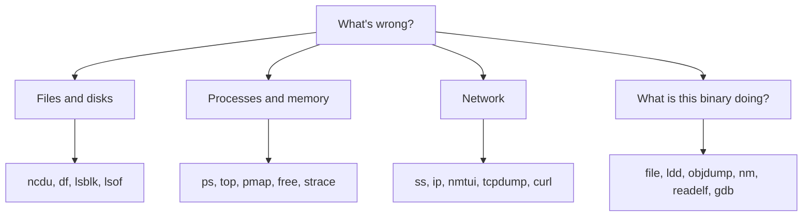

# Linux Tools

Here is a truth every Linux user eventually learns: **the system is covered in small, sharp tools, and fluency means knowing which one to reach for.** You don't memorise every flag – you memorise the *names*, so that when a problem appears you think "that's a job for `strace`" instead of staring at it.

### What it is, in plain words

"Linux tools" here means the everyday command-line utilities that inspect, control and debug a running Unix system. Some come from **GNU coreutils** (`ls`, `cp`, `sort`), some from **util-linux** and **procps-ng** (`ps`, `free`, `mount`), some from **binutils** (`objdump`, `nm`, `readelf`), and some are specialised projects of their own (`strace`, `tcpdump`, `ncdu`). Together they are how you see what the kernel and your programs are actually doing.

This page is a map – a shelf of tools grouped by the kind of question they answer – with pointers to the ones that have their own pages.

### Why it matters

GUIs hide problems. Logs and tools reveal them. Whether you're chasing a stuck process, a full disk, a slow network call or a binary you didn't write, there's a tool that will tell you the truth in a few seconds. On Vikix, sitting in StumpWM with a terminal, these *are* the interface.

### An everyday analogy: a doctor's bag

A doctor doesn't bring a hospital to a house call. She brings a bag of small, trusted instruments: a thermometer, a stethoscope, a light, a blood-pressure cuff. Each answers one kind of question. Linux tools are that bag. You learn which instrument fits which symptom.



### The shelf, by question

**What's using my disk?**
[ncdu](ncdu.md) for an interactive tree of sizes; `df -h` for filesystems; `du -sh *` for a quick one-level look; `lsblk -f` for partitions and mount points; `lsof +L1` for files deleted but still held open.

**What's running, and what's it doing?**
`ps`, `top`/`htop`/`btop` for live views; [pmap](pmap.md) for a process's memory map; `free -h` for RAM; see [Linux Memory and Process](linuxprocessesandmemory.md) and [Linux Introspection](linuxinstrospection.md). When a process misbehaves, **`strace -p PID`** shows every system call; `ltrace` does the same for library calls.

**How do I talk to the network?**
[nmtui](nmtui.md) / `nmcli` to configure connections; `ip addr` / `ip route` (the modern replacement for `ifconfig` and `route`); `ss -tulpn` (the modern replacement for `netstat`) to see who's listening; `curl -v` / `wget` to fetch; `tcpdump -i eth0` or Wireshark to watch packets. For name resolution: `dig` and `resolvectl`.

**What *is* this file?**
`file foo` guesses the type; `strings foo` pulls out readable text; `hexdump -C` / `xxd` show the bytes; `sha256sum` fingerprints it.

**What's inside this binary?**
This is the **binutils** family – essential for C and systems work:

| Tool | Question it answers |
|------|---------------------|
| [`objdump -d`](objdump.md) | What assembly does it contain? |
| `readelf -a` | What's the ELF structure? |
| `nm` | What symbols does it define/use? |
| `ldd` | Which shared libraries does it need? |
| `size` | How big are its text/data/bss? |
| `strip` | Can I remove its symbols? |
| `ar` / `ranlib` | How do I pack a static library? |

Then the debugger: [gdb](gbddebugger.md) (with GEF or `pwndbg` extensions if you do security work), and `perf` for performance counters.

**How do I shape text?**
[awk](awk.md), `sed`, `grep`/`rg`, `cut`, `sort`, `uniq`, `jq` for JSON, `yq` for YAML. Pipelines of these replace a surprising amount of scripting.

**How do I build software?**
`make` (see [Makefile](makefile.md)), `cmake`, compilers (`gcc`, `clang`), `pkg-config`, `git` ([Git](git.md)).

### A hands-on example: one mystery, four tools

A program hangs. Instead of guessing:

```bash
ps aux | grep myapp                 # find the PID
strace -p $PID                      # what's it waiting on? (often a read or futex)
lsof -p $PID                        # which files/sockets does it hold?
ss -tp | grep $PID                  # is it stuck on a network connection?
```

Five minutes later you know whether it's waiting on a disk, a lock, or a server that isn't answering. That pattern – *name the question, pick the tool* – is the whole craft.

### Learning them without drowning

Don't read man pages cover to cover. When you need to do something, do it with the tool, then read `man tool` or `tldr tool` (the `tldr` client gives short examples). Over months the bag fills itself. The pages linked above go deeper on the tools I've found most worth knowing well.

### Common misconceptions

- **"`ifconfig` / `netstat` are the normal tools."** They're obsolete on Linux. Use `ip` and `ss`.
- **"I need a GUI for diagnostics."** Almost never. The tools above cover more ground than most GUIs.
- **"strace is only for experts."** `strace COMMAND` on a program you wrote yourself is the fastest teacher of how user space meets the kernel.
- **"These are Linux-specific."** Many come from Unix and work on BSDs and macOS, sometimes under slightly different names.
- **"Knowing them means memorising flags."** It means knowing they exist. Flags you can look up.

### Connections

- [Linux](linux.md), [BASH](bash.md) and [Bash Cookbook](vikidsbashcookbook.md) – where you use these tools.
- [Linux Tools and Software](linuxtoolsandsoftware.md) – a broader software list.
- [pacman](pacman.md) – Arch's package tool (see Arch-Related below).
- [GCC](gcc.md), [gdb debugger](gbddebugger.md), [objdump](objdump.md).

  [Computing](computing.md) |
  [computingFreedom](computingfreedom.md) |
  [Build](bciyh.md) |
  [Picolisp](picolisp.md) | [Picolisp Machine](pilmachine.md) | [pil sources](pilsource.md) |
  [Linux](linux.md) | [BASH](bash.md) |
  [C Programmming](cprogramming.md) |
  [Operating Systems](os.md) |
  [Javascipt](javascript.md) |
  [Emacs](emacs.md)  | [vim](vim.md) |
  [Pharo Smalltalk](pharo.md) |
  [Computer Security](computersecurity.md) |
  [Python](python.md) |
[Tools to Learn](linuxtools.md)
[awk](awk.md)
[gdb](gdb.md "MISSING PAGE")
[ifconfig](ifconfig.md "MISSING PAGE")
[netstat](netstat.md "MISSING PAGE")
[lsof](lsof.md "MISSING PAGE")
[tcpdump](tcpdump.md "MISSING PAGE")
[time](time.md "MISSING PAGE")
[gprof](gprof.md "MISSING PAGE")
[ctags](ctags.md "MISSING PAGE")
[strace](strace.md "MISSING PAGE")
[ltrace](ltrace.md "MISSING PAGE")
[mtrace](mtrace.md "MISSING PAGE")
[make](make.md "MISSING PAGE")
[ldd](ldd.md "MISSING PAGE")
[objdump](objdump.md)
[hexdump](hexdump.md "MISSING PAGE")
[od](od.md "MISSING PAGE")
[ncdu](ncdu.md)
[strings](strings.md "MISSING PAGE")
[readelf](readelf.md "MISSING PAGE")
[size](size.md "MISSING PAGE")
[nm](nm.md "MISSING PAGE")
[nmtui](nmtui.md)
[strip](strip.md "MISSING PAGE")
[file](file.md "MISSING PAGE")
[lpcs](lpcs.md "MISSING PAGE")
[ipcrm](ipcrm.md "MISSING PAGE")
[ar](ar.md "MISSING PAGE")
[ranlib](ranlib.md "MISSING PAGE")
[arp](arp.md "MISSING PAGE")
[pmap](pmap.md)

## Arch-Related

[pacman](pacman.md)
