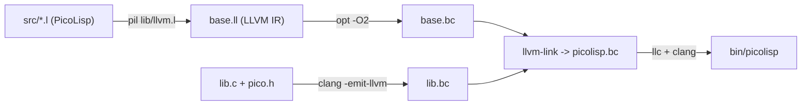

[Open Data Science](opendatascience.md)

# [Makefile](makefile.md)

The `src/Makefile` is how PicoLisp builds itself. When I first studied it (2016–17) it was the pil32 Makefile: `gcc -m32` compiling `main.c`, `gc.c` and the rest. Today's **pil21** Makefile (26.9, dated 13mar26) is reproduced in full below, and it tells a very different story.

### What the pil21 build does



1. **PicoLisp compiles PicoLisp.** `$(PIL) lib/llvm.l lib/ex.l main.l -bye > base.ll` runs the LLVM front end (`src/lib/llvm.l`) over the interpreter's sources and writes LLVM IR.
2. **Bootstrapping.** The tarball ships the generated `.ll` files. The line `$(shell $(PIL) -bye 2>/dev/null || touch *.ll)` checks whether a working `../pil` exists yet. If it doesn't, it marks the `.ll` files as up to date, so the very first build needs only LLVM, not PicoLisp.
3. `opt -O2` optimises the IR. `lib.c` (the small C helper layer, see [pico.h](picoh.md)) is compiled to bitcode with clang, `llvm-link` joins both, and `llc` plus `clang` produce the native `bin/picolisp`, linked with readline and libffi.
4. The same route builds `lib/ext.so` and `lib/ht.so`. Plain C tools follow: `bin/httpGate` and `bin/ssl` (with `-lssl -lcrypto`), `bin/balance`, and `lib/sysdefs` (from `sysdefs.c`, which records the OS's struct sizes and constants for `native`).
5. `make so` builds PicoLisp as a shared library (`lib/picolisp.so`) for embedding.
6. There are separate `Makefile.macos` and `Makefile.openbsd`. The LLVM version is detected with `llvm-config`; versions 15–16 get `-opaque-pointers`.

### Using it

```bash
sudo apt install binutils make clang llvm libreadline-dev libffi-dev libssl-dev pkg-config
cd pil21/src
make            # everything
make clean      # remove *.ll *.bc *.s  (careful: you then need a working pil to rebuild)
```

Compare the two Makefiles and you can see the whole history of PicoLisp: from hand-written C, to a home-made assembler (pil64), to letting LLVM do the machine-specific work so that PicoLisp runs anywhere LLVM does.

## The pil21 Makefile (26.9)


```make
# 13mar26 Software Lab. Alexander Burger

.SILENT:

CC = clang
PIL = ../pil
ASM = opt -O2
LLC = llc
LINK = llvm-link
SHARED = -shared
STRIP = strip

$(shell $(PIL) -bye 2>/dev/null || touch *.ll)

LLVM = $(shell llvm-config --version | cut -d. -f1)
ifeq ($(shell test $(LLVM) -ge 15 -a $(LLVM) -lt 17; echo $$?), 0)
	ASM += -opaque-pointers
endif

OS = $(shell uname)
CPU = $(shell uname -m)

BIN = ../bin
LIB = ../lib

INC = lib/llvm.l vers.l defs.l glob.l dec.l
SRC = main.l gc.l big.l sym.l io.l db.l apply.l flow.l subr.l

all: $(LIB)/sysdefs $(BIN)/picolisp $(LIB)/ext.so $(LIB)/ht.so $(BIN)/balance $(BIN)/ssl $(BIN)/httpGate
so: $(LIB)/picolisp.so

# System definitions
$(LIB)/sysdefs: sysdefs.c
	$(CC) -w -D_OS='"$(OS)"' -D_CPU='"$(CPU)"' sysdefs.c  &&  ./a.out > $(LIB)/sysdefs  &&  rm ./a.out

# Base system
$(BIN)/picolisp: picolisp.bc
	mkdir -p $(BIN)
	$(LLC) picolisp.bc -relocation-model=pic -o picolisp.s
	$(CC) picolisp.s -o $(BIN)/picolisp -rdynamic -lc -lutil -lm -ldl `pkg-config --libs readline libffi`
	$(STRIP) $(BIN)/picolisp

picolisp.bc: base.bc lib.bc
	$(LINK) -o picolisp.bc base.bc lib.bc

base.bc: base.ll
	$(ASM) -o base.bc base.ll

base.ll: $(INC) $(SRC) lib/ex.l
	$(PIL) lib/llvm.l lib/ex.l main.l -bye > base.ll
	mv base.map $(LIB)/map

lib.bc: pico.h lib.c
	$(CC) -O3 -w -c -o lib.bc -D_OS='"$(OS)"' -D_CPU='"$(CPU)"' `pkg-config --cflags libffi` -emit-llvm lib.c

# Base system as shared library
$(LIB)/picolisp.so: picolisp.so.bc
	$(LLC) picolisp.so.bc -relocation-model=pic -o picolisp.so.s
	$(CC) picolisp.so.s -o $(LIB)/picolisp.so $(SHARED)
	$(STRIP) $(LIB)/picolisp.so

picolisp.so.bc: base.so.bc lib.so.bc
	$(LINK) -o picolisp.so.bc base.so.bc lib.so.bc

base.so.bc: base.so.ll
	$(ASM) -o base.so.bc base.so.ll

base.so.ll: $(INC) $(SRC) lib/so.l
	$(PIL) lib/llvm.l -quiche lib/so.l main.l -bye > base.so.ll
	rm base.map

lib.so.bc: pico.h lib.so.c
	$(CC) -O3 -w -c -fPIC -o lib.so.bc -D_OS='"$(OS)"' -D_CPU='"$(CPU)"' `pkg-config --cflags libffi` -emit-llvm lib.so.c

# Extension libraries
$(LIB)/ext.so: ext.bc
	$(LLC) ext.bc -relocation-model=pic -o ext.s
	$(CC) ext.s -o $(LIB)/ext.so $(SHARED)
	$(STRIP) $(LIB)/ext.so

ext.bc: ext.ll
	$(ASM) -o ext.bc ext.ll

ext.ll: $(INC) ext.l
	$(PIL) lib/llvm.l ext.l -bye > ext.ll

$(LIB)/ht.so: ht.bc
	$(LLC) ht.bc -relocation-model=pic -o ht.s
	$(CC) ht.s -o $(LIB)/ht.so $(SHARED)
	$(STRIP) $(LIB)/ht.so

ht.bc: ht.ll
	$(ASM) -o ht.bc ht.ll

ht.ll: $(INC) ht.l
	$(PIL) lib/llvm.l ht.l -bye > ht.ll

# Tools
$(BIN)/balance: balance.c
	$(CC) -O3 -w -o $(BIN)/balance balance.c
	$(STRIP) $(BIN)/balance

# Gate
$(BIN)/ssl: ssl.c
	$(CC) -O3 -w -o $(BIN)/ssl ssl.c -lssl -lcrypto
	$(STRIP) $(BIN)/ssl

$(BIN)/httpGate: httpGate.c
	$(CC) -O3 -w -o $(BIN)/httpGate httpGate.c -lssl -lcrypto
	$(STRIP) $(BIN)/httpGate

# Clean up
clean:
	rm -f *.ll *.bc *.s

clean2: clean
	rm -f $(LIB)/sysdefs $(BIN)/balance $(BIN)/ssl $(BIN)/httpGate
```
