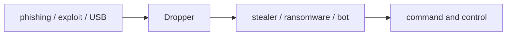

[Read This!](caveatemptor.md) |
  [Picolisp](picolisp.md) | [Picolisp Machine](pilmachine.md) | [Pil Sources](pilsource.md) |
  [Linux](linux.md) | [BASH](bash.md) |
  [C-Programmming](cprogramming.md) |
  [Operating Systems](os.md) |
  [Computer Security](computersecurity.md) | [ICSsecurity](icssecurity.md) |
  [Firewalls](firewalls.md) | [Networking](networking.md) | [Security Programs](securityprogram.md) |
 [Exploitation](exploitation.md) | [Social Engineering](internetexploitation.md) | [Metasploit](metasploit.md) | [wifi-penetration](wifipenetration.md) |
 [Forensics](forensics.md) | [SecureNetworkArchitecture](securenetworkarchitecture.md)

# Types of Malware

Here is the truth about malware types: **the labels (virus, worm, trojan, ransomware…) describe *how* a program spreads or *what* it demands – not how sophisticated it is.** A boring script with a clever delivery path beats a clever payload nobody installs.

### What it is, in plain words

**Malware** is software written to act against the interests of the person who runs it. Common types:

| Type | Trait |
|------|--------|
| Virus | Infects other files/programs; needs a host |
| Worm | Spreads under its own power across networks |
| Trojan | Claims to be useful; hides a harmful payload |
| Ransomware | Encrypts data and demands payment |
| Spyware / stealers | Quietly exfiltrates credentials and files |
| Rootkit | Hides its presence deep in the system |
| Botnet agent | Joins a remote-controlled herd |
| Cryptominer | Burns your CPU/GPU for someone else's coins |
| Adware / PUPs | Grey area of unwanted annoyance |
| Wiper | Destroys data without a ransom business model |

Real incidents mix types: a phishing trojan drops a stealer, then ransomware.

### Why it matters

Defenders who only memorise names miss the behaviours that detection actually catches: unexpected encryption, odd parent/child processes, beaconing to strange hosts. Knowing the types is vocabulary; knowing the behaviours is defence. See [Computer Security](computersecurity.md) and [Linux Security](linuxsecurity.md).

### An everyday analogy: disease words

"Virus" and "bacteria" are useful medical words, but treatment depends on symptoms and transmission. Malware names are the same – start the conversation, then look at what it *does*.



### A hands-on defensive drill (safe)

Don't run malware. Instead, practise recognising *symptoms* on a lab VM:

```bash
# What established outbound connections exist?
ss -tp
# What is listening?
ss -tulpn
# Unexpected cron / services?
systemctl list-timers
ls /etc/cron.*
# Recently modified executables in writable paths
find /tmp /var/tmp /dev/shm -type f -mtime -1 2>/dev/null
```

On Windows lab VMs, Process Explorer and Autoruns fill the same role. Keep samples (if you ever handle them) in isolated VMs with no shared folders and no credentials you care about – or don't keep them at all.

### Common misconceptions

- **"Linux can't get malware."** It can and does – especially servers.
- **"Antivirus stops everything."** It stops known families. Behaviour and patching matter more.
- **"Ransomware always means nation-states."** Often it's commodity crimeware rented as a service.
- **"Macros are dead."** Delivery fashions change; human trust remains the constant.
- **"Onion / crypto means untraceable."** Operational security fails more often than crypto does.

### What to do when you suspect infection

1. Disconnect from networks if data theft or ransomware is plausible.
2. Capture volatile evidence if you're trained to (memory, `ss`, process list) – or call someone who is.
3. Boot from known-good media; do not "clean" in place and hope.
4. Restore from offline backups; rebuild the host.
5. Rotate credentials that lived on the machine.

Prevention remains cheaper: patches, least privilege, backups you have tested, and scepticism toward unexpected attachments and USB gifts.

### Connections

- [Computer Security](computersecurity.md), [Forensics](forensics.md), [Honeypots](honeypots.md).
- [Penetration Testing](penetrationtesting.md) – authorised offence to improve defence.
- [Encryption](encryption.md) – what ransomware abuses.

Virus -
 Needs to be executed and need a carrier to take from source to target

Worm - SRSE (self replicating self executing)

Trojan - Typically to attached itself on the backend of an application and then to open the backdoor
