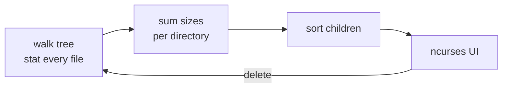

[Computing](computing.md) |
  [computingFreedom](computingfreedom.md) |
  [Build](bciyh.md) |
  [Picolisp](picolisp.md) | [Picolisp Machine](pilmachine.md) | [pil sources](pilsource.md) |
  [Linux](linux.md) | [BASH](bash.md) |
  [C Programmming](cprogramming.md) |
  [Operating Systems](os.md) |
  [Javascipt](javascript.md) |
  [Emacs](emacs.md)  | [vim](vim.md) |
  [Pharo Smalltalk](pharo.md) |
  [Computer Security](computersecurity.md) |
  [Python](python.md) |
[Tools to Learn](linuxtools.md)

# NCDU

The truth about a full disk is that it is almost never "everything, a little bit". **It is usually one or two forgotten directories eating most of the space.** ncdu is the tool that points straight at them.

### What it is, in plain words

**ncdu** (NCurses Disk Usage) is a terminal program that scans a directory tree, adds up how much space everything takes, and then lets you *walk* the result interactively: biggest things at the top, arrow keys to dive in, `d` to delete. It is `du` with eyes.

There are two lines of it today:

- **ncdu 1.x** – the classic C version, still in every distro.
- **ncdu 2.x** – a rewrite in [Zig](ziglang.md), faster on big trees and lighter on memory. Many distros (Void and Arch included) ship 2.x as plain `ncdu`.

Both look and feel the same.

### Why it matters

When a disk fills up, things break in strange ways: builds fail, databases refuse writes, your package manager half-installs an update, logins stall because the shell can't write history. The usual reflex – `df -h` – tells you *that* a disk is full but not *why*. `du -sh *` tells you why, one level at a time, slowly. ncdu scans once and then answers every "where did it go?" instantly.

### An everyday analogy: the overflowing wardrobe

Your wardrobe won't close. You could fold every single shirt a little tighter, or you could open it and notice the three winter coats and the box of old cables taking up half the space. ncdu opens the wardrobe and lines everything up by size, so the coats are the first thing you see.

### A hands-on example

Install it:

```bash
sudo xbps-install -S ncdu      # Void Linux / Vikix
sudo pacman -S ncdu            # Arch / Manjaro
sudo apt install ncdu          # Debian / Ubuntu
```

Scan your home directory:

```bash
ncdu ~
```

Scan the whole root filesystem *without* crossing into other mounts (so it doesn't wander into `/proc`, network shares or USB drives):

```bash
sudo ncdu -x /
```

Inside the browser:

| Key | Does |
|-----|------|
| `↑ ↓` / `j k` | move |
| `→` / `Enter` | open directory |
| `←` | go up |
| `d` | delete selected (asks first) |
| `s` / `n` | sort by size / name |
| `g` | toggle percentage/graph |
| `e` | show hidden/excluded files |
| `i` | info about the item |
| `r` | rescan |
| `q` | quit |

Typical culprits you'll find in seconds: `~/.cache` (browsers, pip, npm, Zig, Go), old `node_modules`, container images in `/var/lib/docker` or `~/.local/share/containers`, old kernels, `/var/log`, and the package cache (`/var/cache/xbps` on Void, `/var/cache/pacman/pkg` on Arch).

### Scanning remote or huge machines

ncdu can save a scan to a file and load it later, which is perfect for servers:

```bash
# On the server: scan and export (no UI)
sudo ncdu -x -o /tmp/root.ncdu /

# Or stream it straight to your laptop and browse there
ssh myserver 'sudo ncdu -x -o- /' | ncdu -f-
```

For read-only browsing where you don't want to delete by accident, add `-r` (read-only) or `-rr` (also disables the shell spawn).

### How it works underneath



It calls `stat()` on every file and adds up the *disk usage* (blocks actually allocated), not the apparent size. That distinction matters: a sparse VM image may say 100 GB in `ls -l` but use 5 GB on disk. Press `a` in ncdu to toggle between apparent size and disk usage. Hard-linked files are counted once and marked `H`.

### Common misconceptions

- **"ncdu shows what `df` shows."** Not always. `df` reports the filesystem's view; files that were deleted but are still held open by a process (an old log a daemon keeps writing) don't appear in any directory, so ncdu can't see them. Find those with `lsof +L1`.
- **"Deleting from ncdu is undoable."** It is a real `rm`. No trash can.
- **"It's only for root."** It works fine as a normal user on anything you can read; unreadable directories are flagged with `!`.
- **"Btrfs/ZFS numbers will match."** Copy-on-write snapshots and compression make per-file sums and free space disagree. Use the filesystem's own tools (`btrfs filesystem du`, `zfs list`) for the full story.
- **"The biggest directory is safe to delete."** Look before you press `d`. `/usr` is big for good reasons.

### Connections

- [Linux Tools](linuxtools.md) and [Tools and Software](linuxtoolsandsoftware.md) – other everyday terminal tools.
- [Files and Directories](filesanddirectories.md) – how the tree ncdu walks is organised.
- [Data Recovery](datarecovery.md) – for when you pressed `d` on the wrong thing.
- [Zig](ziglang.md) – the language ncdu 2 is written in.

[ncdu check free disk space linux](https://opensource.com/article/21/8/ncdu-check-free-disk-space-linux)
