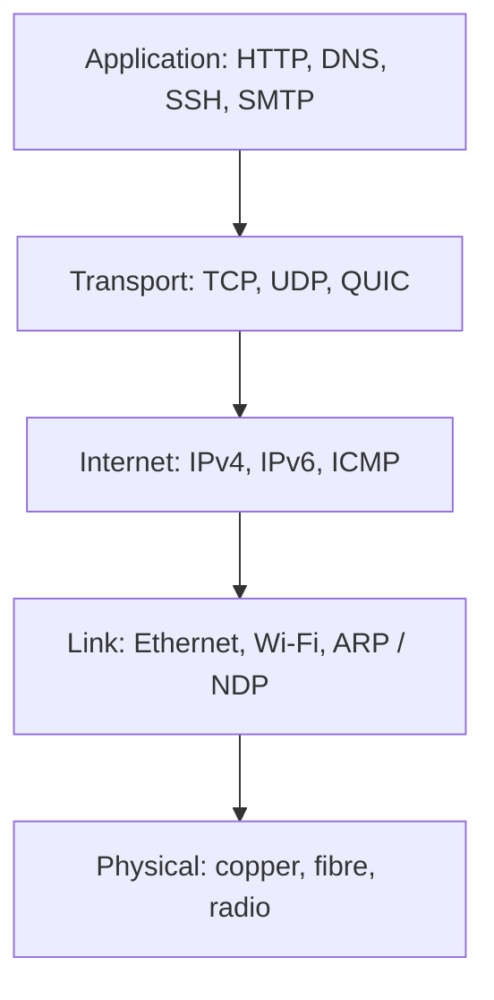

[Quicklinks](quicklinks.md) | [Reading Lists](readinglist.md) | [Computing](computing.md) |
[computingFreedom](computingfreedom.md) |
  [Build](bciyh.md) |
  [Picolisp](picolisp.md) | [Picolisp Machine](pilmachine.md) | [Pil Sources](pilsource.md) |
  [Linux](linux.md) | [BASH](bash.md) |
  [C-Programmming](cprogramming.md) |
  [Operating Systems](os.md) |
  [Javascipt](javascript.md) |
  [Emacs](emacs.md)  | [vim](vim.md) |
  [Pharo Smalltalk](pharo.md) |
  [Computer Security](computersecurity.md) |
  [Python](python.md) |
  [The Compiler](thecompiler.md) |
  [Identifiers](identifier.md) |
  [Literals](literals.md) |
  [storage_linkage](storagelinkage.md) | [Networking](networking.md)

# Network Protocols and Technologies

It probably hasn't escaped you attention that Computer Networks (Social and Otherwise) are possibly one of the most
important technologies invented in the last century. But how do they work? I mean really work under the hood?

Well you have come to the right place.

### What it is, in plain words

Here is the truth about networks: **a network is just envelopes inside envelopes.** Your browser writes a letter (an HTTP request). It goes into a TCP or QUIC envelope that numbers the pages, then into an IP envelope with the destination address, then into an Ethernet or Wi-Fi frame addressed to the next box down the hall. Each box along the way opens only the envelope meant for it, reads the address, and passes the rest on.

Those envelopes are the **layers**:



- **Link layer** moves frames between machines on the same network, using MAC addresses. ARP (IPv4) or Neighbour Discovery (IPv6) maps IP addresses to MAC addresses.
- **Internet layer** moves packets between networks using IP addresses. Routers work here.
- **Transport layer** gives programs a connection: TCP for reliable ordered streams, UDP for fire-and-forget datagrams, and QUIC (the base of HTTP/3) for reliable streams over UDP with encryption built in.
- **Application layer** is what programs actually say to each other.

The seven-layer OSI model in the diagram further down is the textbook version; the four- or five-layer TCP/IP model is what the internet actually runs.

### Why it matters

- **Debugging.** "The internet is down" is never a useful diagnosis. Is it the cable (link), the address (IP), the name lookup (DNS), the port (transport) or the service (application)? Layers turn panic into a checklist.
- **Security.** Every attack lives at a layer: ARP poisoning at the link, spoofing at IP, SYN floods at transport, phishing at the application. See [Firewalls](firewalls.md), [TLS](tls.md) and [Ettercap](ettercap.md).
- **It is changing.** In 2026 well over 40% of traffic to big services arrives over IPv6, HTTP/3 over QUIC is the default for major sites, and DNS is increasingly encrypted (DNS over HTTPS or TLS). The old textbooks are still true underneath, but the top of the stack looks different.

### An everyday analogy: international post

You write a letter in English (application). You put it in an envelope with the recipient's address and a tracking number (transport and IP). The local postman only knows how to reach the sorting office (the link to your router). The sorting office reads the country and sends it on (routing). Nobody along the way reads your letter. And with TLS, the letter is in a locked box anyway.

### A hands-on example: walk up the stack from a Vikix shell

```bash
ip -br link                     # link layer: interfaces and their state
ip -br addr                     # IP addresses (v4 and v6)
ip route                        # where packets go by default
ip neigh                        # ARP / neighbour table: IP to MAC

ping -c3 9.9.9.9                # IP reachability (ICMP)
tracepath -n thevikidtruth.com  # each router on the way

dig +short thevikidtruth.com    # DNS: name to address
dig +short AAAA thevikidtruth.com

ss -tulpn                       # transport: which programs listen on which ports
curl -sI --http2 https://thevikidtruth.com | head -3   # application: HTTP
```

Work top to bottom when something fails: if `dig` fails but `ping 9.9.9.9` works, it is DNS. If `ping` fails but `ip route` shows no default route, it is your link or DHCP. On a laptop, [nmtui](nmtui.md) fixes most Wi-Fi problems; on a minimal Void install `dhcpcd` and `wpa_supplicant` do the same job as runit services.

And from PicoLisp, the transport layer is two functions away:

```picolisp
(let S (connect "thevikidtruth.com" 80)   # TCP socket
   (out S (prinl "HEAD / HTTP/1.0^M") (prinl "Host: thevikidtruth.com^M") (prinl "^M"))
   (in S (line T)) )                       # first line of the reply
```

### Common misconceptions

- **"The internet and the web are the same."** The web (HTTP) is one application running on the internet, alongside email, SSH, DNS, games and VoIP.
- **"IP addresses identify people."** They identify an interface, often shared behind NAT or rotated by the ISP.
- **"TCP is always better than UDP."** UDP is right for DNS, voice, games and as the base of QUIC, where waiting for a lost packet is worse than skipping it.
- **"IPv6 is still coming."** It arrived. Phones on mobile networks often run IPv6-only with translation to IPv4. See [IPv6](https://www.rfc-editor.org/rfc/rfc8200) (RFC 8200 replaced RFC 2460).
- **"HTTPS hides everything."** It hides content, not who you talk to: the IP address and, unless Encrypted Client Hello is used, the server name are visible.

### Connections

- [Firewalls](firewalls.md), [TLS](tls.md), [SSH Login](sshlogin.md), [nmtui](nmtui.md).
- [Ettercap](ettercap.md), [Penetration Testing](penetrationtesting.md), [Computer Security](computersecurity.md).
- [Online VPS](onlinevps.md), [Using Linode](linode.md), [Raspberry Pi](rasberrypi.md), [Operating Systems](os.md).


## Network Technologies & Relay Systems

- [Ethernet & IEEE 802.3](ethernet.md "MISSING PAGE")
- [Token Ring](tokenring.md "MISSING PAGE")
- [Fiber Distributed Data Interface](fddi.md "MISSING PAGE")
- [Relay Systems](relaysystems.md "MISSING PAGE")
- [WAN](wan.md "MISSING PAGE")

## Addressing

- [Addressing Schemes](addressingschemes.md "MISSING PAGE")
- [Routing](routing.md "MISSING PAGE")
- [Address Resolution Protocol MAC Addresses](arp.md "MISSING PAGE")
- [Reverse Address Resolution Protocol](rarp.md "MISSING PAGE")
- [Subnetting](subnetting.md "MISSING PAGE")

## Main Protocols

- [Multi-Homing](multi-homing.md "MISSING PAGE")
- [IP Datagrams](ipdatagrams.md)
- [IP Version 6](ipv6.md)
- [Internet Control Messaging Protocol (ICMP)](icmp.md "MISSING PAGE")
- [Transmission Control Protocol (TCP)](tcp.md "MISSING PAGE")
- [User Datagram Protocol (UDP)](udp.md "MISSING PAGE")
- [The Routing Information Protocol (RIP)](rip.md "MISSING PAGE")
- [Telnet](telnet.md "MISSING PAGE")
- [Rlogin](rlogin.md "MISSING PAGE")
- [File Transfer Protocol (FTP)](ftp.md "MISSING PAGE")
- [Simple Mail Transfer Protocol (SMTP)](smtp.md "MISSING PAGE")
- [Booting Internet Hosts](bootp.md "MISSING PAGE")
- [TFTP](tftp.md "MISSING PAGE")
- [Simple Network Management Protocol (SNMP)](snmp.md "MISSING PAGE")

## Secondary Protocols

- [Echo Protocol](echoprotocol.md "MISSING PAGE")
- [DiscardProtocol](discardprotocol.md "MISSING PAGE")
- [TimeProtocol](timeprotocol.md "MISSING PAGE")
- [DaytimeProtocol](daytimeprotocol.md "MISSING PAGE")
- [NetworkTimeProtocol](networktimeprotocol.md "MISSING PAGE")
- [LinePrinterDaemonProtocol](lineprinterdaemonprotocol.md "MISSING PAGE")
- [SYSLOG](syslog.md "MISSING PAGE")
- [Finger](finger.md "MISSING PAGE")
- [Whois](whois.md "MISSING PAGE")
- [Character Generation Protocol](charactergenerationprotocol.md "MISSING PAGE")
- [QouteOfTheDay](qouteoftheday.md "MISSING PAGE")
- [UsersProtocol](usersprotocol.md "MISSING PAGE")

## Other Considerations

- [Serial Line IP](slip.md "MISSING PAGE")
- [Filtering Packets on Different Protocols](filtering.md "MISSING PAGE")
- <!-- 
  -{={}}
  -{={}}
  -{={}}
   -->

## Request for Comments

Before you start anywhere you probably want to keep this diagram in your mind. I lifted &
modified from RFC-1180. I spent a lot of time confused about these diagrams and what
they meant. If you are too, then please [read this first](datagramencapsulation.md).

```
                          Module Diagram                      Protocol Layers (OSI &
                                                                             TCP/IP*)
                     ----------------------------             Layer-4*--------------
                     |    network applications  |             |Layer 7.Application |
                     |...   \\ | /  .. \\ | /  ...|             |Layer 6.Presentation|
                     |     -----      -----     |             |Layer 5. Session    |
                     |     |TCP|      |UDP|     |             |Layer 4. Transport  |
                     |     -----      -----     |             ----------------------
                     |         \\      /         |
                     |         --------         | roughly
                     |         |  IP  |         | translating  Layer 3 .Internetwork
                     |  -----  -*------         | to
                     |  |ARP|   |               |
                     |  -----   |               |
                     |      \\   |               |
                     |      ------              |
                     |      |ENET|              |               Layer 2. Link
                     |      ---@--              |
                     ----------|-----------------
                               |
         ----------------------o---------                       Layer 1. Physical
             Ethernet Cable
```

There are more that 2500 of this documents. An impossible task.

Below is a list of the most important ones to read.

- [RFC-1180 A TCP/IP Tutorial](rfc-1180.md "MISSING PAGE")
- [RFC-791 INTERNET PROTOCOL](ipdatagrams.md)
- [RFC-793 Transmission Control Protocol](rfc-793.md "MISSING PAGE")
- [RFC-2460 Internet Protocol, Version 6 (IPv6) Specification](ipv6.md)

## Links, Sources and Reading List

- [Faqs RFC's](http://www.faqs.org/rfcs)
- [http://www.rfc-editor.org](http://www.rfc-editor.org)
- [ TCP/IP STACK](https://en.m.wikibooks.org/wiki/A-level_Computing_2009/AQA/Computer_Components,_The_Stored_Program_Concept_and_the_Internet/Structure_of_the_Internet/TCP_IP_protocol_stack
  )
- [the geek stuff ip protocol](http://www.thegeekstuff.com/2012/03/ip-protocol-header/)
- [MS IP Tech paper](https://technet.microsoft.com/en-us/library/cc786128(v=ws.10).aspx)
- [tcpipguide](http://www.tcpipguide.com/free/t_MessageFormattingHeadersPayloadsandFooters.htm)
   [https://en.m.wikipedia.org/wiki/Transmission_Control_Protocol](https://en.m.wikipedia.org/wiki/Transmission_Control_Protocol)
