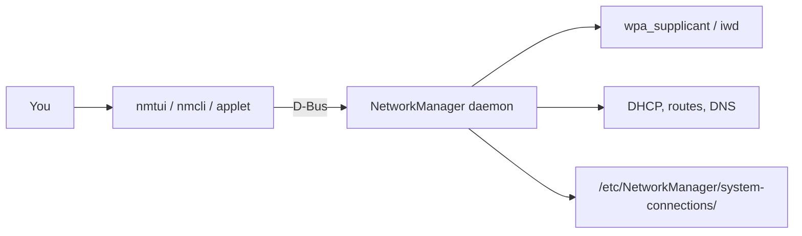

[Computing](computing.md) |
  [computingFreedom](computingfreedom.md) |
  [Build](bciyh.md) |
  [Picolisp](picolisp.md) | [Picolisp Machine](pilmachine.md) | [pil sources](pilsource.md) |
  [Linux](linux.md) | [BASH](bash.md) |
  [C Programmming](cprogramming.md) |
  [Operating Systems](os.md) |
  [Javascipt](javascript.md) |
  [Emacs](emacs.md)  | [vim](vim.md) |
  [Pharo Smalltalk](pharo.md) |
  [Computer Security](computersecurity.md) |
  [Python](python.md) |
[Tools to Learn](linuxtools.md)

# nmtui

Here's the truth about Linux networking in 2026: **you rarely configure interfaces by hand any more – a daemon does it, and you just tell the daemon what you want.** On most desktops that daemon is NetworkManager, and `nmtui` is the friendliest way to talk to it from a terminal.

### What it is, in plain words

**nmtui** (NetworkManager Text User Interface) is a small menu-driven program, with boxes and buttons you drive using arrow keys, Tab and Enter. It gives you three jobs:

1. **Edit a connection** – Wi-Fi, Ethernet, VPN, bridges, static IPs, DNS.
2. **Activate a connection** – join a Wi-Fi network, bring a link up or down.
3. **Set system hostname.**

Everything it does is also possible with its scriptable sibling **nmcli**, and with GUI applets. nmtui is the middle ground: no mouse needed, no flags to remember.

### Why it matters

You will meet a machine with no desktop and no network – a fresh install, a server console, a laptop where the Wi-Fi applet crashed. Typing a WPA passphrase into a menu beats remembering `wpa_supplicant` configuration syntax at 2 a.m. And because nmtui writes the same connection profiles as every other NetworkManager tool, whatever you set up survives reboots and shows up in the GUI later.

### An everyday analogy: a hotel concierge

You could find your own taxi, call the restaurant and book the theatre. Or you could tell the concierge "dinner at eight, then a show" and let them handle it. NetworkManager is the concierge; nmtui is the polite form you fill in at the desk. You state the outcome, the daemon handles DHCP, DNS, routes and roaming.



### A hands-on example

Install and enable it. On Void Linux (runit), which is what Vikix uses:

```bash
sudo xbps-install -S NetworkManager
# make sure no other network manager is running (dhcpcd, wpa_supplicant services)
sudo rm -f /var/service/dhcpcd /var/service/wpa_supplicant
sudo ln -s /etc/sv/dbus /var/service/
sudo ln -s /etc/sv/NetworkManager /var/service/
```

On systemd distros it's `sudo systemctl enable --now NetworkManager`. Your user typically needs to be in the `network` group (Void) or have polkit rules to change connections without sudo.

Join Wi-Fi:

```bash
nmtui
# → Activate a connection → pick your SSID → enter password → Activate
```

Or jump straight in:

```bash
nmtui connect          # straight to the activate screen
nmtui edit             # straight to the editor
```

Give an Ethernet connection a static address: `nmtui edit` → select the wired profile → **IPv4 CONFIGURATION** → change *Automatic* to *Manual* → *Show* → add `192.168.1.50/24`, gateway `192.168.1.1`, DNS `1.1.1.1` → OK → then deactivate and reactivate it.

### The same thing with nmcli

Once you know what you want, the scripting tool is quicker and fits in your dotfiles:

```bash
nmcli device wifi list
nmcli device wifi connect "MyNetwork" --ask
nmcli connection show
nmcli connection modify "Wired connection 1" \
  ipv4.method manual ipv4.addresses 192.168.1.50/24 \
  ipv4.gateway 192.168.1.1 ipv4.dns 1.1.1.1
nmcli connection up "Wired connection 1"
```

A nice StumpWM touch: bind a key to open nmtui in a floating terminal, e.g. `(define-key *root-map* (kbd "N") "exec st -e nmtui")`.

### Where the settings live

Profiles are saved as keyfiles in `/etc/NetworkManager/system-connections/`, readable only by root because they contain passwords. They are plain INI text, so you can back them up or copy them to another machine.

### When it won't connect

A short checklist that solves most problems:

1. `nmcli general status` – is the daemon running, is networking enabled?
2. `nmcli radio wifi` – is Wi-Fi switched off (or blocked)? `rfkill list` will show a hardware or soft block; `rfkill unblock wifi` clears the soft one.
3. `nmcli device` – does your card show up at all? If not, it's a driver or firmware problem, not a NetworkManager one (`dmesg | grep -i firmware`).
4. Logs: `journalctl -u NetworkManager` on systemd, or `/var/log/socklog/` / `svlogtail` on Void with socklog enabled.

### Common misconceptions

- **"nmtui is a separate network stack."** It is just a client. If the NetworkManager daemon isn't running, nmtui can't do anything.
- **"I can run NetworkManager alongside dhcpcd or systemd-networkd."** Two managers fighting over one interface is the classic cause of "it connects, then drops". Pick one.
- **"Editing a connection applies it."** Changes apply when the connection is next activated. Deactivate and activate again.
- **"nmtui is only for Wi-Fi."** It handles bonds, bridges, VLANs, VPNs (via plugins) and IP tunnels too.
- **"It's deprecated."** Still actively shipped with NetworkManager 1.5x in 2026.

### Connections

- [Networking](networking.md) – what DHCP, routes and DNS actually do.
- [systemd](systemd.md) – how services like NetworkManager get started on systemd distros.
- [Simple Linux Configuration](simplelinuxconfig.md) – other small config jobs on a fresh box.
- [Linux Tools](linuxtools.md) – more terminal utilities worth knowing.

[How to use nmtui](https://www.cloudsavvyit.com/13866/how-to-manage-linux-wi-fi-networks-with-nmtui/)
