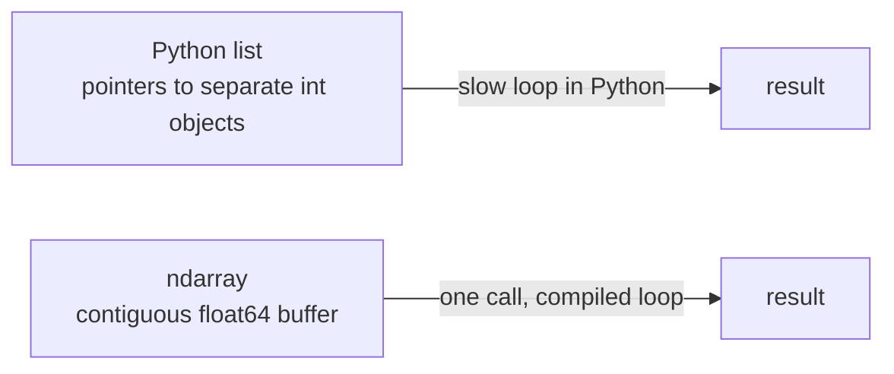

[computingFreedom](computingfreedom.md) |
  [Build](bciyh.md) |
  [Picolisp](picolisp.md) | [Picolisp Machine](pilmachine.md) | [pil sources](pilsource.md) |
  [Linux](linux.md) | [BASH](bash.md) |
  [C Programmming](cprogramming.md) |
  [Operating Systems](os.md) |
  [Javascipt](javascript.md) |
  [Emacs](emacs.md)  | [vim](vim.md) |
  [Pharo Smalltalk](pharo.md) |
  [Computer Security](computersecurity.md) |
  [Python](python.md) |

# NumPy

Here is the truth that makes Python fast at maths: **the maths isn't actually done in Python.** NumPy hands whole arrays to compiled C (and Fortran-descended) code in one go, and that single idea – think in arrays, not loops – is what makes the whole scientific Python world possible.

### What it is, in plain words

**NumPy** (Numerical Python) is the library that gives Python a fast, fixed-type, multi-dimensional array: the `ndarray`. On top of that array it provides:

- **vectorised operations** – `a + b`, `a * 2`, `np.sin(a)` act on every element at once;
- **broadcasting** – rules for combining arrays of different shapes without copying;
- **linear algebra, FFTs, random numbers, statistics**;
- a C API that pandas, SciPy, scikit-learn, Matplotlib, PyTorch and JAX all build on or interoperate with.

NumPy 2.x (first released in 2024) is the current major line. It cleaned up the API, changed some type-promotion rules (NEP 50) and has an updated C ABI, so very old compiled extensions may need rebuilding – a one-time pain most of the ecosystem has long since got through.

### Why it matters

A plain Python loop over a million numbers spends almost all its time on interpreter overhead: checking types, boxing integers, looking up methods. A NumPy array stores raw numbers contiguously in memory, like a C array, and runs a tight compiled loop over them – often 50–100× faster, and able to use SIMD instructions. That's why data science, machine learning and scientific computing happen in Python at all.

### An everyday analogy: the egg carton

A Python list of numbers is a bag of eggs, each wrapped individually in its own box with a label – flexible, but you have to unwrap each one. A NumPy array is an egg carton: same-sized slots, all in a row, all the same type. You can do something to the whole carton at once ("stamp every egg"), and a machine can move along the row at full speed.



### A hands-on example

```bash
python -m venv ~/venvs/sci && . ~/venvs/sci/bin/activate
pip install numpy
```

```python
import numpy as np

# Creating arrays
a = np.arange(10)                 # [0 1 2 ... 9]
m = np.arange(12).reshape(3, 4)   # 3 rows, 4 columns
z = np.zeros((2, 3)); o = np.ones(5); r = np.linspace(0, 1, 5)

# Vectorised maths – no loops
print(a * 2 + 1)                  # [ 1  3  5 ... 19]
print(np.sqrt(a).round(2))

# Shape, type, axis-wise reductions
print(m.shape, m.dtype)           # (3, 4) int64
print(m.sum(axis=0))              # column sums  [12 15 18 21]
print(m.mean(axis=1))             # row means    [1.5 5.5 9.5]

# Slicing and boolean masks
print(m[1, :])                    # second row
print(m[:, -1])                   # last column
print(a[a % 2 == 0])              # [0 2 4 6 8]

# Broadcasting: (3,4) + (4,) -> each row gets the vector added
print(m + np.array([100, 200, 300, 400]))

# Linear algebra
A = np.array([[3., 1.], [1., 2.]])
b = np.array([9., 8.])
x = np.linalg.solve(A, b)         # solves A x = b
print(x)                          # [2. 3.]

# Modern random API
rng = np.random.default_rng(seed=42)
samples = rng.normal(loc=0, scale=1, size=100_000)
print(samples.mean().round(3), samples.std().round(3))
```

Feel the speed difference:

```python
import time
xs = list(range(10_000_000))
t = time.perf_counter(); s = sum(x * x for x in xs); print("python", time.perf_counter() - t)
arr = np.arange(10_000_000)
t = time.perf_counter(); s = (arr * arr).sum(); print("numpy ", time.perf_counter() - t)
```

### Broadcasting in one rule

Compare shapes from the right. Two dimensions are compatible if they are equal or one of them is 1. Missing dimensions count as 1. So shapes `(3, 4)` and `(4,)` work, `(3, 1)` and `(1, 4)` broadcast to `(3, 4)`, but `(3, 4)` and `(3,)` fail – reshape to `(3, 1)` first.

### Common misconceptions

- **"NumPy arrays are just faster lists."** They are fixed-type and fixed-size. Appending creates a whole new array; build a list first, then convert.
- **"Slicing copies."** Basic slices are **views** – changing `b = a[2:5]` changes `a`. Use `.copy()` when you need independence. (Fancy and boolean indexing *do* copy.)
- **"`np.random.seed` is the way."** The legacy global functions still work, but `np.random.default_rng()` generators are the recommended API.
- **"Integers can't overflow in Python."** Python ints can't; NumPy `int64` can, silently wrapping.
- **"Vectorise everything."** Mostly yes, but sometimes a loop compiled with Numba, or a different library (JAX, CuPy for GPUs), is the right tool.

### Connections

- [SciPy](scipy.md) – optimisation, integration, signal processing built on NumPy.
- [iPython](ipython.md) – the interactive shell where NumPy feels best.
- [Python](python.md) and [Python Libraries, tools and Links](pythonlibrariestoolsandlinks.md).
- [Fortran](fortran.md) – the language behind the linear algebra routines.
- [Machine Learning](machinelearning.md) and [Open Data Science](opendatascience.md).
- [Vector Spaces](../mathematics/vectorspaces.md) – the mathematics arrays are made for.

[numpy tutorial](https://numpy.org/doc/stable/user/quickstart.html)

## Libraries, Tools

- [SciPy](scipy.md) --- [@ SciPy.org](https://www.scipy.org/)
- [Numpy](numpy.md) --- [ @ numPy.org](http://www.numpy.org/)
- [iPython](ipython.md) --- [@ ipython.org](https://ipython.org/)
