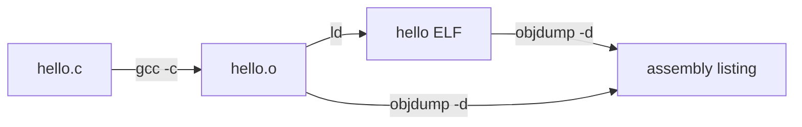

# objdump

The truth behind every program you run: **it is just bytes, and those bytes are instructions you can read.** objdump is the tool that turns the bytes back into something a human can follow.

### What it is, in plain words

**objdump** is part of GNU binutils (along with `as`, `ld`, `nm`, `readelf`, `strings`). Point it at an object file, executable or shared library and it will show you:

- the **headers** – what kind of file, which CPU, where it starts;
- the **sections** – `.text` (code), `.data`, `.rodata`, `.bss` and friends;
- the **symbols** – names of functions and variables;
- the **disassembly** – machine code translated back into assembly mnemonics.

LLVM ships a near drop-in twin, `llvm-objdump`, with the same main flags.

### Why it matters

Source code is what you *meant*; the binary is what the machine *does*. objdump lets you check the difference. You use it to:

- see what your compiler actually generated, and whether `-O2` inlined that function;
- debug a crash address from a log;
- learn assembly by reading real code instead of textbook fragments;
- inspect a binary you didn't build (security work, reverse engineering, malware triage);
- understand linking: which symbols are defined, which are undefined and waiting for a library.

### An everyday analogy: reading the recipe back from the cake

Normally the recipe produces the cake. objdump is a food scientist who takes the cake apart and writes down, as faithfully as possible, every step that must have happened. Some things are lost – the cook's comments, the names of intermediate bowls – but the steps are all there.



### A hands-on example

Write a tiny C program:

```c
/* add.c */
int add(int a, int b) { return a + b; }

int main(void) { return add(2, 3); }
```

Compile it and look inside:

```bash
gcc -O1 -g -c add.c -o add.o
objdump -d add.o
```

On x86-64 you'll see something like:

```
0000000000000000 <add>:
   0:   8d 04 37                lea    (%rdi,%rsi,1),%eax
   3:   c3                      ret

0000000000000004 <main>:
   4:   b8 05 00 00 00          mov    $0x5,%eax
   9:   c3                      ret
```

Three columns: the **address**, the raw **bytes**, and the **instruction**. Notice two truths at once. First, `add` doesn't use `add` at all – the compiler used `lea` because it's a cheap way to add two registers. Second, `main` never calls `add`; the optimiser worked out `2 + 3 = 5` at compile time.

Prefer Intel syntax (what most tutorials and Windows tools use)?

```bash
objdump -d -M intel add.o
```

Interleave the original source with the assembly (needs `-g`):

```bash
objdump -d -S add.o
```

### The flags you'll actually use

| Flag | Shows |
|------|-------|
| `-f` | file header (format, architecture, entry point) |
| `-h` | section headers |
| `-t` | symbol table |
| `-T` | dynamic symbols (what a shared library exports/imports) |
| `-d` | disassemble executable sections |
| `-D` | disassemble *everything*, data included |
| `-S` | mix in source lines |
| `-r` / `-R` | relocations (static / dynamic) |
| `-s` | full hex dump of sections |
| `--visualize-jumps` | ASCII arrows for branches |
| `-C` | demangle C++ names |

### Flat binaries: boot sectors and firmware

A raw binary (a boot sector, a ROM dump) has no headers, so you have to tell objdump what it is:

```bash
objdump -D -b binary -m i8086 boot.bin            # 16-bit real mode
objdump -D -b binary -m i386:x86-64 blob.bin      # 64-bit
```

That's the trick the Stack Overflow link below explains.

### Common misconceptions

- **"Disassembly gives me the source back."** It gives you instructions. Variable names, comments, types and structure are gone unless debug info (`-g`) is present. Getting C back is *decompilation* – a job for Ghidra or similar.
- **"objdump and readelf are the same."** readelf only reads ELF, but in more detail and without relying on BFD; objdump understands many formats and can disassemble. Use both.
- **"Bigger listing means slower code."** Not necessarily; unrolled loops and inlining make more code that runs faster.
- **"`-d` shows everything."** It skips data sections. Use `-D` (and expect nonsense where data gets decoded as instructions).
- **"It works on any binary."** Stripped binaries have no function names; you'll see addresses only.

### Connections

- [Assembly Language](assemblylanguage.md) – to read what objdump prints.
- [GCC](gcc.md) and [The Compiler](thecompiler.md) – where the bytes come from.
- [gdb debugger](gbddebugger.md) – disassemble *while running* with `disassemble`.
- [Intel CPU Architecture](intelcpuarchitecture.md) – the registers you see in the listing.
- [Exploitation](exploitation.md) – reading binaries is step one.
- [pmap](pmap.md) – where those sections land in a running process.

  [Computing](computing.md) |
  [computingFreedom](computingfreedom.md) |
  [Build](bciyh.md) |
  [Picolisp](picolisp.md) | [Picolisp Machine](pilmachine.md) | [pil sources](pilsource.md) |
  [Linux](linux.md) | [BASH](bash.md) |
  [C Programmming](cprogramming.md) |
  [Operating Systems](os.md) |
  [Javascipt](javascript.md) |
  [Emacs](emacs.md)  | [vim](vim.md) |
  [Pharo Smalltalk](pharo.md) |
  [Computer Security](computersecurity.md) |
  [Python](python.md) |
[Tools to Learn](linuxtools.md)

- [disassembling-a-flat-binary-file-using-objdump](https://stackoverflow.com/questions/14290879/disassembling-a-flat-binary-file-using-objdump)
