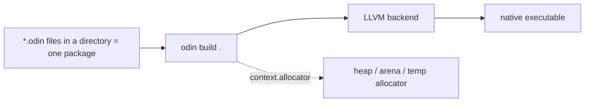

[Read This!](caveatemptor.md) | | [Quick Links](quicklinks.md) | [Algorithms](algorithms.md) | [AssemblyLanguage](assemblylanguage.md) | [BASH](bash.md) |   [C-Programmming](cprogramming.md) |
[CommonLisp](commonlisp.md) |
[Computer Security](computersecurity.md) |  [Databases](databases.md) | [Emacs](emacs.md) |  [Exploitation](exploitation.md) |
[Functional Programming](functional.md) |
[Firewalls](firewalls.md) |   [Git](git.md) | [Haskell](haskell.md) | [Javascript](javascript.md) |  [Julia](julia.md) |
[Linux](linux.md) | [Machine Learning](machinelearning.md) | [Metasploit](metasploit.md) |[Machine Learning](machinelearning.md) |
[Networking](networking.md) | [Operating Systems](os.md) |[Open Data Science](opendatascience.md) | [Odin](odin.md) |
[Picolisp](picolisp.md) | [Pharo Smalltalk](pharo.md) | [Purescript](purescript.md) |
[Python](python.md) |
[Racket](racket.md) | [Scheme](scheme.md) | [Social Engineering](internetexploitation.md) |
[Unity](unity.md) | [vim](vim.md) | [V](vlang.md) |
[Web Development](webdevelopment.md) | [Windows WSL](windowswsl.md) | [Zig](ziglang.md)

# Odin

Here is the truth Odin is built on: **most programs are about transforming data, so the language should make data obvious and get out of the way.** No classes, no hidden allocations, no garbage collector – just a clean, modern take on what C was trying to be.

### What it is, in plain words

**Odin** is a general-purpose, compiled, statically typed systems language created by Ginger Bill (Bill Hall), first public in 2016. It aims at the same space as C, [Zig](ziglang.md) and Jai: games, graphics, simulation tools, and anything where you want control over memory and performance without C's footguns.

Its main ingredients:

- **Simple, Pascal-ish declarations** – `x: int = 5`, or `x := 5` with inference; constants with `::`.
- **Manual memory management, made explicit** – every allocation goes through an **allocator**, and every procedure has an implicit `context` that carries the current allocator and logger. Swap in an arena allocator for a frame and free everything at once.
- **Data-oriented features** – built-in `#soa` (structure-of-arrays) layouts, array programming, swizzling (`v.xyz`), and native matrix and quaternion types.
- **Tagged unions, `enum`s, `bit_set`s**, distinct types, and **multiple return values** – no exceptions; errors are just values.
- **`defer`** for cleanup.
- **Batteries for graphics** – vendored bindings to SDL, raylib, OpenGL, Vulkan, Metal, DirectX, WebGPU and more ship with the compiler in `vendor:`.

It is used in production: JangaFX builds its real-time VFX tools (EmberGen and others) in Odin.

### Why it matters

C is fifty years old and still everywhere, but its build model, header files, macros and undefined behaviour cost a lot of time. Odin keeps C's mental model – structs, pointers, procedures, you know where every byte is – and removes the friction. If you enjoy knowing exactly what the machine is doing (the same instinct that draws people to [PicoLisp](picolisp.md)'s tiny, transparent VM), Odin rewards it.

### An everyday analogy: a well-organised workshop

C is an old workshop where every tool works but the drawers have no labels and some tools bite. C++ is that workshop with three more floors added over decades. Odin is a new workshop designed by someone who worked in the old one for years: same kinds of tools, labelled drawers, guards on the saws, and a big clean bench in the middle for the data you're working on.



### A hands-on example

Odin ships monthly `dev-YYYY-MM` releases (there is no 1.0 yet). Download one from odin-lang.org or GitHub, or build from source (needs LLVM and clang), then put `odin` on your `PATH`.

`hello/main.odin`:

```odin
package main

import "core:fmt"
import "core:strings"

Shape :: union { Circle, Rect }
Circle :: struct { r: f32 }
Rect   :: struct { w, h: f32 }

area :: proc(s: Shape) -> f32 {
    switch v in s {
    case Circle: return 3.14159 * v.r * v.r
    case Rect:   return v.w * v.h
    }
    return 0
}

divmod :: proc(a, b: int) -> (q, r: int, ok: bool) {
    if b == 0 do return 0, 0, false
    return a / b, a % b, true
}

main :: proc() {
    shapes := [?]Shape{ Circle{2}, Rect{3, 4} }
    for s in shapes do fmt.println(area(s))

    if q, r, ok := divmod(17, 5); ok {
        fmt.printf("17 = 5*%d + %d\n", q, r)
    }

    // Dynamic array, cleaned up when main returns
    words := make([dynamic]string)
    defer delete(words)
    append(&words, "void", "stump", "lisp")

    // Temporary allocator: scratch memory freed in one go
    joined := strings.join(words[:], ", ", context.temp_allocator)
    defer free_all(context.temp_allocator)
    fmt.println(joined)

    // Vector maths built in
    v := [3]f32{1, 2, 3}
    fmt.println(v * 2, v.zyx)
}
```

```bash
cd hello && odin run .
```

Note there's no `main.c`-style header, no build script, no package manager: a directory is a package, and `odin run .` compiles it all.

### Odin, C and Zig side by side

| | C | Odin | Zig |
|---|---|---|---|
| Memory | manual, malloc/free | manual, via `context` allocators | manual, allocators passed explicitly |
| Errors | return codes, errno | multiple returns, `or_return` | error unions, `try` |
| Generics | macros | parametric polymorphism (`$T`) | `comptime` |
| Build | make/cmake | built in | `build.zig` |
| C interop | – | `foreign import` | `@cImport` |

### Common misconceptions

- **"No garbage collector means memory bugs everywhere."** Allocators, `defer`, bounds checking (on by default) and the tracking allocator catch most mistakes; arenas remove whole categories of them.
- **"It's just for games."** Games and graphics are its sweet spot, but it's a general systems language.
- **"No 1.0 means it's a toy."** The language is stable in practice and used commercially; the dev-release naming is a choice.
- **"Odin is Go without GC."** The syntax looks similar in places, but Odin has no goroutines, no interfaces and different goals.
- **"You need a package manager."** Odin deliberately has none; vendor code into your project.

### Connections

- [C Programming](cprogramming.md) – what Odin is reacting to.
- [Zig](ziglang.md), [Rust](rust.md) and [V](vlang.md) – other modern systems languages.
- [Assembly Language](assemblylanguage.md) and [objdump](objdump.md) – look at what Odin generates.
- [Algorithms](algorithms.md) and [Data Structures and Algorithms](datastructuresandalgorithms.md) – the data it's all about.

- [Odin-Lang](https://odin-lang.org)
