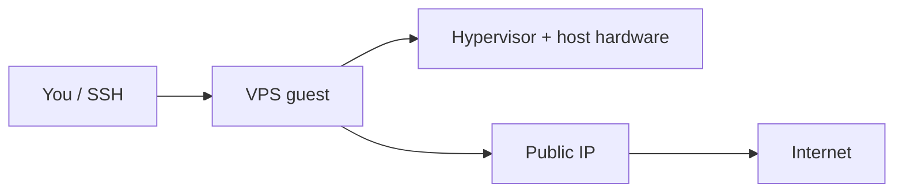

# Online VPS, SaaS, PaaS, IaaS

Here is the truth about a VPS: **you are renting a virtual machine that thinks it is a computer, and you are its sysadmin.** The freedom is real; so is the responsibility when the cron job fills the disk at 3 a.m.

### What it is, in plain words

A **VPS** (Virtual Private Server) is a virtual machine sold by a host – [Linode](linode.md)/Akamai, DigitalOcean, Hetzner, OVH, Vultr, Oracle Cloud's free tier, and many smaller providers. You get a public IP, a chosen Linux image (or your own), CPU/RAM/disk quotas, and root access. Underneath, it's a KVM (usually) guest on hardware you don't own.

Related products:

- **Shared hosting** – someone else runs the web server; you get a panel. Less power, less rope.
- **Dedicated** – whole machine. More money.
- **PaaS** – Fly.io, Render, Railway – deploy apps, less SSH.
- **Home lab** – a Pi or old PC on your fibre; cheap, you handle power and uplink.

### Why it matters

A VPS is how this site, a personal Git host, a VPN endpoint or a PicoLisp app leaves your laptop and meets the world. Learning to harden, update and back up one VPS is the most practical sysadmin education available for a few dollars a month.

### An everyday analogy: renting a workshop

A PaaS is a shared makerspace with rules. A VPS is a locked workshop on an industrial estate: bring your own tools, change the locks, leave at midnight. The landlord (the host) keeps the building standing; everything inside is yours to break.



### A hands-on first-hour checklist

1. **Create the VM** with your SSH public key baked in (never password-only on a public IP).
2. **Log in, update, reboot if kernel changed.**
3. **Create a sudo user**, disable root password login, lock SSH to keys – see [SSH Login](sshlogin.md).
4. **Firewall** – allow 22/80/443 only. [Firewalls](firewalls.md), `ufw` or `nftables`.
5. **Point DNS** at the IP; issue TLS with Caddy or certbot – [TLS](tls.md).
6. **Automatic updates** for security patches, plus a backup plan ([Data Recovery](datarecovery.md) mindset).
7. **Monitoring** – even a cron that curls your site and mails on failure.

```bash
ssh root@YOUR.IP
adduser vikid && usermod -aG sudo vikid   # or wheel
# install key for vikid, then:
sudo apt update && sudo apt full-upgrade
sudo apt install fail2ban ufw
sudo ufw allow OpenSSH && sudo ufw allow http && sudo ufw allow https
sudo ufw enable
```

Pick a nearby region for latency; pick a provider whose network and support you've read about when things break. Price is not the only axis – egress bandwidth, IPv6, snapshots and honest status pages matter.

### Cost control

Set a billing alert the day you open the account. Snapshot calendars, unused load balancers and egress to the public internet are how "\$5/month" becomes a surprise. Prefer providers that charge egress honestly and let you cap it. Tear down experiments when you're done – a forgotten VM is a forgotten attack surface.

### SaaS, PaaS, IaaS: who manages what

The acronyms in the title name a sliding scale of how much the provider runs for you:

| Model | You manage | Provider manages | Example |
|---|---|---|---|
| **On your own metal** | everything | nothing | a Pi on your shelf |
| **IaaS** (a VPS) | OS, runtime, app, data | hardware, hypervisor, network | Linode, Hetzner |
| **PaaS** | app and data | OS, runtime, scaling | Fly.io, Render |
| **SaaS** | just your data and settings | everything else | Fastmail, GitHub |

Read it top to bottom as "handing over responsibility one layer at a time". A VPS (IaaS) is the sweet spot for learning, because you still touch the operating system and therefore still learn how it works. SaaS is the right answer when the thing is not your craft: most people should buy email as SaaS rather than run a mail server, because deliverability is a full-time job.

### A worked example: this site's shape

A static site like this one barely needs a server at all: Hugo builds HTML, and a CDN or GitHub Pages serves it. But the moment you want something dynamic (a comment box, a [PicoLisp](appdev.md) app, a Git host), you want a VPS:

```bash
# A minimal always-on PicoLisp app behind Caddy, on a Void VPS
# 1. a runit service so it restarts on crash and boot
sudo mkdir -p /etc/sv/myapp
printf '#!/bin/sh\nexec chpst -u vikid pil /home/vikid/app.l -go -wait\n' \
  | sudo tee /etc/sv/myapp/run
sudo chmod +x /etc/sv/myapp/run
sudo ln -s /etc/sv/myapp /var/service/     # runit starts supervising it

# 2. Caddy as a reverse proxy that also gets the TLS cert automatically
printf 'app.example.com {\n  reverse_proxy localhost:8088\n}\n' \
  | sudo tee /etc/caddy/Caddyfile
sudo sv restart caddy
```

That is the whole gap between "runs on my laptop" and "runs on the internet": a supervised process and a proxy that terminates [TLS](tls.md). Everything else is hardening.

### Choosing a provider in 2026

Price per gigabyte of RAM has stopped being the interesting number. What actually bites you later:

- **Egress bandwidth pricing.** The hyperscalers (AWS, GCP, Azure) charge a lot to send data out; Hetzner, Linode and DigitalOcean bundle generous allowances. For a hobby project this is the number that turns "cheap" into a bill.
- **IPv6 and a clean IP reputation.** A recycled IP that lands on spam blocklists ruins a mail or web project before you start.
- **Honest status pages and real support.** You find out how good these are only during an outage, so read others' reports first.
- **Region and latency.** Nearer is faster; the Middle East, for instance, is better served from Gulf or European regions than from the US.
- **Snapshots, an API and Terraform support**, so you can rebuild the whole thing from a script instead of clicking.

### Common misconceptions

- **"A VPS is anonymous."** Payment, abuse complaints and WHOIS tell stories. Don't be evil.
- **"More CPU means better."** Burstable credits, noisy neighbours and disk IOPS often matter more.
- **"Snapshots are backups."** Snapshots live with the host. Copy critical data elsewhere.
- **"Managed means secure."** Managed database ≠ patched app. You still own your code.
- **"Free tiers are free forever."** Read the terms; set billing alerts.

### Connections

- [Linode](linode.md), [SSH Login](sshlogin.md), [Ubuntu Common Tasks](ubuntucommontask.md).
- [Firewalls](firewalls.md), [TLS](tls.md), [Linux Security](linuxsecurity.md).
- [Seedbox](seedbox.md), [Virtualization](virtualization.md).

## Sources and Links

- [DigitalOcean vs AWS @ upguard](https://www.upguard.com/articles/digitalocean-vs-aws)
- [DigitalOcean vs Linode @ upguard](https://www.upguard.com/articles/digitalocean-vs-linode)
- [DigitalOcean vs Upcloud @ upguard](https://www.upcloud.com/vs/digitalocean/)
