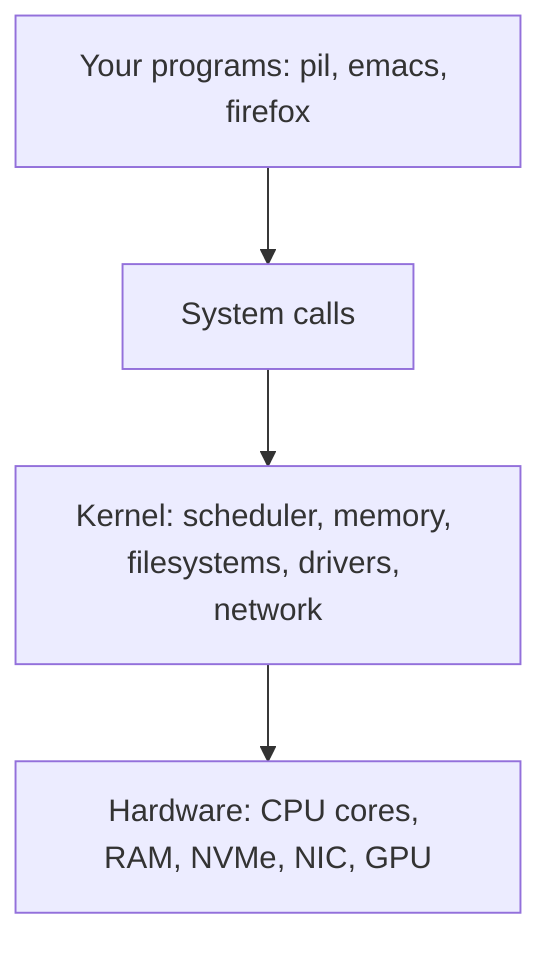

[computingFreedom](computingfreedom.md) |
  [Build](bciyh.md) |
  [Picolisp](picolisp.md) | [Picolisp Machine](pilmachine.md) | [Pil Sources](pilsource.md) |
  [Linux](linux.md) | [BASH](bash.md) |
  [C-Programmming](cprogramming.md) |
  [Operating Systems](os.md) |
  [Javascipt](javascript.md) |
  [Emacs](emacs.md)  | [vim](vim.md) |
  [Pharo Smalltalk](pharo.md) |
  [Computer Security](computersecurity.md) |
  [Python](python.md) |
  [The Compiler](thecompiler.md) |
  [Identifiers](identifier.md) |
  [Literals](literals.md) |
  [storage_linkage](storagelinkage.md) |

# Operating Systems

Here is a truth that took me far too long to see: **an operating system is not the desktop, the icons or the start menu. It is a referee.** It sits between hungry programs and one set of hardware and makes sure everyone gets a fair turn without trampling each other.

Everything else (the shell, the window manager, the app store) is furniture placed on top of that referee.

### What it is, in plain words

An operating system (OS) is the layer of software that owns the machine. It has two jobs:

1. **Abstraction.** It turns ugly hardware into tidy ideas. A spinning disk or an NVMe chip becomes *files*. A CPU becomes many *processes*, each thinking it has the machine to itself. A network card becomes *sockets*. Physical RAM becomes *virtual memory*.
2. **Arbitration.** It decides who gets what, and when. Which process runs next on which core, who may read which file, how much memory each one may take, which packet goes to which program.

The part that does this with full hardware privilege is the **kernel**. On my Vikix box that is the Linux kernel (Void tracks recent stable releases, so in 2026 that means a 6.x kernel). Around it sits the **userland**: the C library (glibc or musl on Void), the init system (runit on Void, [systemd](systemd.md) on most other distros), core tools, and then whatever you run, like StumpWM, Emacs or `pil`.



Programs never touch hardware directly. They ask the kernel through **system calls** (`read`, `write`, `open`, `mmap`, `clone`, `execve` and a few hundred more). The CPU itself enforces this: user code runs in an unprivileged mode, and only the kernel runs in the privileged one.

### Why it matters

If you understand the OS, a lot of "magic" goes away:

- Why a program that leaks memory slows the *whole* machine (paging and swap).
- Why one frozen app does not freeze the others (preemptive scheduling).
- Why `chmod` and users exist at all (protection between processes).
- Why containers are cheap and [virtual machines](virtualization.md) are not (namespaces and cgroups versus a whole emulated machine).
- Why [security](computersecurity.md) bugs in the kernel are the crown jewels of [penetration testing](penetrationtesting.md).

It is also the place where *freedom* lives or dies. Whoever controls the OS controls what your machine will and will not do for you. That is why I care about [computing freedom](computingfreedom.md) and run a system I can read top to bottom.

### An everyday analogy: a busy restaurant

The hardware is the kitchen: a few stoves (CPU cores), counter space (RAM), a pantry (disk). The programs are customers with orders. The OS is the head waiter and the kitchen manager at once.

- Customers never walk into the kitchen. They hand orders to the waiter (system calls).
- The manager slices stove time so every order makes progress (scheduling).
- Each table gets its own numbered tray, so nobody eats from the wrong plate (virtual memory).
- The pantry is labelled and locked by owner (filesystem and permissions).
- If a customer starts throwing plates, they get escorted out, and the rest of the room carries on (process isolation, `kill`).

### A hands-on example: watch the referee work

You can see every one of those jobs from a shell on Linux.

```bash
# Which kernel am I running?
uname -sr

# Processes: the "customers"
ps -eo pid,ppid,ni,stat,comm --sort=-pcpu | head

# Memory as the kernel sees it
free -h
cat /proc/meminfo | head -5

# Ask the kernel what a single process has mapped
pmap $$ | tail -3

# Watch the system calls a program makes
strace -c ls > /dev/null
```

That last one is the eye-opener. Even `ls` makes dozens of system calls: `openat`, `getdents64`, `fstat`, `write`. Every program you have ever used is a conversation with the kernel.

PicoLisp lets you poke the same layer from a REPL:

```picolisp
: (in '("uname" "-r") (line T))   # run a program, read its output
-> "6.12.10_1"
: (in "/proc/loadavg" (till " " T))   # read a kernel file directly
-> "0.42"
```

On Void you can check the init side too: `sv status /var/service/*` lists the runit services the system is supervising. See [Simple Linux Configuration](simplelinuxconfig.md), [Linux Processes and Memory](linuxprocessesandmemory.md) and [Linux Introspection](linuxinstrospection.md) for more of this.

### Common misconceptions

- **"The OS is the GUI."** No. StumpWM, i3, GNOME and Windows Explorer are programs. You can run Linux with no graphics at all, and most servers do.
- **"Linux is an operating system."** Strictly it is a kernel. A full OS is kernel plus userland, which is why people argue about "GNU/Linux". Void, Arch and Ubuntu share a kernel but differ in libc, init and packaging.
- **"More RAM in use means a slow machine."** Linux deliberately fills spare RAM with file cache. Free RAM is wasted RAM; watch the *available* column, not *free*.
- **"Containers are lightweight VMs."** A container shares the host kernel; a VM boots its own. That is a big difference for isolation and for security.
- **"Microkernels lost."** They did not vanish. Minix ran inside Intel's management engine for years, and seL4 and QNX run in cars and aircraft today. Monolithic kernels won the desktop; the idea is very much alive.

### Connections

- Foundations: [Build a Computer in Your Head](bciyh.md), [Assembly Language](assemblylanguage.md), [C Programming](cprogramming.md).
- Linux in practice: [Linux Tools](linuxtools.md), [Bash Cookbook](vikidsbashcookbook.md), [systemd](systemd.md), [Linux Security](linuxsecurity.md), [Arch Linux](archlinux.md), [pacman](pacman.md).
- Other systems: [Windows](windows.md), [WSL](windowswsl.md), [Apple](apple.md), [Virtualization](virtualization.md), [VirtualBox](virtualbox.md).
- The Lisp angle: [PicoLisp](picolisp.md) and the [PicoLisp Machine](pilmachine.md), which shows how thin a language can sit on top of the OS.

The topics below are the classic chapters of any operating systems course, the same order as Tanenbaum's *Modern Operating Systems*. I will fill them in over time.


[Modern Operating Systems](modernoperatingsystems.md) |
[The Minix Book](theminixbook.md) |
[Virtualization](virtualization.md)

- [Processes](processes.md "MISSING PAGE")
- [Threads](threads.md "MISSING PAGE")
- [Interprocess Communication](ipc.md "MISSING PAGE")
- [Scheduling](scheduling.md "MISSING PAGE")
- [Memory](osmemory.md "MISSING PAGE")
- [Virtual Memory](virtualmemory.md "MISSING PAGE")
- [Paging](paging.md "MISSING PAGE")
- [Segmentation](segmentation.md "MISSING PAGE")
- [File Systems](filesystems.md "MISSING PAGE")
- [I/O](io.md "MISSING PAGE")
- [Clocks](clocks.md "MISSING PAGE")
- [Deadlocks](deadlocks.md "MISSING PAGE")
- [Encoding](encoding.md "MISSING PAGE")
- [Compression](compression.md "MISSING PAGE")
- [Caching](caching.md "MISSING PAGE")
- [Virtualization](virtualization.md)
- [Distributed Systems](ds.md "MISSING PAGE")
- [Security](security.md "MISSING PAGE")
- [Cryptography](cryptography.md "MISSING PAGE")
- [Authentication](authentication.md "MISSING PAGE")
- [Attacks](attacks.md "MISSING PAGE")
- [Exploits](exploits.md "MISSING PAGE")
- [Malware](malware.md "MISSING PAGE")
