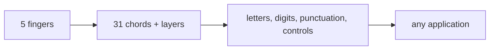

# Penti

Here is a truth about typing that Alexander Burger (the creator of PicoLisp) took seriously: **ten fingers on a QWERTY keyboard is not the only way – and for some jobs, not the best way.** Penti is his five-finger keyboard layout: one hand, five keys, every character reachable by chords.

### What it is, in plain words

**Penti** is a chorded keyboard system. You rest five fingers of one hand on five keys (by default the home row `asdfg` or `hjkl;`), and you type by pressing combinations of them – **chords** – instead of hunting for individual keys. A single finger produces a letter; two or three together produce others; modifiers give digits, symbols and control keys. The whole alphabet, numbers and punctuation fit under one hand.

It's free software from Burger's Software Lab, available for Linux (as a small X11/Wayland utility), and there's a hardware version too. The software sits between your keyboard and the applications, remapping chords on the fly – much like [KMonad](kmonad.md), but with an entirely different philosophy.

### Why it matters

If you ever type with one hand – because the other is on a mouse, holding a book, operating a piece of equipment, or injured – Penti is a complete writing system that doesn't need a second hand. It's also a fascinating experiment in information density: with five binary keys you have \( 2^{5} - 1 = 31 \) non-empty chords, and with a few layers that's more than enough for the Latin alphabet and then some. For someone who lives in [PicoLisp](picolisp.md), it's also a piece of the same design culture: do the most with the least.

### An everyday analogy: a trumpet

A trumpet has three valves. Press them in combinations and you get every note. The valves don't map one-to-one onto notes; the *chord* of valves does. Penti's five keys are the valves; the characters are the notes. Once your fingers know the chords, typing becomes a kind of playing.

### A hands-on example

The source and documentation live at [software-lab.de/penti.html](http://www.software-lab.de/penti.html). On Linux with X11 you typically build the small daemon and run it; it grabs the five keys and emits the mapped characters.

A taste of the default mapping (left hand on `a s d f g`):

| Chord (fingers) | Character |
|---|---|
| 1 (a) | e |
| 2 (s) | t |
| 3 (d) | a |
| 4 (f) | o |
| 5 (g) | i |
| 1+2 | n |
| 1+3 | s |
| 2+3 | h |
| … | … |
| all five | space / enter (by context) |

The common letters get the easiest chords – the same idea that makes Dvorak and Colemak rearrange QWERTY. Digits and punctuation live on a layer reached by a "shift" chord.

Practice tip: don't try to memorise a chart. Print the reference, cover the keycaps if you like, and type pangrams (`the quick brown fox…`) until your fingers find the chords without thinking. Expect a few evenings of frustration and then a sudden click – the same learning curve as any new layout.

Pairing Penti with [StumpWM](bciyh.md) or Emacs is natural: one hand types, the other stays on a trackball or on a spare modifier for window management.

### Common misconceptions

- **"It's a stenography system."** Stenotype machines for court reporting use many more keys and phonetic chords. Penti is a character-by-character layout that happens to use chords.
- **"You need special hardware."** The software remaps an ordinary keyboard. Hardware Penti keyboards exist, but they aren't required.
- **"Five keys can't be enough."** Combinatorics says otherwise: 31 chords × a couple of layers covers everything a normal keyboard does.
- **"It's faster than QWERTY."** For two-handed touch typing, probably not. For one-handed input, or for a secondary hand, it's in a different league from hunt-and-peck.
- **"It's only for PicoLisp people."** Burger made it, and it fits that aesthetic, but it works with every X11/Wayland application.

### Connections

- [KMonad](kmonad.md) – a different, more general approach to keyboard remapping.
- [Keyboard Config](keyboardconfig.md) – ordinary xkb remapping.
- [PicoLisp](picolisp.md) – the language and the culture Penti comes from.
- [Emacs](emacs.md) – where one-handed typing plus a good modifier key shines.

[The Penti Key Board](http://www.software-lab.de/penti.html)
